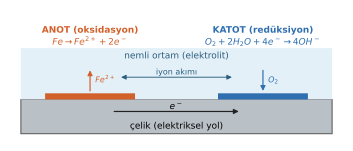

# Hafta 1 · Giriş: Korozyon Hücresi

Bu bölüm dersin geri kalanında sürekli kullanılacak temel kavramları bir araya getirir. Ayrıntılar sonraki haftalarda işleniyor; burada amaç ortak bir dil kurmak.

## 1. Korozyon nedir?

**Corrosion (korozyon)**, bir metalin çevresiyle reaksiyona girerek bozulmasıdır. Metaller cevherlerinden (çoğunlukla oksitlerden) enerji harcanarak üretilir. Korozyon metali bu kararlı, düşük enerjili hâle geri döndürür. Bu yüzden çoğu metal için korozyon reaksiyonunun serbest enerji değişimi negatiftir:

$$\Delta G < 0 \quad \Rightarrow \quad \text{reaksiyon kendiliğinden yürüyebilir}$$

$\Delta G$ yalnızca korozyonun **olup olamayacağını** söyler; **ne kadar hızlı** olacağı kinetiğin konusudur (Hafta 5–6).

## 2. Kimyasal ve elektrokimyasal reaksiyon

- **Kimyasal reaksiyon:** hiçbir türün değerliği değişmez, elektron aktarılmaz.
- **Elektrokimyasal reaksiyon:** en az bir türün değerliği değişir; elektron aktarılır.

Sulu ortamdaki metal korozyonu **elektrokimyasaldır**: metalin çözeltiye geçebilmesi için önce oksitlenmesi (elektron vermesi) gerekir.

## 3. Korozyon hücresinin dört bileşeni

Her korozyon olayı küçük bir elektrokimyasal hücredir:

| Bileşen | Görevi |
|---|---|
| **Anode (anot)** | **Oksidasyonun** olduğu, metalin elektron vererek iyonlarına ayrıştığı bölge. **Metal kaybı (korozyon) burada olur.** |
| **Cathode (katot)** | **Redüksiyonun** olduğu, anottan gelen elektronların harcandığı bölge. **Metal kaplama (biriktirme) burada olur.** |
| **Electrolyte (elektrolit)** | İyonların taşınmasını sağlayan sıvı ortam (su, nemli toprak). Akım metalin içinde elektronlarla, elektrolitin içinde iyonlarla taşınır. |
| **Electrical path (elektriksel yol)** | Elektronların anottan katoda geçişini sağlayan iletken yol. Korozyonda bu yol çoğu zaman metalin kendisidir. |

Bu dördünden biri ortadan kalkarsa hücre durur; biri zayıflatılırsa korozyon yavaşlar. Korunma yöntemlerinin hepsi bu dört bileşenden birini hedef alır.

Örnek: nemli bir ortamdaki çelikte

- Anot: $Fe \rightarrow Fe^{2+} + 2e^-$
- Katot: $O_2 + 2H_2O + 4e^- \rightarrow 4OH^-$
- Elektronlar çeliğin içinden anottan katoda akar; $Fe^{2+}$ ve $OH^-$ yüzeyde buluşup $Fe(OH)_2$ olarak çöker. Pasın oluşumu böyle başlar.

## 4. Küçük akım birimleri

Korozyon akımları çoğu zaman çok küçüktür; birimler arası dönüşümü sağlam bilmek gerekir.

| | |
|---|---|
| 1 A (amper) | = 1 000 mA = 1 000 000 µA |
| 1 mA (miliamper) | = 1 000 µA = $10^{-3}$ A |
| 1 µA (mikroamper) | = 0.001 mA = $10^{-6}$ A |

::: sinav
## Sınavda çıkabilir

- Korozyonun tanımı ve neden çoğu metal için $\Delta G < 0$ olduğu.
- Kimyasal ve elektrokimyasal reaksiyonun farkı; korozyonun neden elektrokimyasal olduğu.
- Korozyon hücresinin dört bileşeni ve her birinin görevi; anotta ve katotta ne olur?
:::
