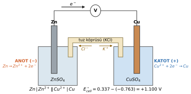
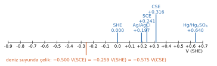

# Hafta 2 · Faraday Yasaları, Elektrokimyasal Hücre ve Elektrot Potansiyeli

Korozyonun neredeyse tamamı **elektrokimyasal** bir süreçtir: metal bir yerde elektron verir, başka bir yerde bu elektronlar harcanır. Bu bölümde iki temel soruyu cevaplıyoruz:

1. Bir akım ne kadar metal çözer ya da biriktirir? → **Faraday yasaları**
2. Bu akımı süren "itici kuvvet" nereden gelir ve nasıl ölçülür? → **Hücre ve elektrot potansiyeli**

## 1. Temel büyüklükler

Faraday hesaplarının neredeyse tamamı birim dönüşümüdür. Önce yapı taşlarını sabitleyelim.

| Büyüklük | Tanım | Değer / birim | Korozyondaki anlamı |
|---|---|---|---|
| Electron ($e^-$) | En küçük negatif yükü taşıyan parçacık; metallerde yük taşıyıcı | $e = 1.602\times10^{-19}$ C | Korozyona uğrayan her atom $z$ elektron verir: $M \rightarrow M^{z+} + ze^-$ |
| Avogadro's number ($N_A$) | 1 mol içindeki parçacık sayısı | $6.022\times10^{23}\ \text{mol}^{-1}$ | Atom sayısını grama bağlar |
| Faraday constant ($F$) | 1 mol elektronun taşıdığı yük, $F = N_A\cdot e$ | $96\,485$ C/mol | Geçen yükü reaksiyona giren kütleye çevirir |
| Current ($I$), current density ($i$) | $I = Q/t$; birim alan başına akım $i = I/A$ | 1 A = 1 C/s; $i$: A/cm², µA/cm² | Aynı akım daha küçük alanda daha şiddetli saldırı demektir |
| Potential ($E$) | Birim yük başına elektriksel enerji; yalnızca bir referansa göre **fark** olarak ölçülür | 1 V = 1 J/C | Reaksiyonun itici kuvveti: $\Delta G = -zFE$ |
| Resistance ($R$), resistivity ($\rho_e$) | $R = V/I$ (Ohm), $R = \rho_e L/A$ | Ω, Ω·m | Elektrolit veya kaplama direnci hücre akımını sınırlar |
| Conductivity ($\sigma$) | Özdirencin tersi, $\sigma = 1/\rho_e$ | S/m | Daha çok iyon → daha iletken → daha agresif elektrolit |

İletkenlik için fikir vermesi açısından: bakır (elektronik) $\approx 6\times10^7$ S/m, deniz suyu $\approx 5$ S/m, saf su $\approx 5.5\times10^{-6}$ S/m. Deniz suyunun korozif olmasının bir nedeni de budur.

### Elektriğin aritmetiği

| Büyüklük | Birim | Kullanacağın bağıntılar |
|---|---|---|
| Charge ($Q$) | coulomb (C) | $1\ \text{C} = 1\ \text{A}\cdot\text{s}$; $1\ \text{A}\cdot\text{h} = 3600$ C |
| Current ($I$) | ampere (A) | $1\ \text{mA} = 10^{-3}$ A; $1\ \mu\text{A} = 10^{-6}$ A |
| Potential ($E$, $V$) | volt (V) | $V = IR$; $1\ \text{V} = 1\ \text{J/C}$ |
| Energy ($W$) | joule (J) | $W = VIt = I^2Rt$ |
| Power ($P$) | watt (W) | $P = VI$ |
| Faraday ($F$) | C/mol | $1\ F = 96\,485$ C |

> **Altın kural:** Herhangi bir formüle girmeden önce her şeyi **saniye, amper ve coulomb**'a çevir. 1 min = 60 s, 1 h = 3600 s, 1 gün = 86 400 s.

## 2. Faraday yasaları: akımdan kütleye

### Fikir: elektron saymak

Çözünen ya da biriken her atom tam olarak $z$ elektron alıp verir. Yani geçen yükü ölçersek, kaç atomun reaksiyona girdiğini de biliriz. Faraday yasası bu sayma işleminin formülleştirilmiş hâlidir.

- **Birinci yasa:** Elektrotta biriken ya da çözünen madde kütlesi geçen yükle ($Q = It$) doğru orantılıdır. Akımı veya süreyi iki katına çıkarırsan kütle de iki katına çıkar.
- **İkinci yasa:** Aynı yük için farklı maddelerin kütleleri **eşdeğer ağırlıkları** ($M/z$) ile orantılıdır. Bir faraday (96 485 C) tam bir eşdeğer ağırlık kadar madde çözer/biriktirir.

### Dört adımda türetme

Anodik reaksiyondan başlayalım: $M \rightarrow M^{z+} + ze^-$. Bir mol metal $z$ mol elektron verir.

1. **Geçen yük:** $I$ akımı $t$ süre boyunca akarsa
   $$Q = It$$
2. **Elektron mol sayısı:** her 96 485 C bir mol elektrondur
   $$n_e = \frac{Q}{F} = \frac{It}{F}$$
3. **Metal mol sayısı:** her atom $z$ elektron verdiğinden $z$'ye böl
   $$n_M = \frac{n_e}{z} = \frac{It}{zF}$$
4. **Kütle:** mol sayısını molar kütle ile çarp
   $$m = n_M\,M = \frac{M\,I\,t}{z\,F}$$

Tek satırda: **yük → mol elektron → mol metal → gram.**

$$\boxed{m = \frac{M I t}{z F} = Z\,Q \qquad Z = \frac{M}{zF}}$$

| Sembol | Anlamı | Birim | Soruda nasıl bulunur |
|---|---|---|---|
| $m$ | Biriken (kaplama) veya çözünen (korozyon) kütle | g | Genelde istenen; ya da ölçülen kütle olarak verilir |
| $M$ | Elementin molar kütlesi | g/mol | Periyodik tablo: Fe 55.85, Cu 63.55, Ni 58.69, Zn 65.38 |
| $I$ | Hücreden geçen akım | A | Verilir; mA ise A'ya çevir |
| $t$ | Akımın aktığı süre | s | Dakika/saat/günü saniyeye çevir |
| $z$ | Atom (veya molekül) başına aktarılan elektron | – | Denkleştirilmiş yarı reaksiyondan: $Cu^{2+}+2e^-\rightarrow Cu$ → $z=2$; $O_2$ için $z=4$ |
| $F$ | Faraday sabiti | C/mol | 96 485 (bazı kitaplar 96 500 alır) |
| $Z$ | Electrochemical equivalent (elektrokimyasal eşdeğer): 1 coulomb'un çözdüğü/biriktirdiği kütle | g/C | Hesaplanır veya verilir |

**Kaplama ve korozyon aynı denklemle anlatılır:** kaplamada metal **katotta** kazanılır, korozyonda metal **anotta** kaybedilir.

### Akım verimi (current efficiency)

Faraday yasası akımın tamamının istenen reaksiyona gittiğini varsayar. Gerçekte akımın bir kısmı yan reaksiyonlara (en çok katotta $H_2$ çıkışına) gider, birikinti dökülebilir ya da kaçak akımlar ısıya dönüşür. Bu yüzden ölçülen kütle hep biraz küçüktür.

$$\eta = \frac{m_{measured}}{m_{Faraday}} = \frac{I_{theoretical}}{I_{actual}} \qquad I_{eff} = \eta\, I$$

- $\eta$: akım verimi, 0 ile 1 arasında (genelde % verilir; %95 → 0.95)
- $m_{measured}$: tartılan kütle (g); $m_{Faraday}$: tüm yük için Faraday'ın öngördüğü kütle (g)
- $I_{actual}$: gerçekten geçen akım (A); $I_{theoretical}$: ölçülen kütleyi %100 verimle verecek akım (A)
- $I_{eff}$: istenen metali üreten **efektif akım** (A). Faraday denklemine bu girer. Verimle **çarpılır**, asla bölünmez.

Tipik değerler: asidik sülfat banyosundan bakır kaplamada %95–99, nikelde %90–97, kromda yalnızca %10–25 (akımın büyük kısmını $H_2$ çıkışı yer).

### Kaplama veya kayıp kalınlığı

Kütleyi kalınlığa çevirmek için yoğunluk ve alan gerekir:

$$V = \frac{m}{\rho} \qquad h = \frac{V}{A}$$

- $V$: hacim (cm³), $\rho$: yoğunluk (g/cm³), $A$: alan (cm²), $h$: kalınlık (cm). $1\ \text{cm} = 10^4\ \mu\text{m}$, $1\ \text{dm}^2 = 100\ \text{cm}^2$.

::: ornek
**Örnek 2.1 · Nikel kaplama kalınlığı**

Toplam yüzey alanı 2.5 dm² olan çelik bir parça nikel kaplanıyor. 75 dakika boyunca 1.25 A sabit akım uygulanıyor; banyonun akım verimi %95. Nikelin tüm yüzeye düzgün biriktiğini kabul et.

**Verilenler:** $A = 2.5\ \text{dm}^2$, $I = 1.25$ A, $t = 75$ min, $\eta = 0.95$; Ni: $M = 58.7$ g/mol, $z = 2$, $\rho = 8.9$ g/cm³; $F = 96\,485$ C/mol

**İstenen:** (a) biriken Ni kütlesi, (b) kaplama kalınlığı (µm)

**Çözüm:**

1. Efektif akım: $I_{eff} = \eta I = 0.95\times1.25 = 1.1875$ A
2. Süre: $t = 75\times60 = 4500$ s
3. Kütle:
   $$m = \frac{M I_{eff} t}{zF} = \frac{58.7\times1.1875\times4500}{2\times96\,485} = 1.626\ \text{g}$$
4. Hacim: $V = m/\rho = 1.626/8.9 = 0.1827$ cm³
5. Alan: $A = 2.5\ \text{dm}^2 = 250$ cm²
6. Kalınlık: $h = V/A = 0.1827/250 = 7.31\times10^{-4}$ cm $= 7.3\ \mu$m

**Sonuç:** (a) $m \approx 1.63$ g Ni, (b) $h \approx 7.3\ \mu$m

**Birim kontrolü:** $\dfrac{(\text{g/mol})(\text{C/s})(\text{s})}{\text{C/mol}} = \text{g}$ ✓; $\dfrac{\text{cm}^3}{\text{cm}^2} = \text{cm}$ ✓

*Not:* Kaplamada parçanın üzerine metal büyümesi gerekir, yani parça elektron **almalıdır**. Elektronları dışarı iten uç güç kaynağının negatif ucudur. Bu yüzden parça (−) uca bağlanır ve **katot** olur; (+) uca bağlı nikel plaka elektron kaybeder, çözünür, **anot** olur. İsimleri işaret değil reaksiyon belirler.
:::

::: ornek
**Örnek 2.2 · Bakır hücresinin akım verimi**

Bakır sülfat çözeltisinden tam 1 saat boyunca 26 mA akım geçiriliyor. Katot tartıldığında üzerinde 0.0300 g bakır biriktiği görülüyor.

**Verilenler:** $I_{actual} = 26$ mA $= 0.026$ A, $t = 1$ h $= 3600$ s, $m_{measured} = 0.0300$ g; Cu: $M = 63.5$ g/mol, $z = 2$

**İstenen:** (a) 0.0300 g'ı %100 verimle biriktirecek akım, (b) akım verimi $\eta$, (c) %100 verimde beklenen kütle

**Çözüm:**

(a) Faraday denklemini akım için çöz:
$$I_{theo} = \frac{m z F}{M t} = \frac{0.0300\times2\times96\,485}{63.5\times3600} = 0.02532\ \text{A} = 25.3\ \text{mA}$$

(b) $\eta = I_{theo}/I_{actual} = 25.32/26 = 0.974$ → **%97.4**

(c) Gerçek akım için Faraday kütlesi:
$$m_{100\%} = \frac{MIt}{zF} = \frac{63.5\times0.026\times3600}{2\times96\,485} = 0.0308\ \text{g}$$

**Kontrol:** $\eta = m_{measured}/m_{Faraday} = 0.0300/0.0308 = 0.974$ ✓. Eksik %2.6'lık yük yan reaksiyonlara (çoğunlukla $H_2$ çıkışı) gitmiştir.
:::

::: ornek
**Örnek 2.3 · Korozyonla kaybedilen demir**

Korozyona uğrayan bir çelik yüzeyde anodik reaksiyon $Fe \rightarrow Fe^{2+} + 2e^-$. Anodik ve katodik bölgeler arasında bir yıl (365 gün) boyunca 0.50 mA sabit akım akıyor. Anot ile katot arasındaki bu akıma **corrosion current (korozyon akımı)** denir; bilinirse kaybı Faraday yasası verir.

**Verilenler:** $I = 0.50$ mA $= 5.0\times10^{-4}$ A, $t = 365$ gün; Fe: $M = 55.85$ g/mol, $z = 2$; $N_A = 6.022\times10^{23}$ mol⁻¹

**İstenen:** (a) geçen yük, (b) elektron mol sayısı, (c) kaybedilen Fe kütlesi, (d) kaybedilen Fe atomu sayısı

**Çözüm:**

- Süre: $t = 365\times24\times3600 = 3.154\times10^{7}$ s
- (a) $Q = It = 5.0\times10^{-4}\times3.154\times10^{7} = 1.577\times10^{4}$ C
- (b) $n_e = Q/F = 15\,768/96\,485 = 0.1634$ mol $e^-$
- $n_{Fe} = n_e/z = 0.1634/2 = 0.0817$ mol
- (c) $m = n_{Fe}\,M = 0.0817\times55.85 = 4.56$ g
- (d) $N = n_{Fe}\,N_A = 0.0817\times6.022\times10^{23} = 4.92\times10^{22}$ atom

**Sonuç:** Yarım miliamperlik "küçük" bir akım bile bir yılda yaklaşık 4.6 g demir götürür.
:::

### Sık yapılan hatalar

| Hata | Doğrusu |
|---|---|
| Süreyi dakika/saat olarak koymak | Daima saniye: 1 h = 3600 s |
| Her tür için $z = 2$ almak | $z$ yarı reaksiyondan: $Cu^{2+}$ → 2, $Al^{3+}$ → 3, $O_2$ → 4 |
| Verimle bölmek | $I_{eff} = \eta I$ ($\eta < 1$) |
| dm², mm, µm ile g/cm³'ü karıştırmak | Uzunluk ve alanları önce cm'ye çevir |
| "Metal katotta çözünür" demek | Metal **anotta** çözünür, **katotta** birikir |

## 3. Akım iki yolla taşınır

Bir hücreyi anlamak için önce akımın metalde ve çözeltide nasıl aktığını bilmek gerekir.

| | Electronic conduction (metallerde) | Electrolytic conduction (çözeltilerde) |
|---|---|---|
| Yük taşıyıcı | Elektronlar; (+) metal iyonları kafeste sabit | (+) ve (−) iyonlar; katoda ve anoda doğru hareket eder |
| Kütle taşınımı var mı? | Hayır; metal nötr kalır | Evet; iyonların kendisi taşınır |
| Kimyasal değişim? | Yok | Hareket eden iyonlarda yok; **elektrotlarda** her zaman var (anot: oksidasyon, katot: redüksiyon) |
| Sıcaklığın etkisi | Sıcaklık **düştükçe** iletkenlik artar (daha az kafes titreşimi) | Sıcaklık **arttıkça** iletkenlik artar (iyonlar daha kolay hareket eder) |
| Diğer faktörler | Metalin türü (Cu ≫ Fe ≫ paslanmaz çelik) | İyon derişimi ve iyonun türü |
| Korozyon örneği | Elektronlar boru duvarından anottan katoda gider | Deniz suyu yağmur suyundan çok daha iyi iletir |

**Arayüzde taşıyıcı değişir.** Metalde akımı elektronlar, elektrolitte iyonlar taşır. Metal/çözelti sınırında elektronik akımın iyonik akıma dönüşmesi gerekir ve bu **yalnızca bir elektrokimyasal reaksiyonla** olabilir (ör. $Fe \rightarrow Fe^{2+} + 2e^-$). Demek ki bir arayüzden geçen akım aslında bir **reaksiyon hızıdır**. Faraday yasasının akımı kütleye bağlayabilmesinin sebebi tam olarak budur.

## 4. Kimyasal mı, elektrokimyasal mı?

- **Chemical (kimyasal) reaksiyon:** Hiçbir türün değerliği değişmez, elektron aktarılmaz. Örnek: $Fe^{2+} + 2OH^- \rightarrow Fe(OH)_2$. Fe +2 kalır, O −2 kalır.
- **Electrochemical (elektrokimyasal) reaksiyon:** En az bir türün değerliği değişir; elektron aktarılır.
  - Anodik: $Fe \rightarrow Fe^{2+} + 2e^-$
  - Katodik: $O_2 + 2H_2O + 4e^- \rightarrow 4OH^-$
- **Coupled (bağlı):** Anodik ve katodik bölgeler birbirine yakınsa $Fe^{2+}$ ve $OH^-$ yüzey yakınında buluşur ve $Fe(OH)_2$ olarak çöker. Bu, pasın oluşumunun ilk adımıdır.

> Bir metalin sıvı içinde çözünebilmesi için önce **oksitlenmesi** gerekir. Bu yüzden metallerin korozyonu bir elektrokimyasal süreçtir.

## 5. Elektrokimyasal hücre

### Anot ve katot: ismi reaksiyon verir, işaret değil

- **Anode (anot):** oksidasyonun olduğu elektrot; elektronlar **açığa çıkar**. Korozyonda metal kaybı burada olur.
- **Cathode (katot):** redüksiyonun olduğu elektrot; elektronlar **harcanır**. Kaplamada metal burada birikir.

Bu tanım her zaman geçerlidir. Değişen tek şey anodun **işaretidir**:

| Hücre tipi | Anot (oksidasyon) | Katot (redüksiyon) |
|---|---|---|
| Galvanic (pil çalışırken, korozyon) | Negatif (−): elektron kaynağı | Pozitif (+) |
| Electrolytic (elektroliz, kaplama) | Pozitif (+): kaynağın + ucuna bağlı | Negatif (−) |

Örnek: $Al \rightarrow Al^{3+} + 3e^-$ anodiktir; $Al^{3+} + 3e^- \rightarrow Al$ katodiktir.

### Her hücrenin dört bileşeni

1. **Electrolyte (elektrolit):** İyonları taşıyan iletken sıvı veya nemli toprak.
2. **Anode:** Oksidasyonun (metal çözünmesinin) olduğu elektrot.
3. **Cathode:** Redüksiyonun ($O_2$ veya $H^+$ redüksiyonu, metal birikmesi) olduğu elektrot.
4. **Electrical path (elektriksel yol):** Elektronları anottan katoda taşıyan metalik bağlantı. Elektrolizde bu yolun üzerinde dış güç kaynağı da vardır.

> Bunlar korozyonun **dört koşuludur**. Herhangi birini ortadan kaldırırsan hücre durur; birini zayıflatırsan korozyon yavaşlar. Kendiliğinden korozyonda itici kuvvet anot ile katot arasındaki **potansiyel farkıdır**; elektriksel yol da metalin kendisidir.

Korozyondan korunma yöntemlerinin hepsi bu dört bileşenden birini hedef alır. Kaplama elektroliti metalden ayırır, katodik koruma anodu dışarı taşır, inhibitör katodik ya da anodik reaksiyonu yavaşlatır.

### Üç hücre tipi

- **Galvanic (galvanik) hücre:** Reaksiyon **kendiliğinden** yürür ve elektrik enerjisi üretir ($P = E\cdot I$). Anot (−), katot (+).
- **Electrolytic (elektrolitik) hücre:** Dış güç kaynağı kendiliğinden olmayan bir reaksiyonu zorla yürütür, enerji harcar. Anot (+), katot (−). Uygulanan gerilim, ters reaksiyonun galvanik geriliminden **büyük** olmalıdır.
- **Concentration (derişim) hücresi:** İki tarafta da **aynı metal** vardır, ama elektrolit homojen değildir (farklı iyon derişimi ya da farklı oksijen miktarı). Yani tek bir metal bile hücre oluşturabilir (Hafta 3'te ayrıntılı).

### Örnek galvanik hücre: Daniell hücresi

- $ZnSO_4$ içindeki Zn **anottur**: $Zn \rightarrow Zn^{2+} + 2e^-$. Zn daha aktiftir ($E^\circ = -0.763$ V), elektron verir.
- $CuSO_4$ içindeki Cu **katottur**: $Cu^{2+} + 2e^- \rightarrow Cu$. Cu daha soydur ($E^\circ = +0.337$ V), elektron alır.
- Elektronlar dış devrede (telde) Zn'den Cu'ya akar.
- Çözeltide katyonlar Cu'ya, $SO_4^{2-}$ Zn'ye doğru gider; tuz köprüsünde $K^+$ Cu tarafına, $Cl^-$ Zn tarafına gider.
- **Salt bridge (tuz köprüsü):** agar + KCl veya $KNO_3$. İyonların geçmesine izin verir ve iki tarafı elektriksel olarak nötr tutar. Köprü olmazsa Zn tarafında (+), Cu tarafında (−) yük birikir ve reaksiyon birkaç an içinde durur.

$$E^\circ_{cell} = E^\circ_{cathode} - E^\circ_{anode} = 0.337 - (-0.763) = +1.100\ \text{V}$$

Bu değer 25 °C ve birim aktivitede (standart koşul) elektronları çinkodan bakıra iten kuvvetin büyüklüğüdür. İki metalin "elektron verme isteği" arasındaki fark ne kadar büyükse gerilim de o kadar büyüktür.

### Açık devre ve kapalı devre

| Açık devre | Kapalı devre | Cell diagram (hücre şeması) |
|---|---|---|
| Elektrotlar arasında tel yok. | Elektronlar telden düşük potansiyelden yüksek potansiyele akar. | $Zn \,|\, Zn^{2+} \,\|\, Cu^{2+} \,|\, Cu$ |
| $Cu^{2+}$ yavaşça Zn'ye difüze olur ve doğrudan onun yüzeyinde reaksiyona girer. | $Cu^{2+}$ Cu üzerinde birikir. | $|$ = faz sınırı; $\|$ = tuz köprüsü |
| Enerji ısıya dönüşür; hücre **kendini korozyona uğratır**. | Ölçülen gerilim akıma ve dirence bağlıdır (IR düşüşü). | Anot solda, katot sağda yazılır. |

> **Pil ile paslanan boru aynı şeydir:** ikisi de galvanik hücredir. Pilde elektronlar dış devrede iş yapar. Boruda anot ve katot aynı metalin üzerindedir, "tel" metalin kendisidir ve enerji ısı olarak kaybolur.

## 6. Potansiyel nereden gelir?

### Arayüzlerin toplamı

Bir hücrenin gerilimi, içindeki arayüzlerdeki potansiyel farklarının toplamıdır: iki elektrot/elektrolit arayüzü, artı küçük contact ve liquid-junction potansiyelleri. En büyük katkı elektrotlardaki **electrical double layer (elektriksel çift tabaka)**'dan gelir.

Tablolardaki **standart** değerler 25 °C ve birim aktivite (iyonlar için ≈ 1 M, gazlar için 1 atm) için geçerlidir. Başka derişim veya sıcaklıkta potansiyel **Nernst denklemi** ile düzeltilir (Hafta 3).

### Metal yüzeyi neden potansiyel taşır? Elektriksel çift tabaka

1. Metal çözeltiye daldırıldığında bazı atomlar iyon olarak ayrılır ($M \rightarrow M^{z+} + ze^-$). Elektronları metalde kalır, yüzey **negatif** yüklenir.
2. Negatif yüzey çözeltideki pozitif iyonları çeker. Yaklaşık **1 nm** aralıkla karşılıklı duran iki zıt yük tabakası oluşur: **electrical double layer**. Yüklü bir **kondansatör** gibi davranır.
3. Bu ince tabaka boyunca elektrik potansiyeli $\Delta\varphi$ kadar **sıçrar**. Elektrot potansiyelinin kaynağı bu sıçramadır.

Biriken yük çözünmeyi yavaşlatır. Sonunda çözünme ve birikme eşit hızda yürür: net reaksiyonun olmadığı **dinamik denge**.

### Potansiyeli nasıl ölçeriz? Referans elektrot

Bir voltmetre her zaman bir **fark** ölçer. Çözeltiye daldırılan ikinci ucu da ikinci bir arayüz oluşturur. Çözüm, bu ikinci arayüzü potansiyeli sabit ve bilinen bir **reference electrode (referans elektrot)** yapmaktır:

$$V = \Delta\varphi_1 - \Delta\varphi_2$$

- $\Delta\varphi_1$: incelenen metalin (working electrode) bilinmeyen potansiyel sıçraması
- $\Delta\varphi_2$: referans elektrodun sabit ve bilinen potansiyel sıçraması

$\Delta\varphi_2$ sabit olduğundan $V$'deki her değişim çalışma elektroduna aittir. Referans elektrot **reversible (tersinir)** olmalıdır (küçük ölçüm akımı onu bozmamalı) ve voltmetre neredeyse hiç akım çekmemelidir.

**SHE (standard hydrogen electrode):** pH 0 asit içinde Pt, $H_2$ 1 atm, 25 °C. $2H^+ + 2e^- \rightleftharpoons H_2$ reaksiyonu tanım gereği **0.000 V** kabul edilir.

> Potansiyeli her zaman referansıyla yaz: "−0.5 V (SCE)". Sadece "−0.5 V" eksik bir bilgidir.

### Referans skalaları arasında dönüşüm

Pratikte SHE yerine daha kullanışlı referans elektrotlar kullanılır. Hepsi aynı "sayı doğrusu" üzerine yerleştirilebilir:

| Referans elektrot | $E$ (V vs SHE, 25 °C) | Nerede kullanılır |
|---|---|---|
| SHE | 0.000 | Tanım; tablolar bu skaladadır |
| Ag/AgCl (doygun KCl) | +0.197 | Laboratuvar, deniz suyu |
| SCE (saturated calomel) | +0.241 | Laboratuvar |
| Cu/CuSO₄ (CSE) | +0.316 | Toprak, boru hatları |
| Hg/Hg₂SO₄ | ≈ +0.64 | Klorürsüz ortamlar |

$$E_{SHE} = E_{ref} + E^{SHE}_{ref}$$

- $E_{SHE}$: metalin SHE'ye göre potansiyeli (V); emf serisi gibi tablolar bu skaladadır
- $E_{ref}$: voltmetrede okunan değer, yani metalin kullandığın referansa göre potansiyeli (V)
- $E^{SHE}_{ref}$: referans elektrodun kendisinin SHE'ye göre potansiyeli (V)

Okunan değeri SHE skalasına çevirmek için referansın potansiyelini **ekle**. Başka bir referansa geçmek için de önce SHE'ye çevir, sonra yeni referansın potansiyelini **çıkar**.

::: ornek
**Örnek 2.4 · Referans skalaları arasında dönüşüm**

Bir çözeltideki M metalinin potansiyeli doygun kalomel elektroda karşı **−0.541 V (SCE)** okunuyor.

**Verilenler:** SCE +0.241 V, Ag/AgCl +0.197 V, CSE +0.316 V (hepsi SHE'ye göre)

**İstenen:** M'nin (a) SHE, (b) Ag/AgCl, (c) CSE skalasındaki potansiyeli

**Çözüm:**

(a) $E_{SHE} = E_{SCE} + 0.241 = -0.541 + 0.241 = -0.300$ V (SHE)

(b) $E_{Ag/AgCl} = E_{SHE} - 0.197 = -0.300 - 0.197 = -0.497$ V (Ag/AgCl)

(c) $E_{CSE} = E_{SHE} - 0.316 = -0.300 - 0.316 = -0.616$ V (CSE)

**Kontrol:** Sayı doğrusunda referans ne kadar sağdaysa (pozitifse), aynı metal ona göre o kadar negatif okunur. CSE en sağda olduğu için en negatif değer ona göre çıktı ✓

Benzer bir durum: deniz suyundaki çelik −0.500 V (SCE) = −0.259 V (SHE) = −0.575 V (CSE).
:::

## 7. Emf serisi (standart redüksiyon potansiyelleri)

Bütün potansiyeller SHE skalasına getirildiğinde metaller sıralanabilir. Bu sıralamaya **emf series** denir.

- Her değer, metalin **kendi iyonlarını** birim aktivitede içeren çözeltideki potansiyelidir (25 °C, SHE'ye karşı).
- Değerlerin hepsi **redüksiyon** olarak yazılır: $M^{z+} + ze^- \rightarrow M$.
- **Daha negatif $E^\circ$ = daha aktif:** bu metal oksitlenmeye yatkındır, bir çiftte **anot** olur.
- **Daha pozitif $E^\circ$ = daha soy (noble):** bu metal çiftte **katot** olur.

| Çift (redüksiyon) | $E^\circ$ (V vs SHE) | |
|---|---|---|
| $Au^{3+}/Au$ | +1.50 | ↑ soy (katodik) |
| $O_2 + 4H^+ + 4e^-/H_2O$ (pH 0) | +1.229 | |
| $Ag^+/Ag$ | +0.799 | |
| $Cu^{2+}/Cu$ | +0.337 | |
| $H^+/H_2$ | 0.000 | referans |
| $Pb^{2+}/Pb$ | −0.126 | |
| $Sn^{2+}/Sn$ | −0.136 | |
| $Ni^{2+}/Ni$ | −0.250 | |
| $Fe^{2+}/Fe$ | −0.440 | |
| $Cr^{3+}/Cr$ | −0.744 | |
| $Zn^{2+}/Zn$ | −0.763 | |
| $Al^{3+}/Al$ | −1.662 | |
| $Mg^{2+}/Mg$ | −2.363 | ↓ aktif (anodik) |

Örnek: Cu +0.337, Fe −0.440, Zn −0.763 V. Cu'ya karşı Fe anottur; Zn'ye karşı Fe katottur.

### Her hücre için iki formül

$$E^\circ_{cell} = E^\circ_{cathode} - E^\circ_{anode} \qquad\qquad \Delta G^\circ = -zFE^\circ_{cell}$$

- $E^\circ_{cell}$: standart hücre potansiyeli (V). $E^\circ_{cathode}$: katodun (yüksek olanın) redüksiyon potansiyeli; $E^\circ_{anode}$: anodun (düşük olanın) redüksiyon potansiyeli. İkisi de tablodan **işaret değiştirilmeden** alınır.
- $\Delta G^\circ$: standart serbest enerji değişimi (J/mol); $z$: hücre reaksiyonunda aktarılan elektron sayısı; $F = 96\,485$ C/mol.
- $E^\circ_{cell} > 0$ → $\Delta G^\circ < 0$ → reaksiyon **kendiliğinden** yürür (ayrıntı Hafta 3).

Daniell hücresi: $E^\circ_{cell} = +1.100$ V > 0, $\Delta G^\circ = -2\times96\,485\times1.100 = -212$ kJ/mol.

> **Potansiyeller katsayılarla çarpılmaz.** Bir yarı reaksiyonu 2 ile çarparsan hem $\Delta G$ hem $z$ iki katına çıkar, $E = -\Delta G/(zF)$ değişmez. $A + B \rightarrow C$ için $E = X$ ise $2A + 2B \rightarrow 2C$ için de $E = X$'tir.

::: ornek
**Örnek 2.5 · Demirli iki hücre: Fe–Cu ve Fe–Zn**

1 M $Fe^{2+}$ içindeki Fe elektrot (i) 1 M $Cu^{2+}$ içindeki Cu ile, (ii) 1 M $Zn^{2+}$ içindeki Zn ile birleştiriliyor.

**Verilenler:** 25 °C; $E^\circ$: $Cu^{2+}/Cu$ +0.337 V, $Fe^{2+}/Fe$ −0.440 V, $Zn^{2+}/Zn$ −0.763 V

**İstenen:** (a) anot ve katot, (b) yarı reaksiyonlar, (c) $E^\circ_{cell}$, (d) $\Delta G^\circ$, (e) demir korozyona mı uğruyor, korunuyor mu?

**Çözüm:** Her çiftte $E^\circ$'ı **düşük olan anottur**.

| | Hücre 1 (Fe–Cu) | Hücre 2 (Fe–Zn) |
|---|---|---|
| (a) | $-0.440 < +0.337$ → Fe anot, Cu katot | $-0.763 < -0.440$ → Zn anot, Fe katot |
| (b) anot | $Fe \rightarrow Fe^{2+} + 2e^-$ | $Zn \rightarrow Zn^{2+} + 2e^-$ |
| (b) katot | $Cu^{2+} + 2e^- \rightarrow Cu$ | $Fe^{2+} + 2e^- \rightarrow Fe$ |
| (c) $E^\circ_{cell}$ | $0.337 - (-0.440) = +0.777$ V | $-0.440 - (-0.763) = +0.323$ V |
| (d) $\Delta G^\circ$ | $-2\times96\,485\times0.777 = -150$ kJ/mol | $-2\times96\,485\times0.323 = -62.3$ kJ/mol |

(e) **Fe–Cu:** demir **korozyona uğrar.** Bakır kaplamadaki bir çizik, alttaki çeliği oyar. **Fe–Zn:** demir **korunur.** Galvanizlemenin (çinko kaplama) prensibi budur.
:::

::: ornek
**Örnek 2.6 · Bakırın elektrolizle kazanılması (electrowinning)**

Bakır, asidik $CuSO_4$ çözeltisinden inert bir anot ile bakır katot arasında elektrolizle kazanılıyor (25 °C, tüm aktiviteler = 1). Katotta bakır birikiyor, anotta oksijen çıkıyor. Hücre 200 A ile çalışıyor.

**Verilenler:** $Cu^{2+}/Cu$: $E^\circ = +0.337$ V; $O_2/H_2O$: $E^\circ = +1.229$ V ($O_2 + 4H^+ + 4e^- \rightarrow 2H_2O$); $I = 200$ A; Cu: $M = 63.55$ g/mol, $z = 2$

**İstenen:** (a) toplam hücre reaksiyonu, (b) kendiliğinden (galvanik) yön ve $E^\circ_{cell}$, (c) uygulanması gereken minimum gerilim, (d) %100 verimle 1 saatte kazanılan bakır

**Çözüm:**

(a) Katot: $Cu^{2+} + 2e^- \rightarrow Cu$; anot: $2H_2O \rightarrow O_2 + 4H^+ + 4e^-$. Elektronları eşitlemek için bakır reaksiyonunu 2 ile çarparız:
$$2Cu^{2+} + 2H_2O \rightarrow 2Cu + O_2 + 4H^+$$

(b) Dışarıdan enerji vermeseydik sistem kendi başına ters yönde çalışırdı. Potansiyeli yüksek olan oksijen reaksiyonu katot, düşük olan bakır anot olurdu (bakır çözünürdü):
$$E^\circ_{cell} = 1.229 - 0.337 = +0.892\ \text{V}$$

(c) Biz bakırı çözmek değil kazanmak istiyoruz, yani hücreyi **tersine** çalışmaya zorluyoruz. Bakırı katot, oksijeni anot yaptığımızda hücre potansiyeli $0.337 - 1.229 = -0.892$ V çıkar. Bu reaksiyonu yürütmek için DC kaynaktan **en az 0.892 V** uygulanmalıdır. (Gerçekte aşırı gerilimler ve IR düşüşü yüzünden daha fazlası gerekir.)

(d) Toplam reaksiyonda 4 elektron görünse de her $Cu^{2+}$ iyonu metalik bakıra dönüşürken **2** elektron alır, yani $z = 2$. Toplam reaksiyondaki 4 elektron **iki** bakır atomu yapar.
$$m = \frac{MIt}{zF} = \frac{63.55\times200\times3600}{2\times96\,485} = 237.1\ \text{g}$$

**Sonuç:** Hücre 1 saatte katotta yaklaşık 237 g bakır biriktirir.
:::

## Formül özeti

| Formül | Anlamı |
|---|---|
| $Q = It$ | Geçen yük (C) |
| $n_e = Q/F$ | Elektron mol sayısı |
| $m = \dfrac{MIt}{zF}$ | Faraday yasası: biriken/çözünen kütle (g) |
| $Z = \dfrac{M}{zF},\quad m = ZQ$ | Elektrokimyasal eşdeğer (g/C) |
| $\eta = \dfrac{m_{measured}}{m_{Faraday}} = \dfrac{I_{theo}}{I_{actual}}$ | Akım verimi (0–1) |
| $I_{eff} = \eta I$ | Efektif akım |
| $V = m/\rho,\quad h = V/A$ | Kaplama/kayıp kalınlığı |
| $E^\circ_{cell} = E^\circ_{cathode} - E^\circ_{anode}$ | Standart hücre potansiyeli |
| $\Delta G^\circ = -zFE^\circ_{cell}$ | Standart serbest enerji değişimi |
| $E_{SHE} = E_{ref} + E^{SHE}_{ref}$ | Referans dönüşümü |

::: sinav
## Sınavda çıkabilir

- Faraday yasasıyla kaplama kalınlığı veya korozyon kaybı hesabı. Verimi **çarp**, süreyi **saniye** yap, alanı **cm²** yap.
- Ölçülen kütleden akım verimi bulma ($\eta = I_{theo}/I_{actual}$).
- Bir hücrede anot/katodu emf serisinden belirleme, $E^\circ_{cell}$ ve $\Delta G^\circ$ hesabı; demirin korunup korunmadığını yorumlama (galvanizleme).
- Referans elektrot dönüşümü (SCE ↔ SHE ↔ Ag/AgCl ↔ CSE).
- Elektrolitik hücrede minimum gerilim ve $z$ seçimi tuzağı (toplam reaksiyondaki $4e^-$ değil, istenen maddenin yarı reaksiyonundaki $z$).
:::
