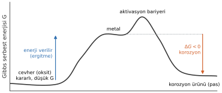
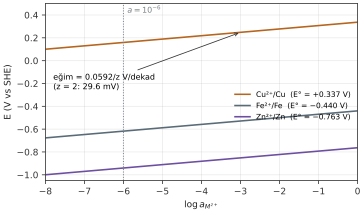
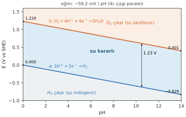
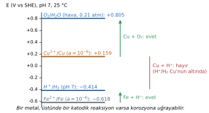
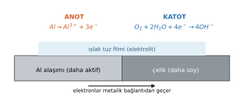

# Hafta 3 · Korozyonun Termodinamiği ve Potansiyel Farklarının Kaynakları

**Başlangıç sorusu:** Oksijeni tamamen uzaklaştırılmış saf suda demir korozyona uğrar mı? Bu bölümün sonunda bu soruyu hesapla cevaplayacağız.

Bir reaksiyonun olup olamayacağına termodinamik karar verir. Bu bölümde Gibbs serbest enerjisinden hücre potansiyeline, oradan da her derişimde geçerli olan **Nernst denklemine** geçiyoruz. Sonra bu araçlarla gerçek hayatta anot ve katodu neyin belirlediğine bakıyoruz.

## 1. Korozyon serbest enerjide "yokuş aşağı" gider

$$\Delta G = \Delta H - T\Delta S \qquad \Delta G = G_{products} - G_{reactants}$$

- $\Delta G$: Gibbs serbest enerji değişimi (J/mol), $\Delta H$: entalpi değişimi (J/mol), $T$: sıcaklık (K), $\Delta S$: entropi değişimi (J/mol·K)
- Ürünlerin serbest enerjisi girenlerden düşükse ($\Delta G < 0$) süreç **spontaneous (kendiliğinden)** yürür.

Metaller cevherlerden (oksitlerden) **enerji harcanarak** (ergitme, redüksiyon) üretilir. Korozyon metali tekrar kararlı oksit hâline döndürür. Bu yüzden çoğu metal için $\Delta G < 0$'dır. Oksitlerin standart oluşum serbest enerjileri:

| Oksit | $\Delta_f G^\circ$ (kJ/mol) | Yorum |
|---|---|---|
| $Al_2O_3$ | −1582 | Çok kararlı oksit; Al'nin oksitlenme isteği çok büyük |
| $Fe_2O_3$ | −742 | Demir kolayca oksitlenir |
| $Cu_2O$ | −146 | Daha az istekli |
| $Au_2O_3$ | **+163** | Pozitif: **altın oksitlenmez** |

> $\Delta G$ bir reaksiyonun **olup olamayacağını** söyler, **ne kadar hızlı** olacağını asla söylemez. Hızı aktivasyon bariyeri, yani **kinetik** belirler (Hafta 5–6). Alüminyumun $\Delta G$'si çok negatif olduğu hâlde pratikte dayanıklı olması bunun en iyi örneğidir.

## 2. Serbest enerjiden gerilime: $\Delta G = -zFE$

Bir korozyon hücresinde serbest enerji **elektriksel iş** olarak açığa çıkar. Bunu dört kısa adımda bağlayalım. $z$ mol elektron, anottan katoda $E$ potansiyel farkı boyunca yavaşça (tersinir olarak) geçsin.

1. $z$ mol elektronun taşıdığı yük: $Q = zF$
2. Elektriksel iş = yük × potansiyel farkı: $W_{el} = QE = zFE$
3. Termodinamik: elde edilebilecek maksimum faydalı iş, serbest enerjideki azalmaya eşittir: $W_{el,max} = -\Delta G$
4. 2 ve 3'ü birleştir:

$$\boxed{\Delta G = -zFE \qquad \Delta G^\circ = -zFE^\circ}$$

- $z$: aktarılan elektron sayısı; $F = 96\,485$ C/mol; $E$: hücre potansiyeli (V). Birim kontrolü: mol × C/mol × J/C = J ✓
- $z$ ve $F$ her zaman pozitif olduğu için işareti $E$ belirler:
  - $E > 0$ → $\Delta G < 0$ → **kendiliğinden**
  - $E < 0$ → $\Delta G > 0$ → kendiliğinden değil

## 3. Emf serisinin sayıları nereden gelir?

$\Delta G = -zFE$ sayesinde emf serisindeki değerleri termodinamik verilerden kendimiz hesaplayabiliriz.

$$\Delta G^\circ = \sum \nu\,\mu^\circ_{products} - \sum \nu\,\mu^\circ_{reactants} \qquad E^\circ = -\frac{\Delta G^\circ}{zF}$$

- $\mu^\circ$ ("mü sıfır"): **standard chemical potential (standart kimyasal potansiyel)**, kJ/mol. Bir türün standart hâlindeki bir molünün serbest enerjisidir; tablolardaki standart oluşum serbest enerjisine eşittir ($\mu^\circ = \Delta_f G^\circ$). Kısmi molar Gibbs serbest enerjisi olarak da geçer.
- Saf elementler için tanım gereği $\mu^\circ = 0$ (Fe, Cu, Zn, $H_2$, $O_2$...).
- $\nu$ ("nü"): stokiyometrik katsayı.
- Yöntem: yarı reaksiyonu **redüksiyon** olarak yaz, sonra $\Delta G^\circ$ = ürünler − girenler (elektronlar 0 sayılır). $\Delta G^\circ$'ı **joule**'e çevirmeyi unutma.

## 4. Aktivite: "etkin derişim"

$E^\circ$ yalnızca birim aktivitede geçerlidir; gerçek çözeltiler nadiren 1 M'dır. Bu yüzden önce aktiviteyi tanımlarız:

$$\mu = \mu^\circ + RT\ln a \qquad a = \gamma\,c$$

- $\mu$: gerçek bileşimdeki kimyasal potansiyel; $\mu^\circ$: standart hâldeki kimyasal potansiyel (J/mol)
- $R = 8.314$ J/(mol·K); $T$: sıcaklık (K)
- $a$: **activity (aktivite)**, birimsiz. Türün standart hâline göre ne kadar "aktif" olduğunu gösterir.
- $\gamma$: activity coefficient (aktivite katsayısı); $c$: derişim (mol/L)

| Tür | Aktivite |
|---|---|
| Saf katı (metal, oksit) ve su (çözücü) | $a = 1$ |
| Gaz | $a = P/(1\ \text{atm})$ |
| Çözünmüş iyon | $a = \gamma c \approx c$ (seyreltik çözeltide) |

Aktivite düştükçe $\mu$ düşer; tür reaksiyona girmeye daha az "istekli" olur.

## 5. Her bileşimde $\Delta G$ ve denge sabiti

$$\Delta G = \Delta G^\circ + RT\ln Q$$

- $Q$: **reaction quotient (reaksiyon oranı)** = (ürünlerin aktivitelerinin çarpımı) / (girenlerin aktivitelerinin çarpımı), her biri katsayısı kadar üslü. Katılar ve su düşer ($a = 1$).
- Daniell hücresi $Zn + Cu^{2+} \rightarrow Zn^{2+} + Cu$ için: $Q = a_{Zn^{2+}}/a_{Cu^{2+}}$

**Dengede** reaksiyon durur: $\Delta G = 0$ ve $Q = K$ (denge sabiti). Buradan:

$$\Delta G^\circ = -RT\ln K \qquad\Rightarrow\qquad E^\circ = \frac{RT}{zF}\ln K$$

Büyük pozitif bir $E^\circ$, devasa bir $K$ demektir: reaksiyon pratikte tamamlanana kadar yürür.

::: ornek
**Örnek 3.1 · Serbest enerji verilerinden standart potansiyeller**

Aşağıdaki standart kimyasal potansiyellerle 25 °C'de $Zn^{2+}/Zn$ ve $Cu^{2+}/Cu$ elektrotlarının standart redüksiyon potansiyellerini, sonra Daniell hücresinin ($Zn + Cu^{2+} \rightarrow Zn^{2+} + Cu$) standart potansiyelini ve denge sabitini hesapla.

**Verilenler:** $\mu^\circ(Zn^{2+}) = -147.1$ kJ/mol, $\mu^\circ(Cu^{2+}) = +65.5$ kJ/mol, $\mu^\circ(Zn) = \mu^\circ(Cu) = 0$; $z = 2$; $R = 8.314$ J/(mol·K), $T = 298.15$ K

**İstenen:** (a) $E^\circ(Zn^{2+}/Zn)$, (b) $E^\circ(Cu^{2+}/Cu)$, (c) hücrenin $\Delta G^\circ$ ve $E^\circ$'ı, (d) $K$

**Çözüm:**

(a) $Zn^{2+} + 2e^- \rightarrow Zn$: $\Delta G^\circ = \mu^\circ(Zn) - \mu^\circ(Zn^{2+}) = 0 - (-147.1) = +147.1$ kJ
$$E^\circ_{Zn} = -\frac{147\,100}{2\times96\,485} = -0.762\ \text{V}$$

(b) $Cu^{2+} + 2e^- \rightarrow Cu$: $\Delta G^\circ = 0 - 65.5 = -65.5$ kJ
$$E^\circ_{Cu} = -\frac{-65\,500}{2\times96\,485} = +0.339\ \text{V}$$

(Tablo değerleri: −0.763 V ve +0.337 V. Gerilim ve serbest enerji aynı şeyi anlatır.)

(c) $\Delta G^\circ = \mu^\circ(Zn^{2+}) + \mu^\circ(Cu) - \mu^\circ(Zn) - \mu^\circ(Cu^{2+}) = -147.1 - 65.5 = -212.6$ kJ
$$E^\circ_{cell} = -\frac{-212\,600}{2\times96\,485} = +1.10\ \text{V}$$
Kontrol: $E^\circ_{cathode} - E^\circ_{anode} = 0.339 - (-0.762) = 1.10$ V ✓

(d)
$$\ln K = \frac{-\Delta G^\circ}{RT} = \frac{212\,600}{8.314\times298.15} = 85.8 \qquad K = e^{85.8} \approx 1.8\times10^{37}$$

**Yorum:** Dengede $a_{Zn^{2+}}/a_{Cu^{2+}} \approx 10^{37}$. Reaksiyon ortamda pratikte hiç $Cu^{2+}$ kalmayana kadar yürür.
:::

## 6. Nernst denklemi

$\Delta G = \Delta G^\circ + RT\ln Q$ ifadesinde $\Delta G = -zFE$ ve $\Delta G^\circ = -zFE^\circ$ yazıp her tarafı $-zF$'ye bölersek dersin en çok kullanılan denklemini elde ederiz:

$$-zFE = -zFE^\circ + RT\ln Q \quad\Rightarrow\quad \boxed{E = E^\circ - \frac{RT}{zF}\ln Q}$$

25 °C'de ($\ln x = 2.303\log x$ ve $2.303\,RT/F = 0.0592$ V):

$$E = E^\circ - \frac{0.0592}{z}\log Q$$

- $E$: gerçek aktivitelerdeki hücre (veya elektrot) potansiyeli (V); $E^\circ$: tablodaki standart potansiyel (V)
- $z$: yazılan reaksiyondaki elektron sayısı; $Q$ = ürünler / girenler
- $E^\circ$, $Q = 1$ ($\log Q = 0$) özel hâlidir.
- 0.0592'li formu **yalnızca 25 °C'de** kullan. Başka sıcaklıkta $RT/zF$'yi $T$ kelvin olarak hesapla.

### Tek elektrot için Nernst

Redüksiyon $M^{z+} + ze^- \rightarrow M$ için $Q = 1/a_{M^{z+}}$ olduğundan log'un önündeki işaret **+** olur:

$$E = E^\circ + \frac{0.0592}{z}\log a_{M^{z+}}$$

- Eğim $0.0592/z$ V/dekad'dır; $z = 2$ için dekad başına 29.6 mV.
- İyon azaldıkça $E$ **daha negatif** olur, metal tablo değerinden **daha aktif** davranır.
- Örnek: $a = 10^{-6}$'da Fe: $E = -0.440 + 0.0296\times(-6) = -0.618$ V.
- $a = 10^{-6}$, Pourbaix diyagramlarında "korozyon yeni başlıyor" kabulü için kullanılan standart değerdir (Hafta 4).

::: ornek
**Örnek 3.2 · 1 M'dan farklı derişimlerde elektrot potansiyelleri**

Üç metal, 25 °C'de kendi iyonlarının çözeltilerine daldırılıyor. Aktiviteleri derişime eşit al.

**Verilenler:** $E^\circ(Zn^{2+}/Zn) = -0.763$ V, $E^\circ(Cu^{2+}/Cu) = +0.337$ V, $E^\circ(Fe^{2+}/Fe) = -0.440$ V; hepsinde $z = 2$, yani $0.0592/z = 0.0296$ V

**İstenen:** (a) 0.010 M $Zn^{2+}$ içinde Zn'nin potansiyeli, (b) $1.0\times10^{-4}$ M $Cu^{2+}$ içinde Cu'nun potansiyeli, (c) Fe elektrodun −0.500 V (SHE) okuduğu $Fe^{2+}$ aktivitesi

**Çözüm:**

(a) $E_{Zn} = -0.763 + 0.0296\log(0.010) = -0.763 + 0.0296\times(-2) = -0.822$ V

(b) $E_{Cu} = 0.337 + 0.0296\log(10^{-4}) = 0.337 - 0.118 = +0.219$ V

(c) Denklemi log için çöz:
$$-0.500 = -0.440 + 0.0296\log a \;\Rightarrow\; \log a = \frac{-0.060}{0.0296} = -2.03 \;\Rightarrow\; a_{Fe^{2+}} = 10^{-2.03} = 9.4\times10^{-3}$$

**Not:** Aynı sonuç $\ln$'li formla da bulunur: $RT/zF = 8.314\times298/(2\times96\,485) = 0.0128$ V, yani $E = E^\circ + 0.0128\ln a$. (c)'de $\ln a = -4.67$ → $a = 9.4\times10^{-3}$ ✓
:::

::: ornek
**Örnek 3.3 · Hücre geriliminden bilinmeyen iyon derişimi (klasik sınav sorusu)**

Bir hücre, kendi iki değerlikli iyonlarının çözeltilerine daldırılmış saf bakır ve saf kurşun elektrotlardan oluşuyor. $Cu^{2+}$ derişimi 0.6 M. Kurşun elektrot oksitleniyor ve hücre potansiyeli 25 °C'de 0.507 V. $Pb^{2+}$ derişimini bul.

**Verilenler:** $[Cu^{2+}] = 0.6$ M, $E_{cell} = 0.507$ V, $E^\circ(Cu^{2+}/Cu) = +0.337$ V, $E^\circ(Pb^{2+}/Pb) = -0.126$ V; Pb anot

**İstenen:** (a) hücre reaksiyonu ve $z$, (b) $E^\circ_{cell}$, (c) $[Pb^{2+}]$

**Çözüm:**

(a) Pb oksitlenir (anot), $Cu^{2+}$ indirgenir (katot): $Pb + Cu^{2+} \rightarrow Pb^{2+} + Cu$, $z = 2$

(b) $E^\circ_{cell} = 0.337 - (-0.126) = 0.463$ V

(c) Hücre için Nernst, $Q = [Pb^{2+}]/[Cu^{2+}]$ (ürünler / girenler; katı Pb ve Cu düşer):
$$0.507 = 0.463 - 0.0296\log\frac{[Pb^{2+}]}{0.6} \;\Rightarrow\; \log\frac{[Pb^{2+}]}{0.6} = \frac{0.463 - 0.507}{0.0296} = -1.49$$
$$[Pb^{2+}] = 0.6\times10^{-1.49} = 0.020\ \text{M}$$

**Kontrol:** $E_{cell} > E^\circ_{cell}$ çıkmış; bu, ürün ($Pb^{2+}$) derişiminin girenden ($Cu^{2+}$) düşük olmasıyla ($Q < 1$, $\log Q < 0$) tutarlı ✓
:::

## 7. Sudaki iki katodik reaksiyon ve pH

Bir metal ancak elektronlarını alacak bir şey varsa korozyona uğrar. Suda iki aday vardır: $H^+$ ve çözünmüş $O_2$. Nernst bunların potansiyellerini verir.

- **Line a (hidrojen):** $2H^+ + 2e^- \rightarrow H_2$, $E^\circ = 0$, $P_{H_2} = 1$ atm
- **Line b (oksijen):** $O_2 + 4H^+ + 4e^- \rightarrow 2H_2O$, $E^\circ = 1.229$ V

$$E_H = -0.0592\,\text{pH} \qquad E_O = 1.229 - 0.0592\,\text{pH} + \frac{0.0592}{4}\log P_{O_2}$$

- $E_H$, $E_O$: hidrojen ve oksijen elektrotlarının potansiyeli (V vs SHE); $P_{O_2}$: oksijen kısmi basıncı (atm)
- pH = $-\log a_{H^+}$ ("power of hydrogen"). Bir pH birimi $H^+$'da 10 kat fark demektir. Düşük pH asidik, yüksek pH bazik, 25 °C'de pH 7 nötr.

- İki çizgi de **pH birimi başına 0.0592 V** düşer: asitte iki katodik reaksiyon da daha güçlüdür.
- pH 7'de: $E_H = -0.414$ V; $E_O = 0.815$ V ($P_{O_2} = 1$ atm), havada ($P_{O_2} = 0.21$ atm) **0.805 V**.
- Çizgi a'nın altında su indirgenir ($H_2$ çıkar), çizgi b'nin üstünde su oksitlenir ($O_2$ çıkar). Arada **su kararlıdır**. Bu çizgi çifti her Pourbaix diyagramının çerçevesidir.

## 8. Korozyon termodinamik olarak mümkün mü?

Korozyon = metal oksidasyonu + bir katodik reaksiyon. Ancak $E_{cell} > 0$ ise, yani katodik reaksiyonun potansiyeli metalinkinin **üstündeyse** yürüyebilir:

$$E_{cell} = E_{cathodic} - E_{metal} > 0 \quad\Rightarrow\quad \text{korozyon mümkün}\ (\Delta G < 0)$$

- Demir ($-0.618$ V) pH 7'deki hidrojen çizgisinin ($-0.414$ V) **altında**: demir **oksijen olmadan da** korozyona uğrayabilir.
- Bakır ($+0.159$ V) hidrojen çizgisinin **üstünde**: bakırın korozyona uğraması için **oksijen** (0.805 V) gerekir.
- Bu test neyin **mümkün** olduğunu söyler, ne kadar **hızlı** olduğunu değil.

::: ornek
**Örnek 3.4 · Demir ve bakır oksijensiz suda korozyona uğrar mı?**

Saf demir ve saf bakır numuneler, tüm çözünmüş oksijeni uzaklaştırılmış (N₂ ile köpürtülmüş) pH 7, 25 °C saf suya konuyor. Yüzeydeki metal iyonu aktivitesini $10^{-6}$, $P_{H_2} = 1$ atm al. Sonra bakır için havayla doygun suda tekrarla.

**Verilenler:** $E^\circ(Fe^{2+}/Fe) = -0.440$ V, $E^\circ(Cu^{2+}/Cu) = +0.337$ V, $E^\circ(O_2/H_2O) = +1.229$ V; $a_{Fe^{2+}} = a_{Cu^{2+}} = 10^{-6}$; pH 7; havada $P_{O_2} = 0.21$ atm

**İstenen:** (a) Fe'nin ve hidrojen elektrodunun potansiyeli, (b) $Fe + 2H^+ \rightarrow Fe^{2+} + H_2$ için $E_{cell}$, (c) aynı test bakır için, (d) havalandırılmış suda bakır

**Çözüm:**

(a) Burada $E^\circ$ değil, Nernst ile gerçek aktivitedeki potansiyeller gerekir:
$$E_{Fe} = -0.440 + 0.0296\log(10^{-6}) = -0.440 - 0.178 = -0.618\ \text{V}$$
$$E_H = -0.0592\times7 = -0.414\ \text{V}$$

(b) Demir çözündüğü için anot, hidrojen çıkışı katottur:
$$E_{cell} = E_H - E_{Fe} = -0.414 - (-0.618) = +0.204\ \text{V} > 0$$
**Evet:** demir hiç oksijen olmasa bile suda korozyona uğrar (pas oluşmasa da çözünür).

(c) $E_{Cu} = 0.337 + 0.0296\times(-6) = +0.159$ V
$$E_{cell} = E_H - E_{Cu} = -0.414 - 0.159 = -0.573\ \text{V} < 0$$
**Hayır:** bakır oksijensiz saf suda korozyona uğramaz.

(d) Oksijen varken katodik reaksiyon artık oksijen redüksiyonudur. pH 7 ve havada $E_O \approx +0.805$ V:
$$E_{cell} = E_O - E_{Cu} = 0.805 - 0.159 = +0.646\ \text{V} > 0$$
**Evet:** bakır ancak suda oksijen varsa korozyona uğrayabilir.

**Başlangıç sorusunun cevabı:** Demir oksijensiz suda da korozyona uğrar; bakır uğramaz.
:::

## 9. Potansiyel farklarının kaynakları: anot nerede olur?

Korozyonun sebebi, aynı yüzey üzerinde veya temas hâlindeki yüzeyler arasında bir **potansiyel farkı** olmasıdır. Nernst denklemindeki her terim böyle bir farkın kaynağı olabilir: $E^\circ$ (farklı metal), $a$ (iyon derişimi), $P_{O_2}$ (oksijen), $T$ (sıcaklık). Bunlara mikroyapı ve soğuk deformasyon da eklenir.

### 9.1 Farklı metaller: galvanik çift (galvanic couple)

- **Elektriksel temas** hâlinde ve **aynı elektrolit** içindeki iki metal bir hücre oluşturur. Daha **aktif** metal anot olur ve tek başına olduğundan **daha hızlı** korozyona uğrar.
- Daha soy metal katot olur ve **korunur**.
- Klasik örnek: ıslak, tuzlu ortamda çeliğe veya bakıra bağlanmış alüminyum alaşımı. Alüminyum korozyona uğrar.
- Aynı etki faydalı da kullanılır: çinko kaplamalar ve kurban anotlar (sacrificial anodes) çeliği korur.
- Hız büyük ölçüde soy metalin ne kadar katodik reaksiyonu ($O_2$ redüksiyonu) taşıyabildiğine bağlıdır.

### 9.2 Emf serisi mi, galvanik seri mi?

| | Emf series | Galvanic series |
|---|---|---|
| Neyi içerir | Saf metaller, kendi iyonlarında, birim aktivitede | Gerçek metaller **ve alaşımlar** |
| Nasıl elde edilir | Denge (termodinamik) değerleri | Belirli bir ortamda (ör. akan deniz suyu) **ölçülür** |
| Ne için kullanılır | **Hesaplar** için | Gerçek çiftleri **değerlendirmek** için |
| Pasiflik | Göstermez | Gösterir: paslanmaz çelik iki kez (aktif ve pasif) yer alır |

Galvanik seri yalnızca ölçüldüğü ortamda geçerlidir. Pratik kural: bir arada kullanılacak metalleri seride **birbirine yakın** seç. Akan deniz suyunda yaklaşık sıralama (soydan aktife):

> **Soy (katodik)** · grafit → platin → titanyum → paslanmaz çelik 304 (pasif) → nikel → bakır → paslanmaz çelik 304 (aktif) → karbon çeliği, dökme demir → alüminyum alaşımları → çinko → magnezyum · **Aktif (anodik)**

Paslanmaz çeliğin iki farklı yerde olması önemlidir: pasif film sağlamken soy metaller arasında, film bozulunca karbon çeliğine yakın davranır (pasiflik, Hafta 7).

### 9.3 Aynı metal, farklı iyon derişimi: metal-ion concentration cell

$$\Delta E = \frac{0.0592}{z}\log\frac{a_{high}}{a_{low}}$$

- İki elektrot da aynı metaldir; yalnızca $a_{M^{z+}}$ farklıdır. Nernst'e göre **seyreltik** tarafın potansiyeli daha düşüktür → **anot**.
- Metal seyreltik tarafta çözünür, derişik tarafta birikir. Derişimler eşitlenince $E \rightarrow 0$ olur.
- Pratikte: hızlı akış yüzeyin bir kısmından metal iyonlarını süpürür (seyreltik → anot); durgun bölgeler onları tutar (derişik → katot).

**Neden $E^\circ$ yok?** İki elektrot da aynı metal olduğu için $E^\circ$'lar birbirini götürür:
$$E_{cell} = E_{katot} - E_{anot} = \left(E^\circ + \tfrac{0.0592}{z}\log a_{derişik}\right) - \left(E^\circ + \tfrac{0.0592}{z}\log a_{seyreltik}\right) = \frac{0.0592}{z}\log\frac{a_{derişik}}{a_{seyreltik}}$$

::: ornek
**Örnek 3.5 · Bakır derişim hücresi**

Gözenekli bir duvarla ayrılmış iki bakır sülfat çözeltisine iki saf bakır elektrot daldırılmış: bir tarafta $5.0\times10^{-4}$ M, diğer tarafta 0.50 M. Elektrotlar 25 °C'de bir voltmetre üzerinden bağlı.

**Verilenler:** $a_{dil} = 5.0\times10^{-4}$, $a_{conc} = 0.50$, $z = 2$, 25 °C

**İstenen:** (a) anot, katot ve yarı reaksiyonlar, (b) hücre potansiyeli, (c) taşınan mol bakır başına $\Delta G$, (d) gerilim zamanla nasıl değişir?

**Çözüm:**

(a) Düşük aktivite → düşük potansiyel → **anot (seyreltik taraf):** $Cu \rightarrow Cu^{2+} + 2e^-$. Yüksek aktivite → **katot (derişik taraf):** $Cu^{2+} + 2e^- \rightarrow Cu$. Derişik tarafta iyonlar metal olarak birikir; seyreltik tarafta yeni $Cu^{2+}$ oluşur.

(b) Oran = 1000, log = 3:
$$E_{cell} = 0.0296\log\frac{0.50}{5.0\times10^{-4}} = 0.0296\times3 = 0.089\ \text{V}$$

(c) $\Delta G = -zFE = -2\times96\,485\times0.0888 = -17.1$ kJ/mol

(d) Seyreltik taraf zenginleşir, derişik taraf fakirleşir; iki derişim eşitlendikçe $E$ sıfıra düşer.
:::

### 9.4 Oksijen farkı: differential aeration (farklı havalanma)

Pratikte en önemli derişim hücresi oksijen içindir:

$$\Delta E = \frac{0.0592}{4}\log\frac{P_{O_2,high}}{P_{O_2,low}}$$

- Oksijen elektrodu $P_{O_2}$'nin yüksek olduğu yerde daha pozitiftir; orası **katot** olur.
- **Oksijence fakir** bölge **anot** olur ve korozyona uğrar.
- Termodinamik $\Delta E$ küçüktür (100 katlık fark için ~30 mV), ama pratik etkisi büyüktür.
- **Evans damlası:** Çelik üzerindeki bir tuzlu su damlasında kenarlar (ince film, çok $O_2$) katot, merkez (az $O_2$) anottur. Pas ikisinin arasında bir halka hâlinde oluşur.
- Aralık korozyonu (crevice), su çizgisi korozyonu ve killi topraktaki boru bu mekanizmayla çalışır.

::: ornek
**Örnek 3.6 · İki farklı topraktan geçen boru**

Çelik bir boru kumlu topraktan killi toprağa geçiyor. Kumda boru yüzeyindeki oksijen kısmi basıncı 0.21 atm, kilde 0.0021 atm. İki toprak da pH 7, sıcaklık 25 °C. Katodik reaksiyon $O_2 + 4H^+ + 4e^- \rightarrow 2H_2O$.

**Verilenler:** $E^\circ(O_2/H_2O) = 1.229$ V; pH 7; $P_{O_2}$ = 0.21 atm (kum), 0.0021 atm (kil); $z = 4$, $0.0592/4 = 0.0148$ V

**İstenen:** (a) her topraktaki oksijen elektrodu potansiyeli, (b) iki bölüm arasındaki potansiyel farkı, (c) hangi bölüm anot, (d) borudaki elektron akış yönü

**Çözüm:**

(a)
$$E_{kum} = 1.229 - 0.0592\times7 + 0.0148\log(0.21) = +0.805\ \text{V}$$
$$E_{kil} = 1.229 - 0.0592\times7 + 0.0148\log(0.0021) = +0.775\ \text{V}$$

(b) pH terimleri birbirini götürür, yalnızca basınç oranı (100) kalır:
$$\Delta E = 0.0148\log\frac{0.21}{0.0021} = 0.0148\times2 = 0.030\ \text{V}$$

(c) **Kil bölümü** daha düşük potansiyelde ve oksijence fakir → **anot**, korozyona uğrar.

(d) Elektronlar boru duvarı içinden **kilden kuma** doğru akar.

**Dikkat:** İki tarafta da aynı reaksiyon olduğu için $E^\circ$ farka girmez.
:::

### 9.5 Tek bir alaşımın içindeki galvanik hücreler: mikroyapı

- **Tane sınırları (grain boundaries):** düzensiz atomlar ve ayrışmış safsızlıklar → daha yüksek enerji → tane içlerine göre **anodik**. Tane sınırları daha aktif davranır.
- **İki fazlı alaşımlar:** her fazın kendi potansiyeli vardır. Perlitik çelikte asit içinde ferrit çözünür (anot), sementit ($Fe_3C$) katodik reaksiyonu taşır.
- **İnklüzyonlar ve partiküller** (ör. çelikte MnS): oyukların (pit) başladığı yerler.
- **Metalografik dağlama** aslında kontrollü korozyondur. Tane sınırlarını ve fazları tam da farklı potansiyelleri olduğu için ortaya çıkarır.

### 9.6 Soğuk deformasyon ve gerilme: çivinin başı ve ucu neden önce paslanır?

$$\Delta E = \frac{\Delta G_{stored}}{zF}$$

- $\Delta G_{stored}$: plastik deformasyonla metalde depolanan enerji (J/mol)
- Soğuk deformasyon dislokasyon yoğunluğunu artırır; metal enerji depolar ve daha az kararlı olur. Potansiyeli $\Delta E$ kadar düşer: **deforme olmuş bölge anottur**.
- Tipik depolanmış enerjiler birkaç yüz J/mol'dür ve sadece birkaç mV verir (Fe için 400 J/mol → $400/(2\times96\,485) \approx 2$ mV).
- Pratik etki daha büyüktür: deformasyon koruyucu filmleri kırar ve küçük deforme anot büyük bir katotla karşı karşıya kalır. Çekme gerilmesi + ortam → **stress corrosion cracking (gerilmeli korozyon çatlaması)**.
- Çivide baş (soğuk şekillendirilmiş) ve uç (soğuk sivriltilmiş) en çok deforme olan yerlerdir → anot. İndikatörlü tuz çözeltisinde önce bu bölgeler maviye ($Fe^{2+}$) döner; gövde katottur.

### 9.7 Alan oranı: küçük anot + büyük katot = tehlike

Potansiyel farkı hangi bölgenin anot olacağına karar verir; **alanlar** ise o bölgeye ne kadar şiddetli saldırılacağını belirler.

$$I_a = I_c \quad\Rightarrow\quad i_a = i_c\,\frac{A_c}{A_a}$$

- $I_a$, $I_c$: anodik ve katodik akım (A); $i_a$, $i_c$: akım yoğunlukları (A/cm²); $A_a$, $A_c$: anot ve katot alanları (cm²)
- Katotta harcanan her elektron anottan gelir: $I_a = I_c$ (yük dengesi). Akım yoğunluğu $i = I/A$ olduğundan anodun akım yoğunluğu $A_c/A_a$ oranıyla büyür.
- Sezgi: 25 A'lik akım 25 cm²'lik bir alana yayılırsa 1 A/cm², 1 cm²'lik alana yığılırsa 25 A/cm² olur.
- Örnek: $i_c = 10\ \mu$A/cm², $A_c/A_a = 100$ → $i_a = 1000\ \mu$A/cm².

| Durum | Sonuç |
|---|---|
| Bakır plaka (büyük katot) + çelik perçinler (küçük anot) | Perçinler hızla çözünür |
| Çelik plaka (büyük anot) + bakır perçinler (küçük katot) | Saldırı geniş alana ince yayılır: kabul edilebilir |

**Tasarım kuralları:** Bağlantı elemanları (cıvata, perçin) plakadan **daha soy** olsun. **Asla yalnızca anodu kaplama:** kaplamadaki bir çizik minicik bir anot olur.

### Özet: anot nerede?

| Kaynak | Nernst terimi | Anot olan… | Tipik örnek |
|---|---|---|---|
| Farklı metaller | $E^\circ$ | daha aktif metal (o ortamın galvanik serisine göre) | Tuz serpintisinde çeliğe bağlı Al alaşımı |
| Metal iyonu derişimi | $a_{M^{z+}}$ | seyreltik taraf | Hızlı akan suda bakır alaşımı |
| Farklı havalanma | $P_{O_2}$ | oksijence fakir taraf | Aralık, su çizgisi, kildeki boru |
| Sıcaklık | $T$ | sisteme bağlı: ölçülmeli | Isı değiştirici, kazan borusu |
| Mikroyapı | fazın $E^\circ$'ı | tane sınırı, aktif faz (ferrit) | Asitte perlitik çelik, dağlama |
| Soğuk deformasyon | depolanmış enerji | deforme bölge | Çivi başı ve ucu, bükülmüş boru |
| Alan oranı (şiddet) | $I_a = I_c$ | küçük anot en çok zarar görür | Bakır plakada çelik perçin |

## Formül özeti

| Formül | Anlamı |
|---|---|
| $\Delta G = -zFE$, $\Delta G^\circ = -zFE^\circ$ | Serbest enerji ↔ potansiyel |
| $E^\circ = -\Delta G^\circ/(zF)$, $\Delta G^\circ = \sum\nu\mu^\circ_{ürün} - \sum\nu\mu^\circ_{giren}$ | Termodinamik veriden $E^\circ$ |
| $\mu = \mu^\circ + RT\ln a$, $a = \gamma c$ | Aktivite |
| $\Delta G = \Delta G^\circ + RT\ln Q$ | Her bileşimde $\Delta G$ |
| $\Delta G^\circ = -RT\ln K$, $E^\circ = \frac{RT}{zF}\ln K$ | Denge sabiti |
| $E = E^\circ - \frac{0.0592}{z}\log Q$ | Nernst (25 °C) |
| $E = E^\circ + \frac{0.0592}{z}\log a_{M^{z+}}$ | Tek elektrot |
| $E_H = -0.0592\,\text{pH}$ | Hidrojen çizgisi (a) |
| $E_O = 1.229 - 0.0592\,\text{pH} + \frac{0.0592}{4}\log P_{O_2}$ | Oksijen çizgisi (b) |
| $E_{cell} = E_{cathodic} - E_{metal} > 0$ | Korozyon kriteri |
| $\Delta E = \frac{0.0592}{z}\log\frac{a_{high}}{a_{low}}$ | Derişim hücresi |
| $\Delta E = \frac{\Delta G_{stored}}{zF}$ | Soğuk deformasyon |
| $i_a = i_c\,A_c/A_a$ | Alan oranı |

::: sinav
## Sınavda çıkabilir

- Hücre geriliminden bilinmeyen iyon derişimi (Örnek 3.3 tipi). $Q$'yu ürünler/girenler olarak doğru kur.
- "X metali oksijensiz / havalandırılmış suda korozyona uğrar mı?" Önce Nernst ile $a = 10^{-6}$'daki metal potansiyeli, sonra $E_H$ veya $E_O$, sonra $E_{cell}$ işareti.
- $\mu^\circ$ verilerinden $E^\circ$ ve $K$ hesabı ($\Delta G^\circ$'ı joule'e çevir).
- Derişim hücresi ve farklı havalanma: hangi taraf anot, $\Delta E$ ne kadar, elektronlar hangi yöne akar?
- Kavramsal: emf ile galvanik serinin farkı, alan oranı ve perçin tasarımı, tane sınırı/soğuk deformasyonun anodik davranışı.
:::
