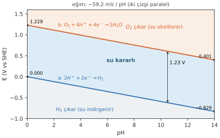
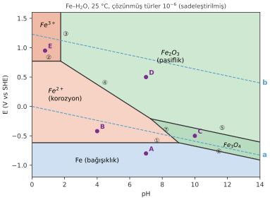
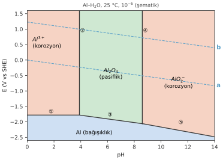
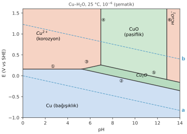

# Hafta 4 · Potansiyel–pH (Pourbaix) Diyagramları

**Başlangıç sorusu:** Çelik bir donatı ıslak betonun içinde onlarca yıl dayanırken, bir yağmur suyu birikintisinde neden birkaç haftada paslanır? İki ortam da ıslak, ikisinde de oksijen var. Bu bölümün sonunda farkın **pH** olduğunu bir harita üzerinden göreceğiz.

## 1. Bir metalin hangi formda kararlı olduğunu gösteren harita

- **Köken:** Marcel Pourbaix'nın doktora tezi (1940'lar); sonra neredeyse bütün elementlerin diyagramlarını içeren bir atlas olarak yayımlandı. **E–pH diyagramı** olarak da geçer.
- **Faz diyagramına benzer:** Faz diyagramında sıcaklık ve bileşim kararlı fazı belirler; Pourbaix diyagramında **potansiyel ($E$)** ve **pH** suda kararlı türü belirler.
- Kabuller: 25 °C, gazlar 1 atm, çözünmüş türlerin aktivitesi sabit (genelde $10^{-6}$).

### Nernst'ten haritaya: ikinci değişken pH

Geçen hafta Nernst denkleminde aynı anda tek bir değişken vardı. Korozyon reaksiyonlarının çoğu elektronların yanında $H^+$ da kullanır, dolayısıyla potansiyelleri **pH'a da** bağlıdır. Herhangi bir reaksiyonu redüksiyon olarak yazalım:

$$a\,A + m\,H^+ + z\,e^- \rightleftharpoons b\,B + c\,H_2O$$

Bu reaksiyon için Nernst denklemi (25 °C):

$$\boxed{E = E^\circ - \frac{0.0592\,m}{z}\,\text{pH} - \frac{0.0592}{z}\log\frac{a_B^{\,b}}{a_A^{\,a}}}$$

- $m$: reaksiyondaki $H^+$ sayısı; $z$: elektron sayısı
- $a_A$, $a_B$: $H^+$ dışındaki giren ve ürün türlerin aktiviteleri (katılar ve su için 1)
- İkinci terim **pH terimi**, üçüncü terim **aktivite terimi**dir. ($-\log a_{H^+} = \text{pH}$ olduğundan $H^+$'nın aktivitesi pH olarak dışarı çıkar.)

Aktiviteleri sabitlersek $E$ yalnızca pH'a bağlı kalır: **her reaksiyon E–pH grafiğinde bir doğru olur.** Bu denklem "ana şablon"dur. Aşağıda göreceğimiz tüm özel formlar, bu şablonda bazı terimlerin sıfır olmasıyla elde edilir.

## 2. Haritayı okumak: üç bölge

Diyagramdaki her nokta bir durumu temsil eder: belirli pH'taki suda, belirli $E$ potansiyelindeki bir metal. Rengi, metalin orada ne olmak "istediğini" söyler. Düz çizgiler metale, kesikli **a** ve **b** çizgileri suya aittir.

| Immunity (bağışıklık) | Corrosion (korozyon) | Passivity (pasiflik) |
|---|---|---|
| Kararlı tür **metalin kendisi**. | Kararlı tür **çözünmüş bir iyon**. | Kararlı tür **katı bir oksit veya hidroksit**. |
| Korozyona uğrayamaz; reaksiyon yok. | Metal çözünme eğilimindedir. | Yüzeyde bir film oluşabilir; reaksiyon var ama ürün yüzeyde kalır. |
| Haritanın altında, düşük potansiyelde bulunur. | Termodinamik olarak korozyon olur der; **ne kadar hızlı** olduğunu söylemez. | Film ancak **yoğun ve yapışkan** ise korur. |

> Haritadaki pasiflik bölgesi yalnızca "katı bir film kararlıdır" anlamına gelir. Bu filmin metali gerçekten koruyup korumayacağını (yoğun mu, gözenekli mi, yapışkan mı) harita **söyleyemez**. Bu kinetiğin ve deneyin konusudur (Hafta 7).

### Ne zaman "korozyona uğruyor" deriz? $10^{-6}$ kuralı

Sudaki bir metal her zaman biraz çözünür. Soru, ne kadarının "fazla" olduğudur. Pourbaix'nın kabulü: metal **$10^{-6}$ mol/L**'den fazla çözünebiliyorsa buna korozyon denir (demir için litrede yaklaşık 0.06 mg). Bu değeri Nernst'e koyarsak bağışıklık ile korozyon arasındaki sınır çıkar:

$$E_{M^{z+}/M} = E^\circ + \frac{0.0592}{z}\log(10^{-6}) = E^\circ - \frac{0.355}{z}$$

Demir için: $E = -0.440 - 0.355/2 = -0.618$ V. Bu potansiyelin altında demir bağışıktır. Üstünde ise pH'a bağlı olarak ya korozyona uğrar ya da pasifleşir.

## 3. Suyun diyagramı: a ve b çizgileri

Her Pourbaix diyagramı suyun kendi iki çizgisini de içerir (Hafta 3'te gördük):

| | Çizgi b (oksijen, üst sınır) | Çizgi a (hidrojen, alt sınır) |
|---|---|---|
| Asitte | $O_2 + 4H^+ + 4e^- \rightleftharpoons 2H_2O$ | $2H^+ + 2e^- \rightleftharpoons H_2$ |
| Bazda (aynı çizgi) | $O_2 + 2H_2O + 4e^- \rightleftharpoons 4OH^-$ | $2H_2O + 2e^- \rightleftharpoons H_2 + 2OH^-$ |
| Denklem | $E = 1.229 - 0.0592\,\text{pH}$ | $E = -0.0592\,\text{pH}$ |
| pH 0 / pH 14 | +1.229 V / +0.401 V | 0.000 V / −0.829 V |
| Çizginin ötesinde | Üstünde su oksitlenir, **$O_2$ gazı** çıkar | Altında su indirgenir, **$H_2$ gazı** çıkar |

- İki çizginin eğimi de **−59.2 mV/pH**'tır; birbirine paraleldir ve aralarındaki fark her pH'ta **1.23 V**'tur.
- İki çizginin arasında **su kararlıdır**. Gerçek suların çoğu bu bant içindedir.
- Bazik tarafta reaksiyonlar $H^+$ yerine $OH^-$ ile yazılır, ama çizgilerin yeri, eğimi ve değerleri aynı kalır.

**Sezgisel yorum:**

- **Düşük (negatif) potansiyel**, ortamda elektron bolluğu demektir (indirgeyici ortam). a çizgisinin altına inince fazla elektronları sudaki $H^+$ iyonları kapar: $2H^+ + 2e^- \rightarrow H_2$. Bu reaksiyon elektron **tükettiği** için **katodik**tir. Korozyona uğrayan metalin verdiği elektronları yutan reaksiyon budur.
- **Yüksek (pozitif) potansiyel**, elektron açlığı demektir (yükseltgeyici ortam). b çizgisinin üstüne çıkınca su elektronlarını verir: $2H_2O \rightarrow O_2 + 4H^+ + 4e^-$ (anodik).
- **Arada:** ne aşırı elektron bolluğu ne de açlığı var; su sıvı olarak kararlıdır.

## 4. Üç tip çizgi: yatay, dikey, eğik

Pourbaix diyagramındaki tüm çizgiler sadece üç tiptir. Tipi, reaksiyonda $e^-$ ve $H^+$'nın olup olmadığı belirler.

| Reaksiyonda ne var? | Çizgi tipi | Ana şablonda ne olur? | Sonuç | Örnek |
|---|---|---|---|---|
| Sadece $e^-$ ($m = 0$) | **Yatay** | pH terimi sıfırlanır | $E$ = sabit; her pH'ta aynı | $Fe^{2+} + 2e^- \rightleftharpoons Fe$ |
| Sadece $H^+$ ($z = 0$) | **Dikey** | $z$ paydada: Nernst **kullanılamaz**; denge sabiti $K$ yazılır | pH = sabit; redoks değil | $Fe_2O_3 + 6H^+ \rightleftharpoons 2Fe^{3+} + 3H_2O$ |
| Hem $e^-$ hem $H^+$ | **Eğik** | Şablon olduğu gibi kullanılır | $E(\text{pH})$ doğrusu, eğim $-0.0592\,m/z$ V/pH | $Fe_2O_3 + 6H^+ + 2e^- \rightleftharpoons 2Fe^{2+} + 3H_2O$ |

> **Dikey çizgi tuzağı:** Elektron yoksa reaksiyon bir redoks reaksiyonu değil, sıradan bir kimyasal dengedir. $0.0592/z$ ifadesinde $z = 0$ olur ve formül tanımsızlaşır. Ayrıca soruda böyle bir reaksiyon için $E^\circ$ değil $\log K$ verilir. Kural: **potansiyel (elektron) yoksa Nernst geçersizdir, $K$ = ürünler/girenler yazılır.**

### Basit bir metal M'nin haritası: dört çizgi

Basit bir metalin bütün haritasını çizmek için dört reaksiyon yeter:

1. $M^{2+} + 2e^- \rightleftharpoons M$ → **yatay** (sadece $e^-$). Altında metal bağışıktır.
2. $M^{2+} + H_2O \rightleftharpoons MO + 2H^+$ → **dikey** (sadece $H^+$). Sağında oksit oluşur.
3. $MO + 2H^+ + 2e^- \rightleftharpoons M + H_2O$ → **eğik**. Metal ile oksit arasındaki sınır.
4. $MO + H_2O \rightleftharpoons MO_2^{2-} + 2H^+$ → **dikey**. Kuvvetli bazda oksit tekrar çözünür.

Böylece harita soldan sağa: $M^{2+}$ (korozyon) | $MO$ (pasiflik) | $MO_2^{2-}$ (korozyon), altta da $M$ (bağışıklık) bölgesi olur.

## 5. Demir–su diyagramı

Demir haritasının her çizgisi bir reaksiyondur:

| Çizgi | Tip | Reaksiyon | Ayırdığı türler |
|---|---|---|---|
| ① | yatay ($e^-$) | $Fe^{2+} + 2e^- \rightleftharpoons Fe$ | $Fe^{2+}$ / Fe |
| ② | yatay ($e^-$) | $Fe^{3+} + e^- \rightleftharpoons Fe^{2+}$ | $Fe^{3+}$ / $Fe^{2+}$ |
| ③ | dikey ($H^+$) | $Fe_2O_3 + 6H^+ \rightleftharpoons 2Fe^{3+} + 3H_2O$ | $Fe_2O_3$ / $Fe^{3+}$ |
| ④ | eğik | $Fe_2O_3 + 6H^+ + 2e^- \rightleftharpoons 2Fe^{2+} + 3H_2O$ | $Fe_2O_3$ / $Fe^{2+}$ |
| ⑤ | eğik | $3Fe_2O_3 + 2H^+ + 2e^- \rightleftharpoons 2Fe_3O_4 + H_2O$ | hematit / manyetit |
| ⑥ | eğik | $Fe_3O_4 + 8H^+ + 8e^- \rightleftharpoons 3Fe + 4H_2O$ | $Fe_3O_4$ / Fe |
| ⑦ | eğik | $Fe_3O_4 + 8H^+ + 2e^- \rightleftharpoons 3Fe^{2+} + 4H_2O$ | $Fe_3O_4$ / $Fe^{2+}$ |

- **Bağışıklık (Fe):** yaklaşık −0.62 V'un altı.
- **Korozyon ($Fe^{2+}$, $Fe^{3+}$):** asidik ve nötr suda. Sol üstteki $Fe^{3+}$ bölgesi çok kuvvetli asit ve yüksek potansiyele karşılık gelir.
- **Pasiflik ($Fe_2O_3$, $Fe_3O_4$):** bazik suda ve yüksek potansiyelde oksitler.
- **a çizgisi her pH'ta mavi bölgenin üstündedir.** Yani suda demir kendiliğinden hiçbir zaman bağışık değildir. Oksijen olsa da olmasa da demirin korozyona uğrama yolu vardır (oksijensiz yavaş olur ama olur).

### Başlangıç sorusunun cevabı: beton ve yağmur suyu

| | Betondaki çelik | Yağmur suyundaki çelik |
|---|---|---|
| pH | Gözenek suyu kuvvetli bazik, ≈ 12.5–13.5 | Hafif asidik, ≈ 5.6, çözünmüş $O_2$ içerir |
| Haritadaki yeri | Yeşil bölge: kararlı tür **oksit** | Kırmızı bölge: kararlı tür **$Fe^{2+}$** |
| Sonuç | İnce, yoğun film çeliği örter → **pasif**, onlarca yıl dayanır | Demir çözünür, gözenekli pas oluşur → haftalar içinde paslanır |

Aynı metal, ikisi de ıslak, ikisinde de oksijen var: farkı **pH** yaratıyor.

## 6. Metali a ve b çizgileriyle karşılaştırmak

Bir metal ancak sudaki bir şey elektronlarını alırsa korozyona uğrar: $H^+$ (a çizgisi) veya $O_2$ (b çizgisi).

| Metal a çizgisinin altında | Metal a ile b arasında | Metal b çizgisinin üstünde |
|---|---|---|
| $H^+$ tek başına onu oksitleyebilir. | $H^+$ oksitleyemez; çözünmüş $O_2$ oksitleyebilir. | Ne $H^+$ ne $O_2$ oksitleyebilir. |
| Oksijensiz de korozyona uğrar ($H_2$ çıkar). | Oksijen yoksa korozyon yok. | Her suda bağışık. |
| Örnekler: Fe, Zn, Al | Örnek: Cu | Örnekler: Au, Pt (çözmek için kral suyu gibi çok güçlü oksitleyiciler gerekir) |

> Bir metalin bağışıklık çizgisi ne kadar aşağıdaysa metal o kadar aktiftir ve korozyona uğramak için o kadar çok yolu vardır.

## 7. Farklı metaller, farklı haritalar

### Alüminyum: amfoter metal

| Çizgi | Reaksiyon |
|---|---|
| ① yatay | $Al^{3+} + 3e^- \rightleftharpoons Al$ |
| ② dikey | $Al_2O_3 + 6H^+ \rightleftharpoons 2Al^{3+} + 3H_2O$ |
| ③ eğik | $Al_2O_3 + 6H^+ + 6e^- \rightleftharpoons 2Al + 3H_2O$ |
| ④ dikey | $Al_2O_3 + H_2O \rightleftharpoons 2AlO_2^- + 2H^+$ |
| ⑤ eğik | $AlO_2^- + 4H^+ + 3e^- \rightleftharpoons Al + 2H_2O$ |

- **Asit (pH < ~4):** Al, $Al^{3+}$ olarak çözünür.
- **Orta (pH ~4–9):** yoğun bir $Al_2O_3$ filmi oluşur → pasiflik. Alüminyumun normal suda dayanmasının nedeni budur.
- **Baz (pH > ~9):** oksit $AlO_2^-$ olarak tekrar çözünür.
- **Amfoter** = hem asitlerden hem bazlardan saldırıya uğrayan.
- Bağışıklık çizgisi (≈ −1.8 V) a çizgisinin çok altındadır: alüminyum suda **hiçbir zaman bağışık değildir**. Termodinamik olarak suda doğrudan korozyona uğrayabilir; onu koruyan şey yalnızca oksit filmidir.

### Bakır: soy metal

| Çizgi | Reaksiyon |
|---|---|
| ① yatay | $Cu^{2+} + 2e^- \rightleftharpoons Cu$ |
| ② eğik | $Cu_2O + 2H^+ + 2e^- \rightleftharpoons 2Cu + H_2O$ |
| ③ eğik | $2Cu^{2+} + H_2O + 2e^- \rightleftharpoons Cu_2O + 2H^+$ |
| ④ dikey | $CuO + 2H^+ \rightleftharpoons Cu^{2+} + H_2O$ |
| ⑤ eğik | $2CuO + 2H^+ + 2e^- \rightleftharpoons Cu_2O + H_2O$ |
| ⑥ dikey | $CuO + H_2O \rightleftharpoons HCuO_2^- + H^+$ |

- Bakırın bağışıklık çizgisi (≈ +0.16 V) **a çizgisinin üstündedir**: $H^+$ bakırı oksitleyemez.
- **Oksijensiz suda** bakır bağışıktır. Bakır boruların uzun ömürlü olmasının nedeni budur.
- **Oksijen varken** (b çizgisine kadar çıkılabilir) bakır asitte $Cu^{2+}$ olarak çözünür, nötr suda $Cu_2O$ / $CuO$ filmleri oluşturur.
- Üç çizgi tipinin hepsi burada görülür: yatay ①, dikey ④ ⑥, eğik ② ③ ⑤.

## 8. Çözümlü örnekler

::: ornek
**Örnek 4.1 · Demir haritasında beş nokta**

25 °C sudaki beş demir numunesinin pH ve potansiyelleri aşağıda. Hesap yapmadan, haritayı okuyarak cevapla.

**Verilenler:** A: pH 7, −0.80 V · B: pH 4, −0.42 V · C: pH 10, −0.50 V · D: pH 7, +0.50 V · E: pH 0.8, +0.95 V

**İstenen:** (a) her noktanın bölgesi, (b) demir bağışık mı, çözünüyor mu, oksit mi oluşturuyor? (c) su a'nın altında mı, a ile b arasında mı, b'nin üstünde mi?

**Çözüm:** (c) için çizgi değerlerini hesapla: $E_a = -0.0592\,\text{pH}$, $E_b = 1.229 - 0.0592\,\text{pH}$.

| Nokta | Bölge | Demir | $E_a$ / $E_b$ (V) | Su |
|---|---|---|---|---|
| A (7, −0.80) | Fe | **Bağışık** (saf demir) | −0.414 / 0.815 | a'nın altında ($H_2$ çıkar) |
| B (4, −0.42) | $Fe^{2+}$ | **Çözünüyor** (iki değerlikli iyon, korozyon) | −0.237 / 0.992 | a'nın altında |
| C (10, −0.50) | $Fe_3O_4$ | **Oksit** (manyetit, pasiflik) | −0.592 / 0.637 | a ile b arasında |
| D (7, +0.50) | $Fe_2O_3$ | **Oksit** (hematit, pasiflik) | −0.414 / 0.815 | a ile b arasında |
| E (0.8, +0.95) | $Fe^{3+}$ | **Çözünüyor** (üç değerlikli iyon, korozyon) | −0.047 / 1.182 | a ile b arasında |
:::

::: ornek
**Örnek 4.2 · Aynı asidik suda üç metal**

Fe, Al ve Cu plakalar aynı asidik suda (pH 4, 25 °C). Durum 1: oksijen yok. Durum 2: oksijen var.

**Haritayı okuma yöntemi:**

1. Her haritada **pH 4**'e git ve orada dikey bir çubuk düşün.
2. Oksijen yoksa ulaşılabilecek en yüksek potansiyel **a çizgisidir** (pH 4'te −0.24 V). Oksijen varsa **b çizgisine** (pH 4'te +0.99 V) kadar çıkılabilir.
3. Çubuk bir **korozyon** bölgesine değiyor mu? Evet → metal korozyona **uğrayabilir**. Sadece **bağışıklık** bölgesinde kalıyorsa → bağışık.

**Çözüm:**

(a) **Oksijensiz:** Fe ve Al'nin bağışıklık çizgileri a'nın çok altında; a'ya kadar olan çubuk korozyon bölgesine ($Fe^{2+}$, $Al^{3+}$) değer → **Fe ve Al korozyona uğrar**. Cu'nun bağışıklık çizgisi (+0.16 V) a'nın üstünde → **Cu bağışık**.

(b) **Oksijenli:** çubuk b'ye kadar uzanır; bakır için de $Cu^{2+}$ bölgesine değer → **üçü de** korozyona uğrayabilir.

(c) Oksijensiz pH 4 suyu için **bakır** seçilir.
:::

::: ornek
**Örnek 4.3 · Demir için her tipten bir çizgi (hesaplı)**

Fe–H₂O sisteminin üç dengesi 25 °C'de veriliyor. Çözünmüş demir türlerinin aktivitesini $10^{-6}$, katıların ve suyun aktivitesini 1 al. Her denge için çizgi tipini ve Pourbaix diyagramındaki yerini bul.

**Verilenler:**
(a) $Fe^{2+} + 2e^- \rightarrow Fe$, $E^\circ = -0.440$ V
(b) $Fe_2O_3 + 6H^+ \rightarrow 2Fe^{3+} + 3H_2O$, $\log K = -1.44$
(c) $Fe_3O_4 + 8H^+ + 8e^- \rightarrow 3Fe + 4H_2O$, $E^\circ = -0.085$ V

**İstenen:** (a) tip ve $E$ değeri, (b) tip ve pH değeri, (c) tip, eğim ve $E(\text{pH})$ denklemi; hangisi su çizgilerine paraleldir?

**Çözüm:**

(a) Sadece $e^-$ var: $m = 0$, $z = 2$ → **yatay**. Ana şablonda pH terimi sıfırlanır; $a_B = a_{Fe} = 1$, $a_A = a_{Fe^{2+}} = 10^{-6}$:
$$E = -0.440 - \frac{0.0592}{2}\log\frac{1}{10^{-6}} = -0.440 - 0.0296\times6 = -0.618\ \text{V}$$
($-\log(1/x) = +\log x$ olduğundan bu, $E = E^\circ + \frac{0.0592}{z}\log a_{Fe^{2+}}$ ile aynıdır.)

(b) Sadece $H^+$ var: $z = 0$ → **dikey**. Nernst kullanılamaz, denge sabiti yazılır. Katı $Fe_2O_3$ ve su düşer:
$$K = \frac{a_{Fe^{3+}}^2\cdot a_{H_2O}^3}{a_{Fe_2O_3}\cdot a_{H^+}^6} = \frac{a_{Fe^{3+}}^2}{a_{H^+}^6}$$
Logaritma al ve $-\log a_{H^+} = \text{pH}$ kullan:
$$\log K = 2\log a_{Fe^{3+}} - 6\log a_{H^+} = 2\log a_{Fe^{3+}} + 6\,\text{pH}$$
$$-1.44 = 2(-6) + 6\,\text{pH} \;\Rightarrow\; \text{pH} = \frac{10.56}{6} = 1.76$$

(c) $m = 8$, $z = 8$ → **eğik**. Katılar ve su için $a = 1$, aktivite terimi sıfırlanır:
$$E = -0.085 - \frac{0.0592\times8}{8}\,\text{pH} = -0.085 - 0.0592\,\text{pH}$$
Eğim −0.0592 V/pH: **a ve b çizgilerine paraleldir** ($m/z = 1$ olan her çizgi suya paraleldir).
:::

### Sınav için karar kuralı

| Reaksiyonda ne var? | Ne yaparsın? | Sonuç |
|---|---|---|
| Sadece $e^-$, $H^+$ yok | Ana şablonu al, pH terimini sil ($m = 0$) | Sadece bir $E$ değeri (yatay çizgi) |
| Sadece $H^+$, $e^-$ yok | Nernst'i bırak, $K$ = ürünler/girenler yaz, log al | Sadece bir pH değeri (dikey çizgi) |
| Hem $e^-$ hem $H^+$ | Ana şablonu aynen kullan | $E(\text{pH})$ doğrusu (eğik çizgi) |

## 9. Pourbaix diyagramlarının sınırları

- **Hız bilgisi yoktur.** Diyagram termodinamiktir; korozyonun ne kadar hızlı olacağını söylemez (alüminyum örneği).
- **Pasif filmin koruyuculuğunu söylemez.** Yalnızca katı bir türün kararlı olduğunu söyler.
- Saf metal ve saf su için çizilir; alaşım elementleri ve $Cl^-$ gibi agresif iyonlar haritayı değiştirir.
- Sabit sıcaklık (25 °C) ve sabit aktivite ($10^{-6}$) varsayar.

## Formül özeti

| Formül | Anlamı |
|---|---|
| $E = E^\circ - \frac{0.0592\,m}{z}\text{pH} - \frac{0.0592}{z}\log\frac{a_B^b}{a_A^a}$ | Ana şablon (25 °C) |
| $E = E^\circ - \frac{0.355}{z}$ | $10^{-6}$'da bağışıklık sınırı |
| $E_b = 1.229 - 0.0592\,\text{pH}$ | Oksijen çizgisi |
| $E_a = -0.0592\,\text{pH}$ | Hidrojen çizgisi |
| Eğim $= -0.0592\,m/z$ V/pH | Eğik çizginin eğimi |
| $\log K = \ldots + (\text{katsayı})\,\text{pH}$ | Dikey çizgi (denge sabitinden) |

::: sinav
## Sınavda çıkabilir

- Verilen bir reaksiyonun çizgi tipini (yatay/dikey/eğik) belirleme ve yerini hesaplama (Örnek 4.3). Dikey çizgide Nernst değil $K$ kullanılır.
- Haritada verilen noktaların bölgesini okuma: bağışık / korozyon / pasif ve suyun durumu.
- "Neden beton içindeki çelik paslanmaz ama yağmur suyundaki paslanır?" (pH ve pasiflik).
- a ve b çizgilerinin denklemleri, pH 0 ve 14'teki değerleri, arasındaki 1.23 V; çizgilerin üstünde/altında ne olur.
- Fe, Al, Cu haritalarının karşılaştırılması: amfoter Al, oksijensiz suda bağışık Cu, suda hiç bağışık olmayan Fe.
:::
