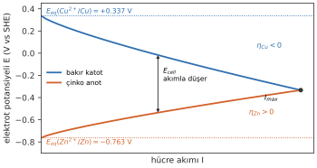
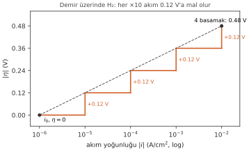
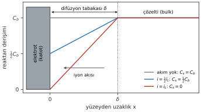
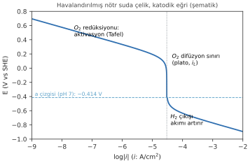

# Hafta 5 · Korozyon Kinetiği I: Polarizasyon

**Başlangıç sorusu:** Seyreltik hidroklorik asitteki bir çinko parçası yavaşça çözünür. Ona bir platin tel değdirdiğinde çinko çok daha hızlı çözünmeye başlar, hidrojen kabarcıkları da **platin** üzerinde çıkar. Asit aynı, çinko aynı, $\Delta G$ aynı. Platin neyi değiştirdi?

- Anodik (yükseltgenme): $Zn \rightarrow Zn^{2+} + 2e^-$ (çinko çözünür)
- Katodik (indirgenme): $2H^+ + 2e^- \rightarrow H_2\uparrow$ (hidrojen gazı çıkar)

Termodinamik (Hafta 3–4) korozyonun **olup olamayacağını** söyledi. Bu hafta **ne kadar hızlı** olacağını konuşuyoruz: kinetik.

## 1. Faraday'dan hıza: akım yoğunluğu = korozyon hızı

Hafta 2'de gördüğümüz Faraday yasasını alan ve zamana bölersek, birim alandaki reaksiyon hızı doğrudan akım yoğunluğuyla verilir:

$$r = \frac{m}{A\,t} = \frac{i\,M}{z\,F} \qquad \text{(mol cinsinden: } r = \frac{i}{zF}\text{)}$$

- $r$: birim alan ve zamanda çözünen kütle (g/cm²·s); $i$: akım yoğunluğu (A/cm²)

Yani bir elektrottaki akım yoğunluğunu bilmek, o elektrotta reaksiyonun ne kadar hızlı yürüdüğünü bilmek demektir. Korozyon hızı = **korozyon akım yoğunluğu** $i_{corr}$.

## 2. Polarizasyon ve aşırı gerilim (overpotential)

Akım akmadığında her elektrot kendi **denge (Nernst) potansiyelindedir**, $E_{eq}$. Net akım akmaya başlayınca elektrotların potansiyeli dengeden uzaklaşır:

$$\eta = E - E_{eq} \qquad \eta > 0:\ \text{anodik} \qquad \eta < 0:\ \text{katodik}$$

- $\eta$: **overpotential (aşırı gerilim)** (V)
- $E$: akım geçerken ölçülen elektrot potansiyeli (V)
- $E_{eq}$: akım geçmezken, gerçek derişimlerdeki Nernst potansiyeli (V)

**Polarization (polarizasyon):** net bir akımın neden olduğu elektrot potansiyeli değişimi. Aşırı gerilim bu değişimin büyüklüğüdür.

### Daniell hücresi üzerinden

1. **Akım sıfırken ($I = 0$):** Bakır katot $+0.337$ V'ta, çinko anot $-0.763$ V'ta dengededir; açık devre gerilimi ≈ 1.1 V.
2. **Akım akınca ($I > 0$):** Anot **yukarı** kayar ($\eta > 0$), katot **aşağı** kayar ($\eta < 0$). İki potansiyel birbirine yaklaşır, hücrenin net gerilimi akım arttıkça **düşer**.
3. **Maksimum akım (kısa devre):** Dış direnç sıfır olunca iki çizgi kesişir. Çekilebilecek en büyük akım budur. Korozyonda anot ile katot aynı metal üzerinde kısa devre olduğundan, bu kesişme noktası **serbest korozyon akımını** ($I_{corr}$) verir (Hafta 6).

> Polarizasyon ne kadar büyükse (çizgiler ne kadar dikse) çizgiler o kadar çabuk kesişir: **akım küçük, korozyon yavaş**. Polarizasyon küçükse (çizgiler yatıksa) kesişme çok büyük akımda olur: metal hızla çözünür.

## 3. Polarizasyonun üç nedeni

Bir elektrot üç farklı fiziksel nedenle polarize olur. Günlük hayattan üç resimle:

| | Activation (aktivasyon) | Concentration (derişim) | Ohmic (iR düşüşü) |
|---|---|---|---|
| Benzetme | Tırmanılacak bir tepe | Kapıdaki bir kuyruk | Uzun bir yol |
| Neden | Yük aktarım adımının kendisi yavaştır: bir **enerji bariyeri** | Reaksiyona giren tür ($O_2$, $H^+$) yüzeye yeterince hızlı **ulaşamaz** (difüzyon) | Elektrolitin (veya bir filmin) **direnci** vardır |
| Tanımlayan | **Tafel** denklemi | **Limiting current** (sınır akımı) $i_L$ | $iR = i\rho L$ |
| Ne zaman baskın | Genelde düşük akımlarda | Sudaki $O_2$ redüksiyonunda tipik | Toprakta, tatlı suda, kaplama altında büyük |

$$\eta_{total} = \eta_{act} + \eta_{conc} + i\rho L$$

Üçü **toplanır**; genelde biri **dar boğazdır** (bottleneck). Pilden akım çekerken veya metal paslanırken kaybedilen gerilimin bir kısmı elektronları bariyerin üstünden zıplatmaya, bir kısmı hammaddeyi yüzeye yetiştirmeye, bir kısmı da sıvının iç direncine gider.

::: ornek
**Örnek 5.1 · Aşırı gerilim ve işareti**

0.10 M $CuSO_4$'ten bakır kaplanırken bakır katot, ona çok yakın yerleştirilmiş doygun kalomel elektroda karşı −0.100 V okunuyor. İkinci bir hücrede 0.010 M $ZnSO_4$ içinde çözünen çinko anot SCE'ye karşı −0.950 V okunuyor. Aktiviteleri derişime eşit al, 25 °C.

**Verilenler:** Cu: $E = -0.100$ V (SCE), $[Cu^{2+}] = 0.10$ M; Zn: $E = -0.950$ V (SCE), $[Zn^{2+}] = 0.010$ M; $E^\circ(Cu^{2+}/Cu) = +0.337$ V, $E^\circ(Zn^{2+}/Zn) = -0.763$ V; SCE = +0.241 V (SHE)

**İstenen:** (a) bakırın $E_{eq}$'i, (b) bakırın aşırı gerilimi, anodik mi katodik mi? (c) çinkonun $E_{eq}$'i, (d) çinkonun aşırı gerilimi

**Çözüm:** Her iki elektrot için aynı üç adım: Nernst → SHE'ye çevir → çıkar.

(a) $E_{eq}(Cu) = 0.337 + 0.0296\log(0.10) = 0.337 - 0.030 = +0.307$ V

(b) Ölçülen değer SHE'de: $E = -0.100 + 0.241 = +0.141$ V
$$\eta_{Cu} = 0.141 - 0.307 = -0.166\ \text{V} \quad\Rightarrow\quad \textbf{katodik}\ (\text{biriktirme})$$

(c) $E_{eq}(Zn) = -0.763 + 0.0296\log(0.010) = -0.763 - 0.059 = -0.822$ V

(d) $E = -0.950 + 0.241 = -0.709$ V
$$\eta_{Zn} = -0.709 - (-0.822) = +0.113\ \text{V} \quad\Rightarrow\quad \textbf{anodik}\ (\text{çözünme})$$

**Dikkat edilecekler:** $\eta$'yı $E^\circ$'dan değil, gerçek derişimdeki $E_{eq}$'den ölç. SCE okumasını görür görmez **+0.241** ekleyip SHE'ye çevir, sonra çıkar. $\eta$ eksi → katot, artı → anot.
:::

## 4. Exchange current density (değişim akım yoğunluğu) $i_0$

Dengede bir elektrotta "hiçbir şey olmuyor" değildir. İleri ve geri reaksiyonlar **eşit hızda** yürür; net akım sıfırdır. Her iki yöndeki bu eşit akım yoğunluğuna **exchange current density** $i_0$ denir. Bir elektrot reaksiyonunun en önemli kinetik sayısıdır ve on mertebe kadar değişebilir.

Aynı reaksiyon ($2H^+ + 2e^- \rightarrow H_2$, asit, 25 °C), farklı metal yüzeylerinde:

| Metal | $i_0$ (A/cm²), yaklaşık | |
|---|---|---|
| Pt | $10^{-3}$ | çok hızlı |
| Pd | $\sim10^{-4}$ | |
| Ni | $\sim10^{-6}$ | |
| Fe | $10^{-6}$ | |
| Cu | $\sim10^{-7}$ | |
| Sn | $\sim10^{-8}$ | |
| Zn | $\sim10^{-10}$ | |
| Pb, Hg | $2\times10^{-12}$ | Pt'den **milyar kat** yavaş |

- $i_0$, reaksiyonun **hangi metal yüzeyinde** yürüdüğüne çok bağlıdır.
- **Yüksek $i_0$** → belirli bir akım için küçük $\eta$ yeter. **Düşük $i_0$** → büyük $\eta$ gerekir.

> **Başlangıç sorusunun cevabı:** Hidrojen çıkışı çinko üzerinde çok yavaş, platin üzerinde çok hızlıdır. Pt'nin $i_0$'ı devasa büyüktür; harika bir elektrokatalizördür. Çinkoya değdirilen platin, katodik reaksiyonun kendi yüzeyinde yürümesine izin verir: çinkodan çıkan elektronlar Pt'ye akar ve $H^+$ orada kolayca indirgenir. Platin termodinamiği ($\Delta G$) değiştirmedi, **katodik reaksiyonun hızını** artırdı. Böylece çinko da daha hızlı çözünür.

## 5. Tafel denklemi: merdiven olarak

Aktivasyon polarizasyonu, dengeden yeterince uzakta ($|\eta| \gtrsim 0.1$ V) **Tafel denklemi** ile verilir:

$$\eta = b\,\log\frac{|i|}{i_0} \qquad |\eta| = |b| \times (i_0\text{'dan } i\text{'ye kadar olan dekad sayısı})$$

- $b$: **Tafel slope (Tafel eğimi)**, V/dekad. Anodik reaksiyonda $b_a > 0$, katodik reaksiyonda $b_c < 0$.
- $i_0$: değişim akım yoğunluğu (A/cm²); $i$: çalışma akım yoğunluğu (A/cm²)

**Tek kuralla Tafel:** akımı **on kat** artırmanın bedeli hep aynı ek gerilimdir, $b$.

- $i_0$ merdivenin ilk basamağıdır; orada $\eta = 0$.
- $b$ bir basamağın yüksekliğidir (hidrojen çıkışı için yaklaşık 0.12 V).
- $i_0$'dan $i$'ye kadar dekadları say ve $b$ ile çarp. Demir üzerinde hidrojen, $10^{-6} \rightarrow 10^{-2}$ A/cm²: 4 basamak × 0.12 = **0.48 V**.
- Büyük $i_0$ (Pt): az basamak, küçük $\eta$. Küçük $i_0$ (Hg): çok basamak, büyük $\eta$.

**Arka plan (ders kitabından):** Tafel denklemi, hem anodik hem katodik yöndeki hızları içeren Butler–Volmer denkleminin yüksek aşırı gerilim limitidir. $|\eta|$ küçükken ters yöndeki reaksiyon ihmal edilemez ve eğri düz çizgiden sapar. Bu yüzden Tafel denklemi $|\eta| \approx 20$ mV gibi küçük değerlerde **kullanılmaz**.

::: ornek
**Örnek 5.2 · Aynı akım, üç farklı katot**

Asit içinde platin, demir ve cıva üzerinde 10 mA/cm² ($1.0\times10^{-2}$ A/cm²) katodik akım yoğunluğuyla hidrojen çıkıyor. Üçü için $b_c = -0.12$ V/dekad.

**Verilenler:** $|i| = 1.0\times10^{-2}$ A/cm²; $i_0$: Pt $10^{-3}$, Fe $10^{-6}$, Hg $2\times10^{-12}$ A/cm²

**İstenen:** (a) Pt, (b) Fe, (c) Hg için $\eta$; (d) $H_2$ üretimi için en iyi katot hangisi, $H_2$ çıkışı hangisinde en zor?

**Çözüm:** $i_0$ ile çalışma akımı arasındaki dekadları say; her dekad 0.12 V.

(a) Pt: $\eta = -0.12\log\dfrac{10^{-2}}{10^{-3}} = -0.12\times1 = -0.12$ V

(b) Fe: $\eta = -0.12\log\dfrac{10^{-2}}{10^{-6}} = -0.12\times4 = -0.48$ V

(c) Hg: $\eta = -0.12\log\dfrac{10^{-2}}{2\times10^{-12}} = -0.12\times9.70 = -1.16$ V

(d) En az ek gerilimi Pt ister: en iyi $H_2$ katodu (elektrolizörler). Hg üzerinde $H_2$ çıkışı 1 V'tan fazla aşırı gerilim ister; orada önce başka reaksiyonlar gerçekleşir.

**Yorum:** Aynı reaksiyon, aynı $E_{eq}$, ama on kata varan farklı aşırı gerilim.
:::

## 6. Derişim polarizasyonu

Aktivasyon, yüzeydeki adımla ilgiliydi. Şimdi reaksiyona girecek türün önce yüzeye **ulaşması** gerekiyor.

$$i = zFD\,\frac{C_b - C_s}{\delta} \qquad\qquad i_L = \frac{zFDC_b}{\delta}$$

- $D$: difüzyon katsayısı (cm²/s); $\delta$: difüzyon tabakası kalınlığı (cm)
- $C_b$, $C_s$: çözeltinin içindeki (bulk) ve yüzeydeki derişim (**mol/cm³**)
- $i_L$: **limiting current density (sınır akım yoğunluğu)** (A/cm²)

- Yüzeye yakın bölgede çözelti durgundur; iyonlar veya $O_2$ kalınlığı $\delta$ olan bir tabakadan **difüzyonla** gelir.
- Reaksiyon hızlandıkça $C_s$ düşer. $C_s = 0$ olunca akım daha fazla artamaz: **sınır akımı** $i_L$.
- $i_L$; **karıştırma** (daha ince $\delta$), daha yüksek **derişim** ve daha yüksek **sıcaklık** (daha büyük $D$) ile artar. Çözeltiyi karıştırırsan tabaka incelir ve bu akım tavanı yukarı çıkar.

### Derişim aşırı gerilimi

Nernst denkleminde $C_b$ yerine $C_s$ yazılarak ($C_s/C_b = 1 - i/i_L$) türetilir:

$$\eta_{conc} = \frac{2.303\,RT}{zF}\log\left(1 - \frac{i}{i_L}\right)$$

- Katotta $i/i_L < 1$ olduğundan log negatiftir: $\eta_{conc} < 0$.
- $i \ll i_L$ olduğu sürece neredeyse sıfırdır. $i \rightarrow i_L$ olurken parantezin içi sıfıra gider, $\log 0 \rightarrow -\infty$: eğri **dikleşir**. Daha fazla gerilim vermenin anlamı kalmaz, akım artmaz.
- Anodik çözünmede pek görülmez (metal iyonları her zaman yüzeyden ayrılabilir); **katodik $O_2$ ve $H^+$ redüksiyonunda** sık görülür.

## 7. Tam polarizasyon eğrisi

Üç katkıyı birleştirince her korozyon laboratuvarında ölçülen eğri ortaya çıkar. Örnek: havalandırılmış nötr sudaki çeliğin katodik eğrisi.

- **Üst kısım:** $O_2$ redüksiyonu, aktivasyon kontrolünde (Tafel doğrusu).
- **Orta kısım:** $O_2$ daha hızlı gelemez → **$i_L$'de plato** (birkaç on µA/cm² mertebesinde).
- **Alt kısım:** a çizgisinin altına (pH 7'de −0.41 V) inince **$H_2$ çıkışı** başlar ve akım tekrar artar. Oksijen "bitince" sistem daha negatif potansiyellere iner ve sudaki $H^+$ indirgenmeye başlar.

## 8. Sık yapılan hatalar

| Hata | Doğrusu |
|---|---|
| $\eta$'yı $E^\circ$'dan ölçmek | $\eta = E - E_{eq}$: gerçek derişimdeki Nernst potansiyelini kullan |
| Katot için pozitif $\eta$ | Katot: **$\eta < 0$**; anot: $\eta > 0$ |
| "Dengede hiçbir şey olmaz" | İki yön de $i_0$ hızında yürür; sadece net akım sıfırdır |
| Tafel'i $|\eta| = 20$ mV'ta kullanmak | Tafel yalnızca $|\eta| \gtrsim 0.1$ V için; dengeye yakın eğri düz çizgiden sapar |
| $i_L = zFDC_b/\delta$'da $C_b$'yi mol/L koymak | $D$ cm²/s ve $\delta$ cm iken $C_b$ **mol/cm³** olmalı |
| IR düşüşünü elektrot polarizasyonu saymak | O **elektrolite** aittir; referansı yaklaştır (Luggin kapiler) veya düzelt |

## Formül özeti

| Formül | Anlamı |
|---|---|
| $r = \dfrac{iM}{zF}$ | Akım yoğunluğundan kütle hızı |
| $\eta = E - E_{eq}$ | Aşırı gerilim |
| $\eta = b\log(|i|/i_0)$ | Tafel denklemi |
| $i_L = zFDC_b/\delta$ | Sınır akım yoğunluğu |
| $\eta_{conc} = \frac{2.303RT}{zF}\log(1 - i/i_L)$ | Derişim aşırı gerilimi |
| $\eta_{total} = \eta_{act} + \eta_{conc} + i\rho L$ | Toplam polarizasyon |

::: sinav
## Sınavda çıkabilir

- Ölçülen potansiyelden aşırı gerilim hesabı (Örnek 5.1): Nernst → SHE'ye çevir → çıkar → işaretten anot/katot.
- Tafel ile aşırı gerilim: dekad sayısı × $b$ (Örnek 5.2); hangi metal iyi $H_2$ katodu?
- "Overpotential, polarization, ohmic drop nedir?" türü tanım soruları; üç polarizasyon tipini karşılaştırma.
- $i_L$ formülü ve karıştırma/sıcaklık/derişimin etkisi (birim tuzağı: mol/cm³).
- Çinkoya platin değdirme sorusu: $i_0$ ve katalizör kavramıyla açıklama.
:::
