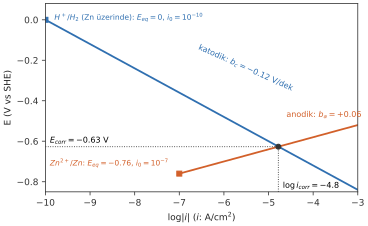
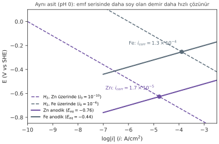
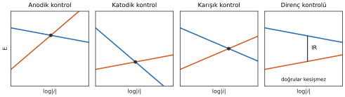
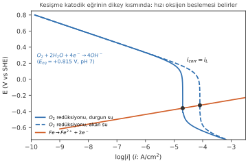
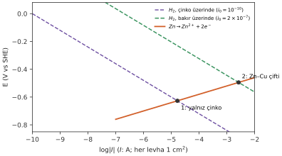
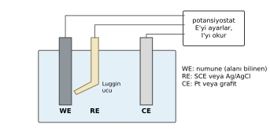
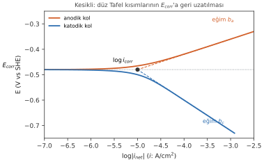

# Hafta 6 · Korozyon Kinetiği II: Karışık Potansiyel ve Evans Diyagramları

Hafta 5'te elektrotlara tek tek baktık. Bu hafta korozyona uğrayan **tek bir yüzeyde** bir anot ve bir katodu birlikte inceliyoruz. Yol haritası:

> İki reaksiyon → $E_{corr}$ ve $i_{corr}$ → Evans diyagramı → asitte çinko ve demir → hızı kim kontrol ediyor? → oksijen difüzyonu → galvanik çift ve alan → $i_{corr}$'u ölçmek → $i_{corr}$'dan mm/yıl'a

**Başlangıç sorusu:** Emf serisine göre demir çinkodan daha soydur (−0.44 V'a karşı −0.76 V; aradaki fark 0.32 V). İkisini de aynı oksijensiz aside koyarsan hangisi **daha hızlı** çözünür? Cevabını şimdi tahmin et; bu bölümde iki hızı da hesaplayacağız.

## 1. Karışık potansiyel teorisi (mixed-potential theory)

Korozyona uğrayan bir metal tek bir reaksiyon değil, **aynı yüzeyde aynı anda** yürüyen iki reaksiyondur:

- Anodik: $Zn \rightarrow Zn^{2+} + 2e^-$
- Katodik: $2H^+ + 2e^- \rightarrow H_2$

Elektronlar metalin içinden anodik bölgelerden katodik bölgelere akar. Metalde yük birikemez, o yüzden:

$$\sum I_a = \sum |I_c| \qquad E_{corr}\text{'da:}\quad i_a = |i_c| = i_{corr}$$

- **Toplam anodik akım = toplam katodik akım** (Wagner ve Traud, 1938). Ne kadar yükseltgenme varsa o kadar indirgenme vardır.
- Metal, ikisinin eşit olduğu **tek bir potansiyele** oturur: **corrosion potential (korozyon potansiyeli)** $E_{corr}$; bu noktadaki akım yoğunluğu **corrosion current density** $i_{corr}$'dur.
- $E_{corr}$ iki denge potansiyelinin **arasındadır**. $i_{corr}$ çözünme hızıdır (Faraday).

> Korozyon olabilmesi için her anodik reaksiyona karşılık bir katodik reaksiyonun olması şarttır.

## 2. Evans diyagramı

Aynı iki eğriyi $\log|i|$'ye karşı çizersek iki düz Tafel doğrusu elde ederiz: **Evans diagram**.

$$\text{anodik: } E = E_{eq,a} + b_a\log\frac{i}{i_{0,a}} \qquad \text{katodik: } E = E_{eq,c} + b_c\log\frac{|i|}{i_{0,c}}$$

- $E_{eq,a}$, $E_{eq,c}$: anodik ve katodik reaksiyonun o koşullardaki Nernst potansiyelleri (V)
- $i_{0,a}$, $i_{0,c}$: değişim akım yoğunlukları (A/cm²); $b_a > 0$, $b_c < 0$: Tafel eğimleri (V/dekad)

- Eksenler: düşeyde $E$, yatayda $\log|i|$. Her reaksiyon bir Tafel doğrusudur.
- Her doğru **kendi noktasından** başlar: $(\log i_0,\ E_{eq})$.
- Anodik doğru $b_a$ eğimiyle **yukarı**, katodik doğru $b_c$ eğimiyle **aşağı** gider.
- **Kesişme noktası** doğrudan $E_{corr}$ ve $\log i_{corr}$'u verir.

### $E_{corr}$'dan $i_{corr}$'a

$E_{corr}$'da katodik akım korozyon akımına eşittir. Katodik reaksiyonun Tafel denklemini $i_{corr}$ için çözelim:

1. Tafel: $\eta_c = b_c\log\dfrac{|i_c|}{i_0}$, burada $\eta_c = E_{corr} - E_{eq,c}$
2. $b_c$'ye böl: $\dfrac{\eta_c}{b_c} = \log|i_c| - \log i_0$
3. $E_{corr}$'da $|i_c| = i_{corr}$: $\log i_{corr} = \log i_0 + \dfrac{\eta_c}{b_c}$
4. Antilog: $$\boxed{i_{corr} = i_0\times10^{\eta_c/b_c}}$$

$\eta_c/b_c$, $i_0$'ın üzerine çıkılan **dekad (basamak) sayısıdır**. İki eksi işareti birbirini götürür, sonuç pozitif çıkar.

::: ornek
**Örnek 6.1 · $E_{corr}$'dan $i_{corr}$'a: çinko ve demir**

Çinko ve demir aynı oksijensiz hidroklorik asitte (pH 0, 25 °C) korozyona uğruyor. Tek katodik reaksiyon iki metalde de Tafel'e uyan hidrojen çıkışı. Ölçülen korozyon potansiyelleri: $E_{corr}(Zn) = -0.627$ V, $E_{corr}(Fe) = -0.253$ V (SHE).

**Verilenler:** $H_2$ çizgisi: $E_{eq} = -0.0592\,\text{pH} = 0.00$ V, $b_c = -0.12$ V/dekad; $i_0(H_2\text{, Zn üzerinde}) = 10^{-10}$ A/cm²; $i_0(H_2\text{, Fe üzerinde}) = 10^{-6}$ A/cm²

**İstenen:** (a) her metalde katodik aşırı gerilim $\eta_c$, (b) çinkonun $i_{corr}$'u, (c) demirin $i_{corr}$'u, (d) hangisi kaç kat hızlı çözünür?

**Çözüm:**

(a) $\eta_c = E_{corr} - E_{eq}(H_2)$:
Zn: $-0.627 - 0 = -0.627$ V; Fe: $-0.253 - 0 = -0.253$ V

(b) Zn: $\dfrac{\eta_c}{b_c} = \dfrac{-0.627}{-0.12} = 5.23$ dekad
$$i_{corr} = 10^{-10}\times10^{5.23} = 1.7\times10^{-5}\ \text{A/cm}^2$$

(c) Fe: $\dfrac{-0.253}{-0.12} = 2.11$ dekad
$$i_{corr} = 10^{-6}\times10^{2.11} = 1.3\times10^{-4}\ \text{A/cm}^2$$

(d) $\dfrac{i_{corr}(Fe)}{i_{corr}(Zn)} = \dfrac{1.3\times10^{-4}}{1.7\times10^{-5}} \approx 8$ → **demir yaklaşık 8 kat daha hızlı çözünür.**
:::

## 3. "Daha soy" demek "daha yavaş" demek değildir

- Çinkonun itici kuvveti daha büyüktür: anodik doğrusu **daha aşağıdan** (−0.76 V) başlar.
- Ama hidrojen çıkışı çinko üzerinde **çok yavaştır** ($i_0 = 10^{-10}$), demir üzerinde hızlıdır ($10^{-6}$). Demirin katodik doğrusu **dört dekad sağdadır**.
- Bu yüzden demirin doğruları daha büyük bir akımda kesişir: $i_{corr}(Fe) \approx 8\times i_{corr}(Zn)$.
- Emf serisi bir metalin korozyona **uğrayıp uğrayamayacağını** söyler; hız **iki reaksiyonun kinetiğine** bağlıdır.

> **Başlangıç sorusunun cevabı:** Emf serisinde çinko daha aktif olmasına rağmen, aynı oksijensiz asitte demir çinkodan daha hızlı çözünür.

## 4. Hızı kim kontrol ediyor?

İki reaksiyondan hangisi daha çok polarize oluyorsa (doğrusu daha dikse) hızı o belirler; dar boğaz odur.

| Kontrol tipi | Ne olur? | $E_{corr}$ nerede? | Örnek |
|---|---|---|---|
| **Anodic control** | Anodik doğru dik (çok polarize) | Katodik $E_{eq}$'e yakın | Pasifleşen metaller |
| **Cathodic control** | Katodik doğru dik | Anodik $E_{eq}$'e yakın | Asitte çinko, doğal suda demir |
| **Mixed control** | İkisi benzer ölçüde polarize | Ortalarda | |
| **Resistance control** | Elektrolit (veya gözenekli kaplama) o kadar dirençli ki doğrular hiç kesişmez | IR düşüşü akımı sınırlar | Çok saf su, kuru toprak, kaplama altı |

## 5. Oksijen difüzyon kontrolü: hızı metal değil su belirler

Nötr suda katodik reaksiyon oksijen redüksiyonudur ve oksijenin yüzeye difüzyonla gelişi sınırlıdır (Hafta 5).

$$i_{corr} = i_L = \frac{zFDC_b}{\delta} \qquad (O_2\text{ için } z = 4)$$

- Katodik reaksiyon $O_2 + 2H_2O + 4e^- \rightarrow 4OH^-$ (pH 7'de $E_{eq} = +0.815$ V). Eğrisi sınır akımında **dikleşir**.
- Çeliğin anodik doğrusu katodik eğriyi onun **dikey kısmında** keser: $i_{corr} = i_L$.
- Hız neredeyse çeliğe değil, **oksijen beslemesine** (O₂ miktarı, akış, sıcaklık) bağlıdır.
- Daha hızlı akış → daha ince $\delta$ → daha büyük $i_L$ → daha hızlı korozyon.
- Bu yüzden havalandırılmış suda "daha iyi bir karbon çeliği" korozyonu pek azaltmaz.

## 6. Evans diyagramında galvanik çift

İki farklı metali birleştirelim; Evans diyagramı galvanik korozyonu (Hafta 3) sayısal olarak açıklar.

- Çinko ve bakır asit içinde temas ediyor: **tek metal, tek potansiyel** (çift potansiyeli).
- Çinko çözünür: $Zn \rightarrow Zn^{2+} + 2e^-$. Hidrojen ise çoğunlukla **bakır** üzerinde çıkar: $2H^+ + 2e^- \rightarrow H_2$, çünkü bakırda $i_0 \approx 2\times10^{-7}$ A/cm², çinkoda yalnızca $10^{-10}$.
- İki reaksiyon farklı alanlarda yürüdüğü için akım **yoğunluğu** değil **akım** $I = i\cdot A$ kullanılır.
- Çift noktası (2), yalnız çinkonun noktasından (1) çok daha büyük bir akımdadır: çinko daha hızlı korozyona uğrar, bakır korunur.

Başlangıçtaki çinko–platin sorusu (Hafta 5) da tamamen aynı resimdir: platin, $i_0$'ı çok büyük bir katot ekler.

### Alan oranı

$$A_a\,i_a = A_c\,|i_c| \qquad (\text{toplam anodik akım = toplam katodik akım})$$

- Katot alanı 10 kat artarsa katodik doğru **bir dekad sağa** kayar.
- Çift noktası yukarı ve sağa kayar; anot daha hızlı çözünür (slayttaki örnekte 4.6 kat).
- **Kural:** küçük anot + büyük katottan kaçın. Bakır levhada çelik perçin (küçük anot, büyük katot) çok kötüdür; çelik levhada bakır perçin kabul edilebilir.

## 7. Ne ölçülebilir? Potansiyostat ve üç elektrotlu hücre

$E_{corr}$'da anodik ve katodik akımlar **eşit ve zıttır**; net akım **sıfırdır**. Serbestçe korozyona uğrayan bir metale ampermetre bağlarsan hiçbir şey okumazsın, oysa metal $i_{corr}$ hızında çözünmektedir.

**Potansiyostat** potansiyeli $E_{corr}$'dan uzaklaştırır ve **net akımı** ölçer. $E_{corr}$'dan uzaklaştıkça net eğri Tafel doğrularına yaklaşır; $i_{corr}$ böyle ölçülür.

- **Working electrode (WE, çalışma elektrodu):** alanı bilinen numune.
- **Reference electrode (RE):** $E$'yi ölçer (SCE veya Ag/AgCl). **Luggin** ucu, IR düşüşünü küçük tutmak için WE'ye yakın konur.
- **Counter electrode (CE, karşı elektrot):** Pt veya grafit; akımı taşır.
- **Potansiyostat** WE ile RE arasındaki $E$'yi ayarlar, WE ile CE arasındaki akımı okur. Yavaş bir tarama $E$'ye karşı $\log|i|$ eğrisini verir.

### Tafel ekstrapolasyonu

$$E - E_{corr} = b_a\log\frac{i}{i_{corr}} \qquad E - E_{corr} = b_c\log\frac{|i|}{i_{corr}}$$

($E - E_{corr}$ burada $E_{corr}$'a göre polarizasyondur.)

1. Eğriyi $E_{corr}$ çevresinde yaklaşık ±0.25 V aralığında ölç.
2. Eğrinin **Tafel kısımlarından** (en az 50–100 mV uzakta) düz doğrular geçir.
3. Bunları **$E_{corr}$'a kadar geri uzat**: $\log i_{corr}$'da buluşurlar.
4. Eğimler aynı anda $b_a$ ve $b_c$'yi verir.

## 8. Korozyon hızı birimleri

| Birim | Anlamı | Çelik için 1 mm/y ($\rho = 7.86$ g/cm³) |
|---|---|---|
| mm/y | yılda kaybedilen kalınlık (mm), SI | 1 mm/y |
| mpy | mils per year; 1 mil = 0.001 inch = 0.0254 mm | 39.4 mpy |
| g m⁻² d⁻¹ | metrekare başına günde kaybedilen gram | 21.5 g m⁻² d⁻¹ |
| mdd | desimetrekare başına günde miligram | 215 mdd |

**Penetrasyon birimleri** (mm/y, mpy) duvarın ne kadar hızlı inceldiğini doğrudan söyler; kütle kaybını kalınlığa çevirmek için yoğunluğa bölmek gerekir. Bu yüzden mühendislikte tercih edilirler.

### Ne kadar hızlı "çok hızlı"? (Fontana skalası, çelikler ve nikel alaşımları için)

| Bağıl direnç | mpy | mm/y | Yorum |
|---|---|---|---|
| Outstanding | < 1 | < 0.025 | |
| Excellent | 1–5 | 0.025–0.13 | Kritik parçalar için uygun |
| Good | 5–20 | 0.13–0.5 | Korozyon payıyla kabul edilebilir |
| Fair | 20–50 | 0.5–1.3 | Sadece ucuz/kolay değiştirilen parçalar |
| Poor | 50–200 | 1.3–5 | |
| Unacceptable | > 200 | > 5 | |

### Mühendislik birimlerinde Faraday

1. Faraday: $m = \dfrac{MIt}{zF}$
2. Alana böl ($I/A = i$): $\dfrac{m}{At} = \dfrac{iM}{zF}$
3. Kütleden kalınlığa ($m = \rho A d$, $d$ = kaybedilen kalınlık): $\dfrac{d}{t} = \dfrac{iM}{zF\rho}$
4. Birimleri yerleştir:

$$\boxed{CR\ (\text{mm/y}) = 3.27\times10^{-3}\,\frac{i_{corr}(\mu\text{A/cm}^2)\,M}{z\,\rho}} \qquad \frac{\Delta m}{At} = \frac{i_{corr}M}{zF}$$

- $i_{corr}$: **µA/cm²**; $M$: g/mol; $z$: atom başına elektron; $\rho$: g/cm³
- $3.27\times10^{-3} = \dfrac{10\ \text{mm/cm}\times3.15\times10^7\ \text{s/y}\times10^{-6}\ \text{A}/\mu\text{A}}{96\,485\ \text{C/mol}}$ (F sabitin içindedir)
- Demir için ($M = 55.85$, $z = 2$, $\rho = 7.86$): **1 µA/cm² = 0.0116 mm/y = 0.46 mpy**
- İkinci formül birim alan ve zamandaki kütle kaybını verir (yoğunluk girmez).

::: ornek
**Örnek 6.2 · $i_{corr}$'dan mm/y'ye**

Karbon çeliği için iki korozyon akımı bulundu: havalandırılmış durgun deniz suyunda 19 µA/cm², oksijensiz asitte 5.0 µA/cm².

**Verilenler:** Fe: $M = 55.85$ g/mol, $z = 2$, $\rho = 7.86$ g/cm³; 1 m² = 10⁴ cm²; 1 gün = 86 400 s

**İstenen:** (a) 19 µA/cm² için CR (mm/y ve mpy), (b) 19 µA/cm² için kütle kaybı (g m⁻² d⁻¹)

**Çözüm:**

(a)
$$CR = 3.27\times10^{-3}\times\frac{19\times55.85}{2\times7.86} = 0.22\ \text{mm/y}$$
$0.22\times39.4 = 8.7$ mpy

(b) Yoğunluk girmez, $M$ kalır:
$$\frac{\Delta m}{At} = \frac{19\times10^{-6}\times55.85}{2\times96\,485}\times10^4\times86\,400 = 4.8\ \text{g m}^{-2}\text{d}^{-1}$$

**Yorum:** Fontana skalasında 8.7 mpy "good" sınıfına girer. Korumasız çelik deniz suyunda 10 yılda yaklaşık 2 mm kaybeder. Asitteki 5.0 µA/cm² ise $5.0\times0.0116 = 0.058$ mm/y (≈ 2.3 mpy) eder.
:::

## 9. Sık yapılan hatalar

| Hata | Doğrusu |
|---|---|
| "$E_{corr}$ metalin Nernst potansiyelidir" | $E_{corr}$ **karışık** bir potansiyeldir; iki $E_{eq}$ arasındadır ve kinetikten gelir |
| "Daha az soy metal her zaman daha hızlı korozyona uğrar" | Hız **iki reaksiyonun kinetiğine** bağlıdır (Örnek 6.1) |
| $b_c$'yi artı işaretle kullanmak | Katodik Tafel eğimi **negatiftir** |
| Farklı alanlardaki akım yoğunluklarını toplamak | Galvanik çiftte **akım** $I = i\cdot A$ kullan |
| "Havalandırılmış suda daha iyi çelik → daha az korozyon" | O₂ difüzyon kontrolünde $i_{corr} = i_L$: hızı **su** belirler |
| "$E_{corr}$'da akım sıfır, yani hiçbir şey olmuyor" | Yalnızca **net** akım sıfır; metal $i_{corr}$ hızında çözünür |
| Tafel doğrusunu $E_{corr}$'a yakın noktalardan geçirmek | Yalnızca düz kısımlar ($E_{corr}$'dan ≥ 50–100 mV uzakta) |

## Formül özeti

| Formül | Anlamı |
|---|---|
| $\sum I_a = \sum|I_c|$; $E_{corr}$'da $i_a = |i_c| = i_{corr}$ | Karışık potansiyel teorisi |
| $E = E_{eq} + b\log(|i|/i_0)$ | Evans diyagramındaki Tafel doğruları |
| $i_{corr} = i_0\times10^{\eta_c/b_c}$ | $E_{corr}$'dan $i_{corr}$ |
| $i_{corr} = i_L = zFDC_b/\delta$ | Oksijen difüzyon kontrolü |
| $A_a i_a = A_c|i_c|$ | Alan oranı |
| $CR = 3.27\times10^{-3}\,\dfrac{i_{corr}M}{z\rho}$ | mm/y ($i$: µA/cm²) |
| $\dfrac{\Delta m}{At} = \dfrac{i_{corr}M}{zF}$ | Kütle kaybı hızı |

::: sinav
## Sınavda çıkabilir

- $E_{corr}$ verilip $i_{corr}$ isteme (Örnek 6.1): $\eta_c$ → dekad sayısı → $i_{corr} = i_0\times10^{\eta_c/b_c}$.
- "Emf serisinde daha aktif olan çinko neden demirden yavaş çözünür?" Evans diyagramıyla açıklama.
- Kontrol tipleri (anodik/katodik/karışık/direnç) ve oksijen difüzyon kontrolünde akışın etkisi.
- $i_{corr}$'u mm/y, mpy ve g m⁻² d⁻¹'e çevirme; Fontana skalasıyla yorumlama.
- Galvanik çift ve alan oranı; neden ampermetreyle $i_{corr}$ ölçülemez, potansiyostat ve Tafel ekstrapolasyonu nasıl çalışır.
:::
