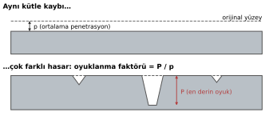
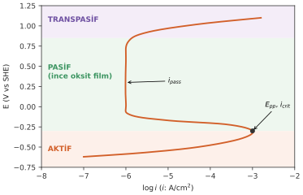
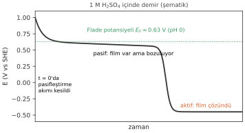
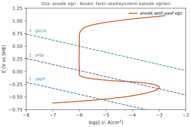
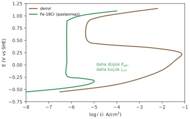
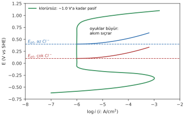

# Hafta 7 · Korozyon Hızları ve Pasiflik

Bu bölüm iki kısımdan oluşuyor:

1. **Korozyon hızını ölçmek ve yorumlamak:** kütle kaybı testi, oyuklanma faktörü, servis ömrü
2. **Pasiflik:** aktif–pasif eğri, Flade potansiyeli, kendiliğinden pasifleşme, klorür

**Başlangıç sorusu 1:** Çelik bir borunun et kalınlığı 8 mm; en az 5 mm gerekiyor. Muayene ortalama 0.12 mm/y korozyon hızı veriyor. Boru daha kaç yıl dayanır?

**Başlangıç sorusu 2:** Demir seyreltik nitrik asitte şiddetle çözünür. Çok daha güçlü bir oksitleyici olan derişik nitrik asitte ise neredeyse hiç reaksiyona girmez. Normalde daha güçlü oksitleyici daha büyük katodik akım ve daha hızlı korozyon demektir. Burada farklı olan ne?

## Semboller

| Sembol | Adı | Anlamı |
|---|---|---|
| $E_{corr}$ | corrosion potential | Serbestçe korozyona uğrayan metalin potansiyeli (Hafta 6) |
| $i_{corr}$ | corrosion current density | Akım yoğunluğu olarak korozyon hızı (Hafta 6) |
| $E_{pp}$ | primary passivation potential (birincil pasifleşme potansiyeli) | Anodik akım maksimuma ulaşır; film oluşmaya başlar |
| $i_{crit}$ | critical current density (kritik akım yoğunluğu) | $E_{pp}$'deki maksimum anodik akım; pasifleşmek için aşılmalı |
| $i_{pass}$ | passive current density (pasif akım yoğunluğu) | Pasif bölgedeki küçük, neredeyse sabit akım: pasif hız |
| $E_F$ | Flade potential | Altında pasif film bozulur; demir için $E_F = 0.63 - 0.059\,\text{pH}$ |
| $E_{tp}$ | transpassive potential | Üstünde film çözünür veya $O_2$ çıkar; akım tekrar artar |
| $E_{pit}$ | pitting potential (oyuklanma potansiyeli) | Üstünde klorür filmi yerel olarak kırar; oyuklar büyür |
| $i_L$ | limiting current density | Difüzyon kontrollü katodik reaksiyonun maksimum hızı (Hafta 5) |
| $P/p$ | pitting factor (oyuklanma faktörü) | En derin oyuk / ortalama penetrasyon; düzgün korozyonda 1 |

## Kısım 1 · Korozyon hızını ölçmek

### 1. Kütle kaybı testi (ASTM G1, G31)

En eski ve en doğrudan yöntem: numuneyi önce ve sonra tart.

1. **Hazırla ve ölç:** alan $A$ (cm²), yoğunluk $D$
2. **Temizle ve tart:** ilk kütle $W_0$ (±0.1 mg)
3. **Maruz bırak:** test çözeltisine bilinen bir süre $T$ boyunca daldır
4. **Ürünleri temizle:** kimyasal temizleme (ASTM G1)
5. **Tekrar tart:** kütle kaybı $W = W_0 - W_1$
6. **Hesapla:** tek bir sayı, ortalama hız

Basit ve güvenilirdir; diğer bütün yöntemler bununla karşılaştırılarak doğrulanır. **Sınırlaması:** tüm maruziyet süresi için tek bir ortalama hız verir. Aynı şekilde temizlenen **boş (blank) kuponlar**, temizleme sırasında sökülen metali düzeltmek için kullanılır.

### ASTM G31 formülü

Tek bir formül kütle kaybını her birime çevirir; yalnızca $K$ sabiti değişir:

$$CR = \frac{K\,W}{A\,T\,D}$$

- $W$: kütle kaybı (g); $A$: maruz kalan alan (cm²); $T$: süre (**saat**); $D$: yoğunluk (g/cm³)

| İstenen birim | $K$ |
|---|---|
| mm/y | $8.76\times10^4$ (= 10 mm/cm × 8760 h/y) |
| mpy | $3.45\times10^6$ |
| mdd (mg dm⁻² gün⁻¹) | $2.40\times10^6\times D$ |

Formül **düzgün (uniform)** korozyon ve iç saldırı olmadığını (oyuklanma, taneler arası korozyon yok) varsayar. Oyuk bulunursa ortalama hız, oyuk derinliği **ile birlikte** raporlanır.

::: ornek
**Örnek 7.1 · Kütle kaybı kuponu**

Hafta 6'daki karbon çeliğinden (Tafel ekstrapolasyonu: 5.0 µA/cm²) yapılmış 5.0 cm × 2.5 cm × 0.30 cm boyutlarında bir kupon, aynı oksijensiz asitte 30 gün (720 h) bekletiliyor. Temizlendikten sonra 0.118 g kaybettiği görülüyor. Korozyon düzgün.

**Verilenler:** kupon 5.0 × 2.5 × 0.30 cm (tüm yüzler açık); $W = 0.1180$ g; $T = 720$ h; $D = 7.86$ g/cm³; Fe için 1 µA/cm² = 0.0116 mm/y

**İstenen:** (a) maruz alan, (b) CR (mm/y ve mpy), (c) mdd cinsinden hız, (d) eşdeğer $i_{corr}$; Hafta 6 ile karşılaştır

**Çözüm:**

(a) Altı yüzün alanı:
$$A = 2(5.0\times2.5 + 5.0\times0.30 + 2.5\times0.30) = 2(12.5 + 1.5 + 0.75) = 29.5\ \text{cm}^2$$

(b)
$$CR = \frac{8.76\times10^4\times0.1180}{29.5\times720\times7.86} = 0.062\ \text{mm/y}$$
mpy için $K = 3.45\times10^6$: $CR = 2.4$ mpy

(c) $K = 2.40\times10^6 D$ olduğundan $D$ sadeleşir:
$$CR = \frac{2.40\times10^6\times0.1180}{29.5\times720} = 13\ \text{mdd}$$

(d) $i_{corr} = \dfrac{0.062}{0.0116} = 5.3\ \mu\text{A/cm}^2$

**Yorum:** 2.4 mpy Fontana skalasında "excellent". Kütle kaybından bulunan 5.3 µA/cm², elektrokimyasal ölçümle (5.0 µA/cm²) **uyumlu**: iki yöntem birbirini doğruluyor.
:::

### 2. Hızı değerlendirmek: ortalama değil, en derin nokta

Aynı kütle kaybı çok farklı hasarlar anlamına gelebilir.

$$\text{pitting factor} = \frac{P}{p} \qquad \text{ömür} = \frac{t_{wall} - t_{min}}{CR}$$

- $p$: ortalama penetrasyon (kütle kaybından); $P$: en derin oyuğun derinliği
- $t_{wall}$: et kalınlığı; $t_{min}$: izin verilen minimum kalınlık; $t_{wall} - t_{min}$: **corrosion allowance (korozyon payı)**
- Oyuklanma faktörü düzgün korozyonda 1, oyuklanmada 5–20 veya daha fazladır.
- Bir duvar **en ince** noktasından deliner: ömür için $p$ değil $P$ kullanılır.

> **Ömür = korozyon payı / en derin saldırının hızı.**

::: ornek
**Örnek 7.2 · Boru ne kadar dayanır? (Başlangıç sorusu 1)**

Borunun et kalınlığı 8 mm, en az 5 mm gerekli. Kütle kaybı kuponları ortalama 0.12 mm/y veriyor. Kesilen bir boru parçası oyuklanma faktörünün 4 olduğunu gösteriyor.

**Verilenler:** $t_{wall} = 8$ mm, $t_{min} = 5$ mm, ortalama hız 0.12 mm/y, $P/p = 4$

**İstenen:** (a) korozyon payı, (b) korozyon düzgün olsaydı ömür, (c) oyuklanma faktörüyle ömür, (d) mühendis ne raporlamalı?

**Çözüm:**

(a) Korozyon payı $= 8 - 5 = 3$ mm

(b) Düzgün: $3/0.12 = 25$ yıl

(c) En derin oyuğun hızı $= 4\times0.12 = 0.48$ mm/y → $3/0.48 = 6.3$ yıl

(d) 25 değil, **yaklaşık 6 yıl** raporlanmalı. En derin oyuklar düzenli muayene edilmeli ya da boru korunmalı (kaplama, katodik koruma…). Oyuklanma ömrü dört kat kısalttı.
:::

## Kısım 2 · Pasiflik

### 3. Pasiflik nedir?

| Tanım 1 | Tanım 2 | Pasif film |
|---|---|---|
| Belirgin **anodik polarizasyon** sayesinde korozyona direnç. | Reaksiyona girme yönünde **büyük termodinamik eğilime rağmen** korozyona direnç. | Çok ince: yaklaşık 1–10 nm; koşullar uygunsa kendini onarır. |
| Örnekler: Cr, Ni, Ti, Mo, **paslanmaz çelikler**, Monel. | Örnekler: $H_2SO_4$ içinde Pb, suda Mg, inhibitörlü dekapaj asidinde demir. Genelde daha kalın bir ürün tabakası. | Korozyon çok küçük bir $i_{pass}$ ile sürer. İki teori: **oksit film** (difüzyon bariyeri) veya **adsorbe oksijen tabakası**. |

> Pasif bir metal emf serisinde aktiftir, yine de çok düşük hızda korozyona uğrar. **Pasif ≠ bağışık:** pasif bölgede arka planda (çok yavaş) korozyon sürer; bağışık bölgede metal kararlıdır, korozyon yoktur.

### Her film pasif film değildir

Her metal bir miktar film büyütür. Hangisi gerçekten korur?

| Koruyucu bir film… | Koruyucu olmayan film |
|---|---|
| **İnce ve süreklidir:** gözenek, çatlak yok | **Çelikteki pas:** kalın, gözenekli, çatlar ve pul pul dökülür |
| **Yapışkandır:** metalin üzerinde kalır | Su ve $O_2$ metale ulaşır; korozyon pasın **altında** sürer |
| **Bariyerdir:** iyonlar ve elektronlar içinden zor geçer | **Kalın ≠ koruyucu** |
| Ortamda **çözünmez** ve **kendini onarır** | |

Koruyucu örnekler: $Cr_2O_3$ (paslanmaz), $Al_2O_3$, $TiO_2$, NiO. Koruyucu olmayan: karbon çeliğindeki pas (FeOOH, $Fe_2O_3\cdot nH_2O$). Kararı yalnızca $\Delta G$ değil, filmin **yapısı** verir.

### $Al_2O_3$ neden korur, $Cu_2O$ neden korumaz?

| $Al_2O_3$ (alüminyum üzerinde) | $Cu_2O$ (bakır üzerinde) |
|---|---|
| Havada **milisaniyeler** içinde oluşur, yalnızca **birkaç nm** kalınlığında | **Kusurlu** bir oksit: $Cu^+$ iyonları içinden geçebilir |
| **Yoğun, yapışkan**, elektriksel yalıtkan: iyonlar zor hareket eder | **Büyümeye** devam eder, daha az yapışkandır; gerçek bir bariyer değildir |
| pH ≈ 4–9'da çözünmez; çizilince yeniden oluşur | Belirgin bir aktif–pasif döngüsü, $i_{crit}$ yok |
| $E^\circ = -1.66$ V olmasına rağmen onlarca yıl dayanır: **gerçek pasiflik** | Bakır **soy** olduğu için ($E^\circ = +0.34$ V) dayanır; patina yalnızca **yavaşlatır** (Tanım 2) |

> Pourbaix diyagramında kararlı oksit ≠ koruyucu oksit. Sorulacak soru: **iyonlar filmin içinden geçebiliyor mu?** Alüminyumu filmi, bakırı soyluğu korur; aynı "dayanıklı" kelimesi iki farklı nedeni anlatır.

### 4. Aktif–pasif eğri

Pasifleşebilen bir metalin anodik polarizasyon eğrisi Hafta 6'dakinden çok farklı görünür: önce yukarı, sonra geri, sonra neredeyse dikey.

1. **Aktif bölge:** metal çözünür; potansiyel arttıkça akım da artar (Hafta 5–6'daki gibi).
2. **$E_{pp}$'de** akım maksimuma ulaşır: **kritik akım yoğunluğu $i_{crit}$**.
3. $E_{pp}$'nin üstünde film oluşur ve akım mertebelerce **düşer**, $i_{pass}$'a kadar geri gelir. Potansiyel artsa bile akımın geri gelmesinin sebebi filmin oluşmasıdır.
4. **Pasif bölge:** potansiyel artar ama akım $i_{pass}$'ta neredeyse sabit kalır; koruyucu ince film vardır.
5. **Transpasif bölge:** yüksek potansiyelde film çözünür veya $O_2$ çıkar; akım potansiyelle birlikte tekrar artar.

### 5. Flade potansiyeli: film $E_F$'ye kadar dayanır

Film bir kez oluştuktan sonra ne kadar kararlıdır?

- Demiri pasifleştir, sonra akımı kes: potansiyel kendiliğinden düşer, bir platoda **durur** (film hâlâ var ama bozuluyor), sonra aniden aktif değere düşer (artık film yok).
- Bu plato **Flade potansiyelidir**, $E_F$: altında film çözünür.

$$E_F = 0.63 - 0.059\,\text{pH}\quad (\text{V vs SHE, demir})$$

- $E_F$ ne kadar pozitifse film o kadar kolay bozulur.
- pH 0'da: Fe **0.63 V**, Ni **0.2 V**, Cr **−0.2 V**. Cr–Fe alaşımlarında $E_F$ en çok **%10–15 Cr** arasında düşer: paslanmaz çeliğin temeli.
- **Pasifleştiriciler** (kromat, nitrit) demiri akım olmadan da pasifleştirir. Kromatla $E_F = 0.54$ V: daha kararlı bir film.

### 6. Pasiflik ve ortam: pH ve sıcaklık eğriyi kaydırır

Aynı metal bir suda pasif, diğerinde aktif olabilir.

- **pH:** film yalnızca Pourbaix'nın katı bir **oksit** gösterdiği yerde vardır. Demir bazda (beton, pH 13) kolay, asitte zor pasifleşir.
- **Flade:** $E_F = 0.63 - 0.059\,\text{pH}$; pH yükseldikçe $E_F$ **düşer**, film daha kararlı olur.
- **Amfoter Al:** yalnızca pH ≈ 4–9'da pasif.
- **Sıcaklık artınca (veya pH düşünce):** $i_{crit}$ ve $i_{pass}$ **artar**, pasif aralık **daralır**, $E_{pit}$ düşer. Pasifleşmek için aşılması gereken akım büyür.
- 25 °C'de pasif olan bir çelik, sıcak asitte **aktif** olabilir.

### 7. Kendiliğinden pasifleşme: oksitleyici karar verir

Aktif–pasif eğriyi farklı katodik reaksiyonlarla aynı Evans diyagramına koyalım.

| Katodik eğri | Kesişme | Sonuç |
|---|---|---|
| **1 · Zayıf oksitleyici** | Aktif bölgede tek kesişme | Metal **korozyona uğrar** |
| **2 · Orta oksitleyici** | Üç kesişme (aktif ve pasif bölgede) | Film varsa pasif, **çizilirse aktif**: kararsız |
| **3 · Güçlü oksitleyici** | Pasif bölgede tek kesişme ($E_{pp}$'de katodik akım > $i_{crit}$) | **Kendiliğinden pasif** |

> **Kural:** Pasifleşmek için $E_{pp}$'deki katodik akımın $i_{crit}$'tan **büyük** olması gerekir.

**Başlangıç sorusu 2'nin cevabı:** Derişik $HNO_3$'te katodik akım $E_{pp}$'de $i_{crit}$'u aşar ve pasif bir oksit film oluşur (eğri 3); demir film çizilene kadar pasif kalır. Seyreltik $HNO_3$'te katodik akım $i_{crit}$'a ulaşamaz, demir aktif bölgede kalır ve şiddetle çözünür (eğri 1).

### 8. Paslanmaz çelik: krom demiri kolay pasifleştirir

- En az **≈ %11–12 Cr** (tanım gereği ≥ %10.5) sürekli, $Cr_2O_3$ bakımından zengin bir film verir.
- Krom **$E_{pp}$'yi düşürür**, **$i_{crit}$'u** mertebelerce azaltır ve pasif aralığı genişletir.
- Bu yüzden **yalnızca çözünmüş $O_2$** bile onu pasifleştirebilir: kendiliğinden pasifleşme (Örnek 7.3).
- **Ni** indirgeyici asitlerde yardımcı olur; **Mo** klorüre karşı $E_{pit}$'i yükseltir.
- Filmin onarılması için **oksijen** gerekir: oksijensiz yerlerde (aralıklar) paslanmaz çelik aktifleşebilir.

::: ornek
**Örnek 7.3 · Paslanmaz çelik mi, karbon çeliği mi?**

İki çelik havalandırılmış nötr suda (25 °C) kullanılıyor. Tek katodik reaksiyon difüzyonla sınırlı oksijen redüksiyonu: durgun suda $i_L = 20$ µA/cm², akan suda 80 µA/cm². $E_{pp}$'de iki çelik de oksijen eğrisinin platosunda.

**Verilenler:** paslanmaz: $i_{crit} = 10$ µA/cm², $i_{pass} = 0.10$ µA/cm²; karbon çeliği: $i_{crit} = 100$ µA/cm²; Fe esaslı için 1 µA/cm² ≈ 0.0116 mm/y

**İstenen:** (a) paslanmaz çelik kendiliğinden pasifleşir mi? (b) karbon çeliği? (c) durgun suda iki hız (mm/y), (d) akan suda ne değişir?

**Çözüm:** Oksijenin sağlayabileceği akımı ($i_L$) her çeliğin ihtiyacıyla ($i_{crit}$) karşılaştır.

(a) Paslanmaz: $i_L = 20 > i_{crit} = 10$ µA/cm² → **pasif**

(b) Karbon çeliği: $i_L = 20 < i_{crit} = 100$ µA/cm² → **aktif**, $i_{corr} = i_L$. Ne kadar "zorlarsak zorlayalım" sınır akımı katodik akımı sınırlar; çelik aktif bölgede kalır.

(c) Paslanmaz: $0.10\times0.0116 = 0.0012$ mm/y. Karbon çeliği: $20\times0.0116 = 0.23$ mm/y. Paslanmaz yaklaşık **200 kat** daha yavaş.

(d) Akan suda $i_L = 80$ µA/cm² (daha ince difüzyon tabakası). Paslanmaz için hâlâ $80 > 10$ → pasif kalır. Karbon çeliği hâlâ aktif ($80 < 100$) ve hızı $80\times0.0116 = 0.93$ mm/y'ye çıkar.
:::

### 9. Anodik pasifleştirme: metali daha anodik yapmak onu koruyabilir

Oksitleyici metali pasifleştiremiyorsa bir potansiyostat pasifleştirebilir.

- $E_{corr}$'da aktif olan metalin potansiyeli potansiyostatla $E_{pp}$'nin üstüne **yükseltilir**; akım $i_{crit}$'u geçer, sonra $i_{pass}$'a düşer.
- Aynı şey akımsız da yapılabilir: **daha iyi bir katot** eklemek, ör. paslanmaz çeliğe Pd veya Cu alaşımlamak (katodik alaşımlama).
- **Anodic protection (anodik koruma)** prensibi budur: $H_2SO_4$ için çelik tanklar, asitlerde paslanmaz çelik.
- Potansiyel **pasif pencerede** tutulmalıdır: $E_{pp}$'nin altında aktif, $E_{pit}$ veya $E_{tp}$'nin üstünde saldırı var.
- Yalnızca **aktif–pasif** metaller için geçerlidir. Cu veya Zn için daha anodik = daha hızlı korozyon.
- Pratikte (deniz altı, toprak altı yapılarında) katodik koruma daha yaygındır.

### 10. Pasiflik ve Pourbaix diyagramı: pasif bölgeye iki yol

Hafta 4'teki Pourbaix diyagramı aktif–pasif eğriyle aynı hikâyeyi anlatır.

- Pourbaix'nın **korozyon bölgesi** ↔ eğrinin **aktif** kısmı; **pasiflik bölgesi** ↔ **pasif** kısmı.
- ① **Sabit pH'ta $E$'yi yükselt:** anodik polarizasyon veya daha güçlü oksitleyici ($HNO_3$, $O_2$).
- ② **Sabit $E$'de pH'ı yükselt:** bazik su, beton (pH 13).
- $Fe^{2+}$ / $Fe_2O_3$ sınırı kabaca $E_{pp}$'nin bulunduğu yerdir.
- Pourbaix oksitin **kararlı** olduğunu söyler, **koruduğunu** değil ($Cu_2O$, klorür). Ne kadar koruduğunu polarizasyon eğrileri söyler.

### 11. Klorür ve pasifliğin bozulması

Pasif filmin zayıf noktası klorür iyonlarıdır.

- Klorür iyonları filme adsorbe olur ve onu **zayıf noktalarda** (inklüzyonlar, çizikler) kırar.
- **Pitting potential $E_{pit}$'in** üstünde akım sıçrar: küçük ama derin oyuklar büyür.
- **Daha çok $Cl^-$** (veya daha yüksek sıcaklık) → **daha düşük $E_{pit}$**: pasif aralık küçülür.
- Deniz suyu klasik örnektir: pasif bir alaşım bile **yerel olarak** saldırıya uğrayabilir.
- Ti, Ta, Mo, Zr yüksek $Cl^-$'de bile pasif kalır; Fe, Cr ve paslanmaz çelikler pasifliğini kaybedebilir.

## Formül özeti

| Formül | Anlamı |
|---|---|
| $CR = \dfrac{KW}{ATD}$ | ASTM G31 ($K$: mm/y için $8.76\times10^4$, mpy için $3.45\times10^6$, mdd için $2.40\times10^6 D$; $T$ saat) |
| $P/p$ | Oyuklanma faktörü |
| ömür $= \dfrac{t_{wall} - t_{min}}{CR_{\text{en derin}}}$ | Servis ömrü |
| $E_F = 0.63 - 0.059\,\text{pH}$ | Demir için Flade potansiyeli |
| $i_{cathodic}(E_{pp}) > i_{crit}$ | Kendiliğinden pasifleşme koşulu |
| Fe: 1 µA/cm² = 0.0116 mm/y | Akımdan hıza hızlı dönüşüm |

::: sinav
## Sınavda çıkabilir

- Pasiflik: aktif–pasif eğriyi çizip $E_{pp}$, $i_{crit}$, $i_{pass}$, $E_{tp}$ işaretleme; "pasif ≠ bağışık" farkı; koruyucu filmin özellikleri.
- Kendiliğinden pasifleşme: $i_L$ ile $i_{crit}$ karşılaştırması (Örnek 7.3); derişik/seyreltik nitrik asit sorusu.
- ASTM G31 ile kütle kaybı hesabı (alanı altı yüzden hesapla, süre **saat**).
- Oyuklanma faktörü ve servis ömrü: ortalama değil en derin oyuk.
- pH, sıcaklık ve klorürün pasifliğe etkisi; Flade potansiyeli; kromun rolü.
:::
