:::: sayfa
## Soru 1 · Nikel kaplama kalınlığı (Örnek 2.1)

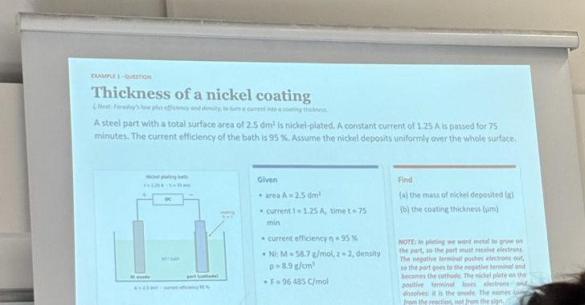{.slayt}

::: soru
Toplam yüzey alanı 2.5 dm² olan çelik bir parça nikel kaplanıyor. 75 dakika boyunca 1.25 A sabit akım uygulanıyor; banyonun akım verimi %95. Nikelin tüm yüzeye düzgün biriktiğini kabul et.

**Verilenler:** $A = 2.5$ dm², $I = 1.25$ A, $t = 75$ min, $\eta = 0.95$; Ni: $M = 58.7$ g/mol, $z = 2$, $\rho = 8.9$ g/cm³; $F = 96\,485$ C/mol

**İstenen:** (a) biriken Ni kütlesi (g), (b) kaplama kalınlığı (µm)
:::

::: alan
.
:::

::: ref
Çözüm: ders notları Sayfa 7
:::
::::

:::: sayfa
## Soru 2 · Bakır hücresinin akım verimi (Örnek 2.2)

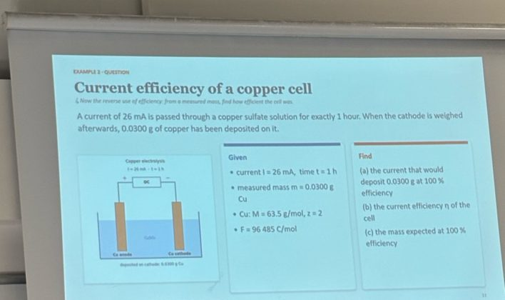{.slayt}

::: soru
Bakır sülfat çözeltisinden tam 1 saat boyunca 26 mA akım geçiriliyor. Katot tartıldığında üzerinde 0.0300 g bakır biriktiği görülüyor.

**Verilenler:** $I = 26$ mA, $t = 1$ h, $m = 0.0300$ g; Cu: $M = 63.5$ g/mol, $z = 2$; $F = 96\,485$ C/mol

**İstenen:** (a) 0.0300 g'ı %100 verimle biriktirecek akım, (b) akım verimi $\eta$, (c) %100 verimde beklenen kütle
:::

::: alan
.
:::

::: ref
Çözüm: ders notları Sayfa 7–8
:::
::::

:::: sayfa
## Soru 3 · Korozyonla kaybedilen demir (Örnek 2.3)

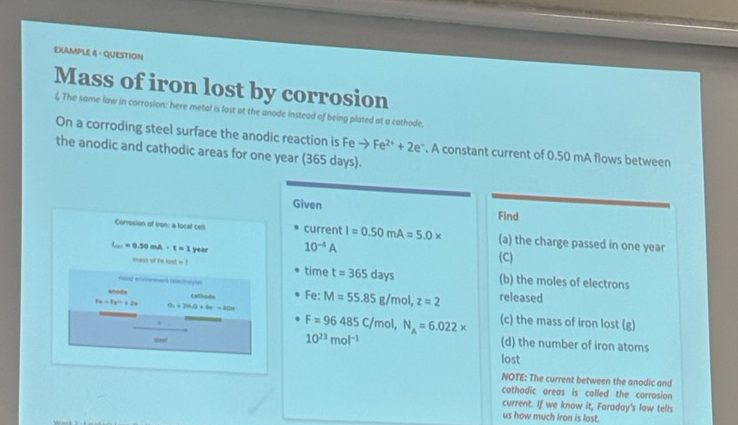{.slayt}

::: soru
Korozyona uğrayan bir çelik yüzeyde anodik reaksiyon $Fe \rightarrow Fe^{2+} + 2e^-$. Anodik ve katodik bölgeler arasında bir yıl (365 gün) boyunca 0.50 mA sabit akım akıyor.

**Verilenler:** $I = 0.50$ mA, $t = 365$ gün; Fe: $M = 55.85$ g/mol, $z = 2$; $F = 96\,485$ C/mol; $N_A = 6.022\times10^{23}$ mol⁻¹

**İstenen:** (a) geçen yük (C), (b) elektron mol sayısı, (c) kaybedilen Fe kütlesi (g), (d) kaybedilen Fe atomu sayısı
:::

::: alan
.
:::

::: ref
Çözüm: ders notları Sayfa 8
:::
::::

:::: sayfa
## Soru 4 · Referans skalaları arasında dönüşüm (Örnek 2.4)

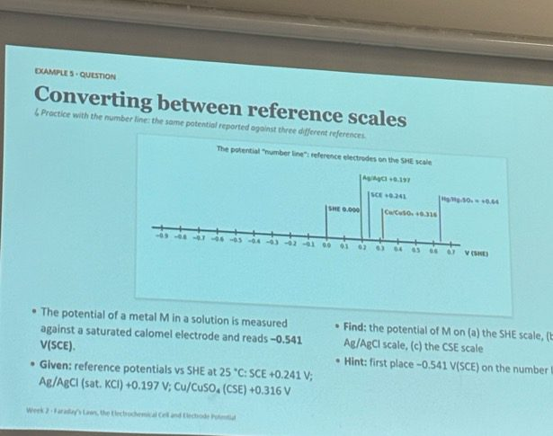{.slayt}

::: soru
Bir çözeltideki M metalinin potansiyeli doygun kalomel elektroda karşı **−0.541 V (SCE)** okunuyor.

**Verilenler (SHE'ye göre, 25 °C):** SCE +0.241 V; Ag/AgCl (doygun KCl) +0.197 V; Cu/CuSO₄ (CSE) +0.316 V

**İstenen:** M'nin potansiyeli (a) SHE, (b) Ag/AgCl, (c) CSE skalasında
:::

::: alan
.
:::

::: ref
Çözüm: ders notları Sayfa 13
:::
::::

:::: sayfa
## Soru 5 · Demirli iki hücre: Fe–Cu ve Fe–Zn (Örnek 2.5)

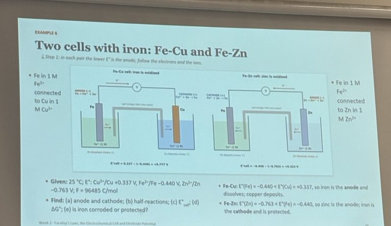{.slayt}

::: soru
1 M $Fe^{2+}$ içindeki Fe elektrot (i) 1 M $Cu^{2+}$ içindeki Cu ile, (ii) 1 M $Zn^{2+}$ içindeki Zn ile birleştiriliyor.

**Verilenler:** 25 °C; $E^\circ$: $Cu^{2+}/Cu$ = +0.337 V, $Fe^{2+}/Fe$ = −0.440 V, $Zn^{2+}/Zn$ = −0.763 V; $F = 96\,485$ C/mol

**İstenen (her iki hücre için):** (a) anot ve katot, (b) yarı reaksiyonlar, (c) $E^\circ_{cell}$, (d) $\Delta G^\circ$, (e) demir korozyona mı uğruyor, korunuyor mu?
:::

::: alan
.
:::

::: ref
Çözüm: ders notları Sayfa 14
:::
::::

:::: sayfa
## Soru 6 · Bakırın elektrolizle kazanılması (Örnek 2.6)

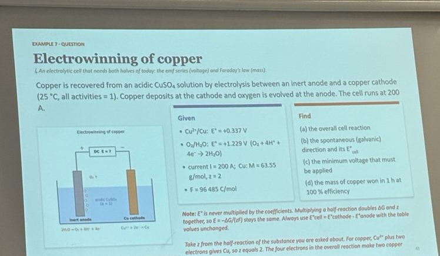{.slayt}

::: soru
Bakır, asidik $CuSO_4$ çözeltisinden inert bir anot ile bakır katot arasında elektrolizle kazanılıyor (25 °C, tüm aktiviteler = 1). Katotta bakır birikiyor, anotta oksijen çıkıyor. Hücre 200 A ile çalışıyor.

**Verilenler:** $Cu^{2+}/Cu$: $E^\circ = +0.337$ V; $O_2/H_2O$: $E^\circ = +1.229$ V ($O_2 + 4H^+ + 4e^- \rightarrow 2H_2O$); $I = 200$ A; Cu: $M = 63.55$ g/mol, $z = 2$; $F = 96\,485$ C/mol

**İstenen:** (a) toplam hücre reaksiyonu, (b) kendiliğinden (galvanik) yön ve $E^\circ_{cell}$, (c) uygulanması gereken minimum gerilim, (d) %100 verimle 1 saatte kazanılan bakır kütlesi
:::

::: alan
.
:::

::: ref
Çözüm: ders notları Sayfa 15
:::
::::

:::: sayfa
## Soru 7 · Serbest enerji verilerinden standart potansiyeller (Örnek 3.1)

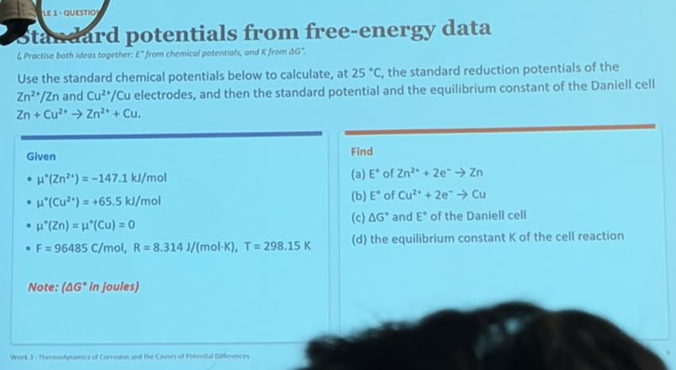{.slayt}

::: soru
Aşağıdaki standart kimyasal potansiyellerle 25 °C'de $Zn^{2+}/Zn$ ve $Cu^{2+}/Cu$ elektrotlarının standart redüksiyon potansiyellerini, sonra Daniell hücresinin ($Zn + Cu^{2+} \rightarrow Zn^{2+} + Cu$) standart potansiyelini ve denge sabitini hesapla.

**Verilenler:** $\mu^\circ(Zn^{2+}) = -147.1$ kJ/mol, $\mu^\circ(Cu^{2+}) = +65.5$ kJ/mol, $\mu^\circ(Zn) = \mu^\circ(Cu) = 0$; $z = 2$; $F = 96\,485$ C/mol; $R = 8.314$ J/(mol·K), $T = 298.15$ K

**İstenen:** (a) $E^\circ(Zn^{2+}/Zn)$, (b) $E^\circ(Cu^{2+}/Cu)$, (c) hücrenin $\Delta G^\circ$ ve $E^\circ$'ı, (d) denge sabiti $K$
:::

::: alan
.
:::

::: ref
Çözüm: ders notları Sayfa 19
:::
::::

:::: sayfa
## Soru 8 · 1 M'dan farklı derişimlerde elektrot potansiyelleri (Örnek 3.2)

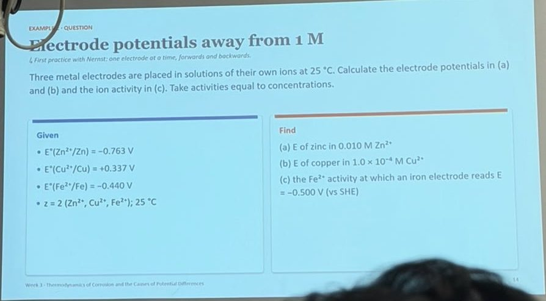{.slayt}

::: soru
Üç metal, 25 °C'de kendi iyonlarının çözeltilerine daldırılıyor. Aktiviteleri derişime eşit al.

**Verilenler:** $E^\circ(Zn^{2+}/Zn) = -0.763$ V, $E^\circ(Cu^{2+}/Cu) = +0.337$ V, $E^\circ(Fe^{2+}/Fe) = -0.440$ V; hepsinde $z = 2$; $R = 8.314$ J/(mol·K), $T = 298$ K, $F = 96\,485$ C/mol

**İstenen:** (a) 0.010 M $Zn^{2+}$ içinde Zn'nin potansiyeli, (b) $1.0\times10^{-4}$ M $Cu^{2+}$ içinde Cu'nun potansiyeli, (c) Fe elektrodun −0.500 V (SHE) okuduğu $Fe^{2+}$ aktivitesi
:::

::: alan
.
:::

::: ref
Çözüm: ders notları Sayfa 20–21
:::
::::

:::: sayfa
## Soru 9 · Hücre geriliminden bilinmeyen iyon derişimi (Örnek 3.3)

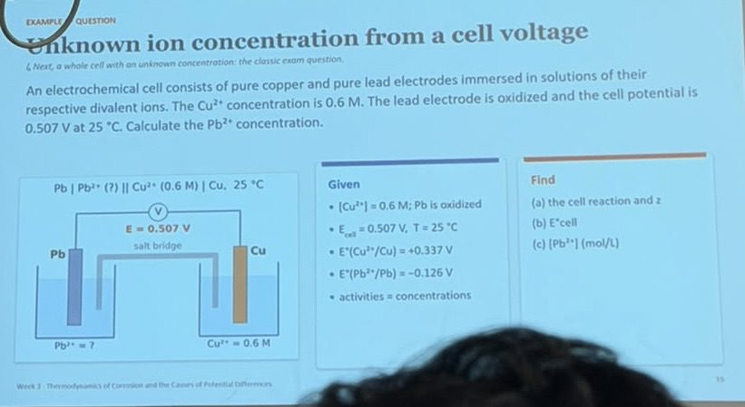{.slayt}

::: soru
Bir hücre, kendi iki değerlikli iyonlarının çözeltilerine daldırılmış saf bakır ve saf kurşun elektrotlardan oluşuyor. $Cu^{2+}$ derişimi 0.6 M. Kurşun elektrot oksitleniyor ve hücre potansiyeli 25 °C'de 0.507 V.

**Verilenler:** $[Cu^{2+}] = 0.6$ M, $E_{cell} = 0.507$ V, $E^\circ(Cu^{2+}/Cu) = +0.337$ V, $E^\circ(Pb^{2+}/Pb) = -0.126$ V; aktivite = derişim; $R = 8.314$ J/(mol·K), $T = 298$ K, $F = 96\,485$ C/mol

**İstenen:** (a) hücre reaksiyonu ve $z$, (b) $E^\circ_{cell}$, (c) $[Pb^{2+}]$ (mol/L)
:::

::: alan
.
:::

::: ref
Çözüm: ders notları Sayfa 21
:::
::::

:::: sayfa
## Soru 10 · Demir ve bakır oksijensiz suda korozyona uğrar mı? (Örnek 3.4)

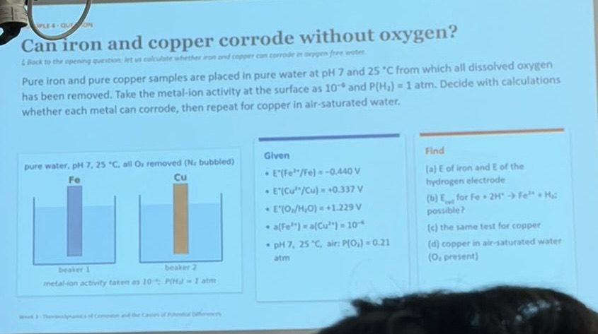{.slayt}

::: soru
Saf demir ve saf bakır numuneler, tüm çözünmüş oksijeni uzaklaştırılmış pH 7, 25 °C saf suya konuyor. Yüzeydeki metal iyonu aktivitesini $10^{-6}$, $P_{H_2} = 1$ atm al. Sonra bakır için havayla doygun suda tekrarla.

**Verilenler:** $E^\circ(Fe^{2+}/Fe) = -0.440$ V, $E^\circ(Cu^{2+}/Cu) = +0.337$ V, $E^\circ(O_2/H_2O) = +1.229$ V; $a_{Fe^{2+}} = a_{Cu^{2+}} = 10^{-6}$; pH 7; havada $P_{O_2} = 0.21$ atm; $R = 8.314$ J/(mol·K), $T = 298$ K, $F = 96\,485$ C/mol

**İstenen:** (a) Fe'nin ve hidrojen elektrodunun potansiyeli, (b) $Fe + 2H^+ \rightarrow Fe^{2+} + H_2$ için $E_{cell}$: korozyon mümkün mü? (c) aynı test bakır için, (d) havalandırılmış suda bakır
:::

::: alan
.
:::

::: ref
Çözüm: ders notları Sayfa 23
:::
::::

:::: sayfa
## Soru 11 · Bakır derişim hücresi (Örnek 3.5)

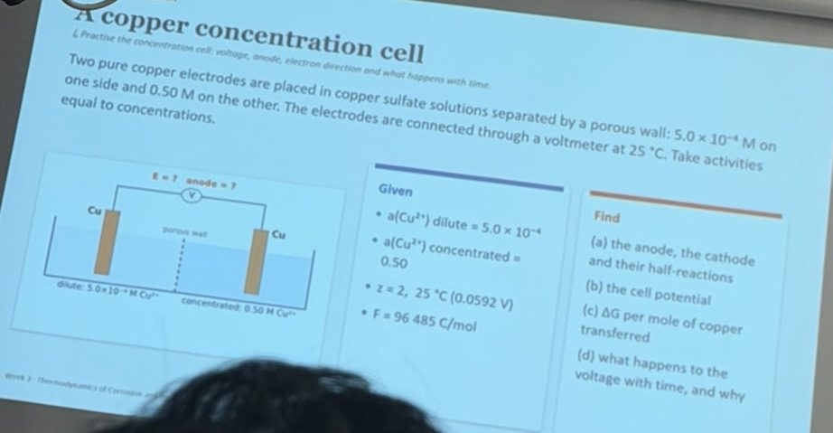{.slayt}

::: soru
Gözenekli bir duvarla ayrılmış iki bakır sülfat çözeltisine iki saf bakır elektrot daldırılmış: bir tarafta $5.0\times10^{-4}$ M, diğer tarafta 0.50 M. Elektrotlar 25 °C'de bir voltmetre üzerinden bağlı.

**Verilenler:** $a_{seyreltik} = 5.0\times10^{-4}$, $a_{derişik} = 0.50$, $z = 2$, 25 °C; $E^\circ(Cu^{2+}/Cu) = +0.337$ V; $R = 8.314$ J/(mol·K), $F = 96\,485$ C/mol

**İstenen:** (a) anot, katot ve yarı reaksiyonlar, (b) hücre potansiyeli, (c) taşınan mol bakır başına $\Delta G$, (d) gerilim zamanla nasıl değişir?
:::

::: alan
.
:::

::: ref
Çözüm: ders notları Sayfa 25
:::
::::

:::: sayfa
## Soru 12 · İki farklı topraktan geçen boru (Örnek 3.6)

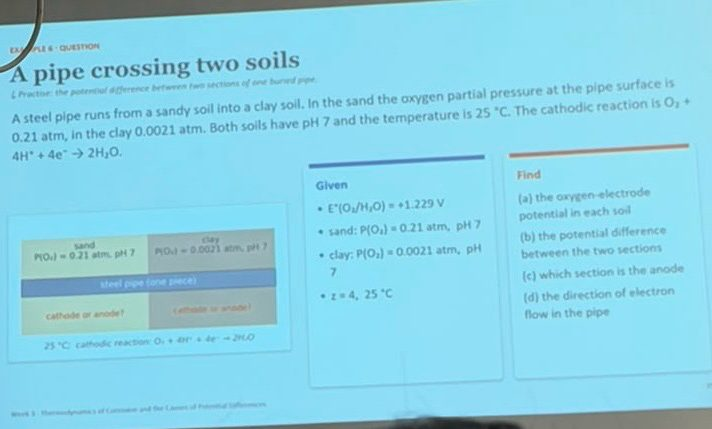{.slayt}

::: soru
Çelik bir boru kumlu topraktan killi toprağa geçiyor. Kumda boru yüzeyindeki oksijen kısmi basıncı 0.21 atm, kilde 0.0021 atm. İki toprak da pH 7, sıcaklık 25 °C. Katodik reaksiyon $O_2 + 4H^+ + 4e^- \rightarrow 2H_2O$.

**Verilenler:** $E^\circ(O_2/H_2O) = 1.229$ V; pH 7; $P_{O_2}$ = 0.21 atm (kum), 0.0021 atm (kil); $z = 4$; $R = 8.314$ J/(mol·K), $T = 298$ K, $F = 96\,485$ C/mol

**İstenen:** (a) her topraktaki oksijen elektrodu potansiyeli, (b) iki bölüm arasındaki potansiyel farkı, (c) hangi bölüm anot, (d) borudaki elektron akış yönü
:::

::: alan
.
:::

::: ref
Çözüm: ders notları Sayfa 25–26
:::
::::

:::: sayfa
## Soru 13 · Demir haritasında beş nokta (Örnek 4.1)

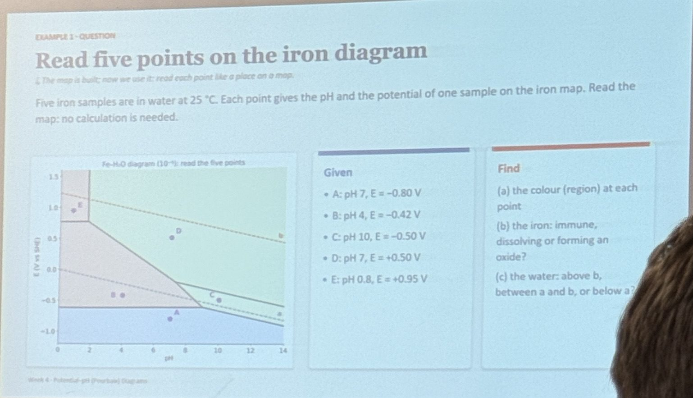{.slayt}

::: soru
25 °C sudaki beş demir numunesinin pH ve potansiyelleri aşağıda. Haritayı okuyarak cevapla.

**Verilenler:** A: pH 7, −0.80 V · B: pH 4, −0.42 V · C: pH 10, −0.50 V · D: pH 7, +0.50 V · E: pH 0.8, +0.95 V

**İstenen:** (a) her noktanın bölgesi, (b) demir bağışık mı, çözünüyor mu, oksit mi oluşturuyor? (c) su a'nın altında mı, a ile b arasında mı, b'nin üstünde mi?

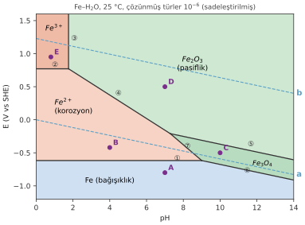{width=42%}
:::

::: alan
.
:::

::: ref
Çözüm: ders notları Sayfa 35
:::
::::

:::: sayfa
## Soru 14 · Aynı asidik suda üç metal (Örnek 4.2)

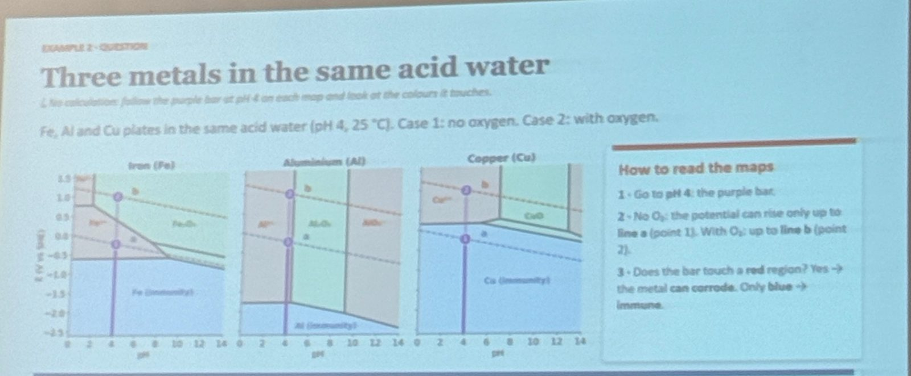{.slayt}

::: soru
Fe, Al ve Cu plakalar aynı asidik suda (pH 4, 25 °C). Durum 1: oksijen yok. Durum 2: oksijen var.

**İstenen:** (a) oksijensizken hangi metaller korozyona uğrayabilir? (b) oksijenliyken? (c) oksijensiz pH 4 suyu için hangi metali seçersin?
:::

::: alan
.
:::

::: ref
Çözüm: ders notları Sayfa 36
:::
::::

:::: sayfa
## Soru 15 · Demir için her tipten bir çizgi (Örnek 4.3)

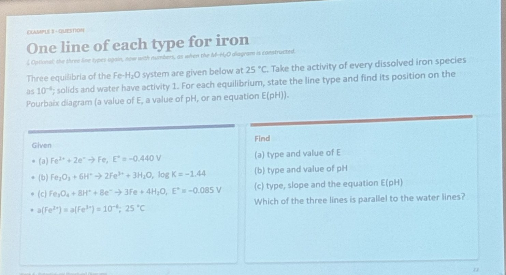{.slayt}

::: soru
Fe–H₂O sisteminin üç dengesi 25 °C'de veriliyor. Çözünmüş demir türlerinin aktivitesini $10^{-6}$, katıların ve suyun aktivitesini 1 al. Her denge için çizgi tipini ve Pourbaix diyagramındaki yerini bul.

**Verilenler:**  
(a) $Fe^{2+} + 2e^- \rightarrow Fe$, $E^\circ = -0.440$ V  
(b) $Fe_2O_3 + 6H^+ \rightarrow 2Fe^{3+} + 3H_2O$, $\log K = -1.44$  
(c) $Fe_3O_4 + 8H^+ + 8e^- \rightarrow 3Fe + 4H_2O$, $E^\circ = -0.085$ V
$R = 8.314$ J/(mol·K), $T = 298$ K, $F = 96\,485$ C/mol

**İstenen:** (a) tip ve $E$ değeri, (b) tip ve pH değeri, (c) tip, eğim ve $E(\text{pH})$ denklemi; hangisi su çizgilerine paraleldir?
:::

::: alan
.
:::

::: ref
Çözüm: ders notları Sayfa 36–37
:::
::::

:::: sayfa
## Soru 16 · Aşırı gerilim ve işareti (Örnek 5.1)

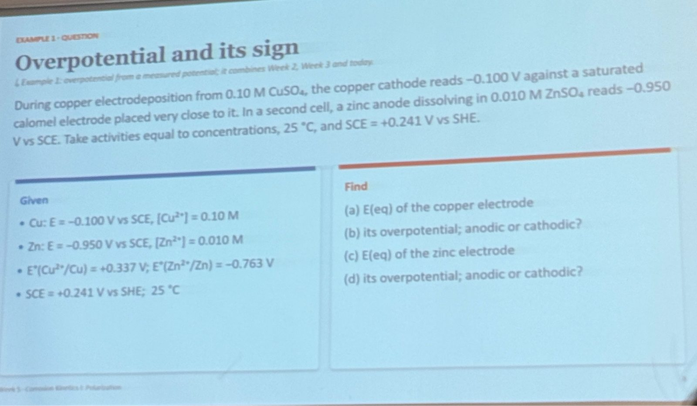{.slayt}

::: soru
0.10 M $CuSO_4$'ten bakır kaplanırken bakır katot, ona çok yakın yerleştirilmiş doygun kalomel elektroda karşı −0.100 V okunuyor. İkinci bir hücrede 0.010 M $ZnSO_4$ içinde çözünen çinko anot SCE'ye karşı −0.950 V okunuyor. Aktiviteleri derişime eşit al, 25 °C.

**Verilenler:** $E^\circ(Cu^{2+}/Cu) = +0.337$ V, $E^\circ(Zn^{2+}/Zn) = -0.763$ V; SCE = +0.241 V (SHE); $R = 8.314$ J/(mol·K), $T = 298$ K, $F = 96\,485$ C/mol

**İstenen:** (a) bakırın $E_{eq}$'i, (b) bakırın aşırı gerilimi: anodik mi katodik mi? (c) çinkonun $E_{eq}$'i, (d) çinkonun aşırı gerilimi: anodik mi katodik mi?
:::

::: alan
.
:::

::: ref
Çözüm: ders notları Sayfa 41
:::
::::

:::: sayfa
## Soru 17 · Aynı akım, üç farklı katot (Örnek 5.2)

::: soru
Asit içinde platin, demir ve cıva üzerinde 10 mA/cm² ($1.0\times10^{-2}$ A/cm²) katodik akım yoğunluğuyla hidrojen çıkıyor. Üçü için $b_c = -0.12$ V/dekad.

**Verilenler:** $i_0$: Pt $10^{-3}$, Fe $10^{-6}$, Hg $2\times10^{-12}$ A/cm²

**İstenen:** (a) Pt, (b) Fe, (c) Hg için $\eta$; (d) $H_2$ üretimi için en iyi katot hangisi, $H_2$ çıkışı hangisinde en zor?
:::

::: alan
.
:::

::: ref
Çözüm: ders notları Sayfa 42
:::
::::

:::: sayfa
## Soru 18 · E_corr'dan i_corr'a: çinko ve demir (Örnek 6.1)

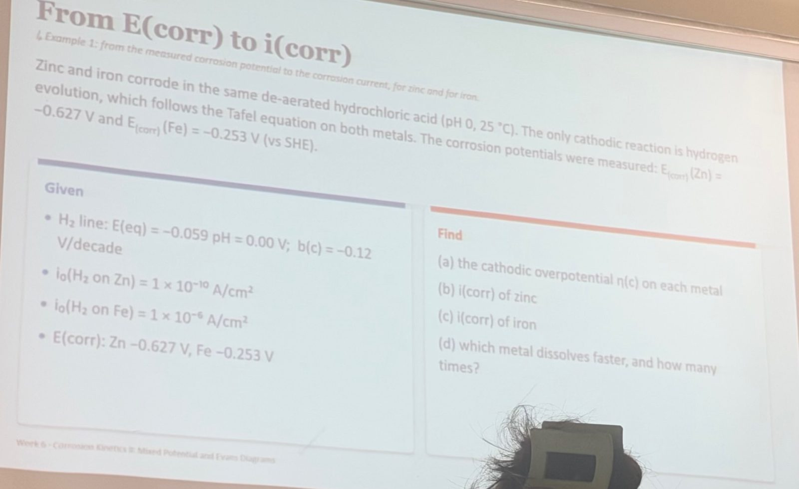{.slayt}

::: soru
Çinko ve demir aynı oksijensiz hidroklorik asitte (pH 0, 25 °C) korozyona uğruyor. Tek katodik reaksiyon iki metalde de Tafel'e uyan hidrojen çıkışı. Ölçülen korozyon potansiyelleri: $E_{corr}(Zn) = -0.627$ V, $E_{corr}(Fe) = -0.253$ V (SHE).

**Verilenler:** $H_2$ çizgisi: $E_{eq} = 0.00$ V (pH 0), $b_c = -0.12$ V/dekad; $i_0(H_2$, Zn üzerinde$) = 10^{-10}$ A/cm²; $i_0(H_2$, Fe üzerinde$) = 10^{-6}$ A/cm²

**İstenen:** (a) her metalde katodik aşırı gerilim $\eta_c$, (b) çinkonun $i_{corr}$'u, (c) demirin $i_{corr}$'u, (d) hangisi kaç kat hızlı çözünür?
:::

::: alan
.
:::

::: ref
Çözüm: ders notları Sayfa 47
:::
::::

:::: sayfa
## Soru 19 · i_corr'dan mm/y'ye (Örnek 6.2)

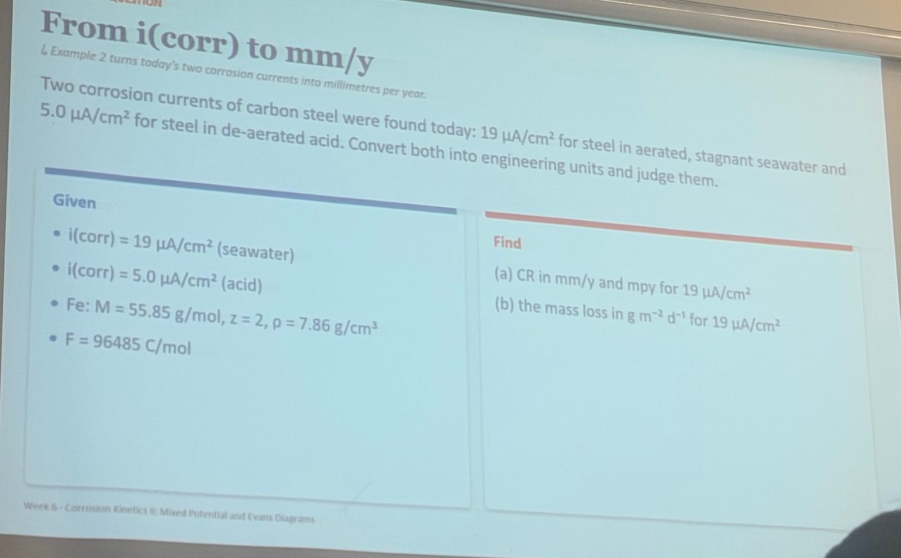{.slayt}

::: soru
Karbon çeliği için iki korozyon akımı bulundu: havalandırılmış durgun deniz suyunda 19 µA/cm², oksijensiz asitte 5.0 µA/cm².

**Verilenler:** Fe: $M = 55.85$ g/mol, $z = 2$, $\rho = 7.86$ g/cm³; $F = 96\,485$ C/mol; 1 m² = 10⁴ cm²; 1 gün = 86 400 s; 1 mm/y = 39.4 mpy

**İstenen:** (a) 19 µA/cm² için CR (mm/y ve mpy), (b) 19 µA/cm² için kütle kaybı (g m⁻² gün⁻¹), (c) 5.0 µA/cm² için CR (mm/y); Fontana skalasına göre yorumla
:::

::: alan
.
:::

::: ref
Çözüm: ders notları Sayfa 53
:::
::::

:::: sayfa
## Soru 20 · Kütle kaybı kuponu (Örnek 7.1)

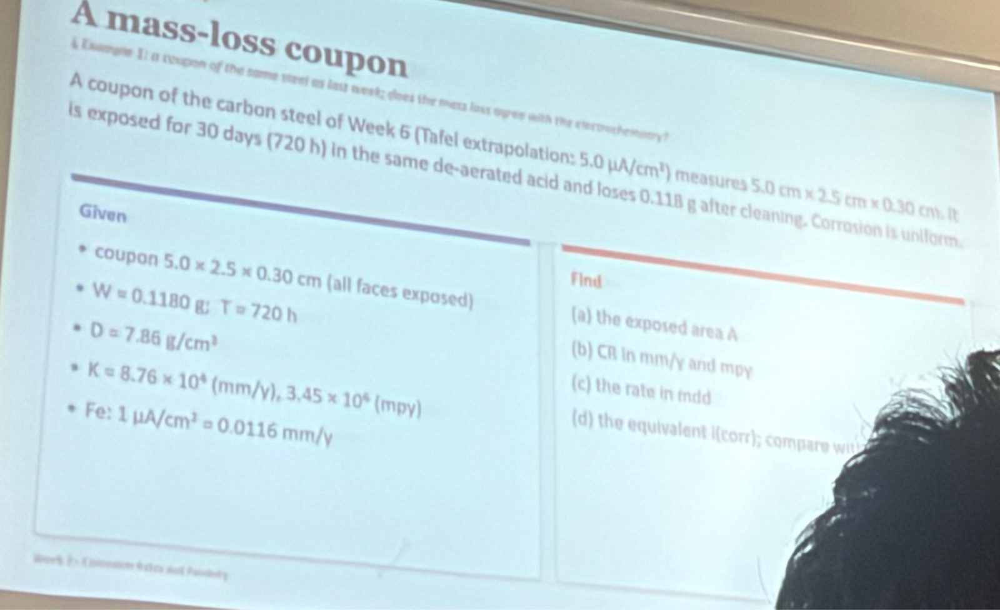{.slayt}

::: soru
5.0 cm × 2.5 cm × 0.30 cm boyutlarında bir karbon çeliği kupon oksijensiz asitte 30 gün (720 h) bekletiliyor. Temizlendikten sonra 0.118 g kaybettiği görülüyor. Korozyon düzgün. Aynı çelik için Tafel ekstrapolasyonu 5.0 µA/cm² vermişti.

**Verilenler:** kupon 5.0 × 2.5 × 0.30 cm (tüm yüzler açık); $W = 0.1180$ g; $T = 720$ h; $D = 7.86$ g/cm³; $K$: $8.76\times10^4$ (mm/y), $3.45\times10^6$ (mpy), $2.40\times10^6 D$ (mdd); Fe için 1 µA/cm² = 0.0116 mm/y

**İstenen:** (a) maruz alan, (b) CR (mm/y ve mpy), (c) mdd cinsinden hız, (d) eşdeğer $i_{corr}$; Tafel sonucuyla karşılaştır
:::

::: alan
.
:::

::: ref
Çözüm: ders notları Sayfa 56
:::
::::

:::: sayfa
## Soru 21 · Boru ne kadar dayanır? (Örnek 7.2)

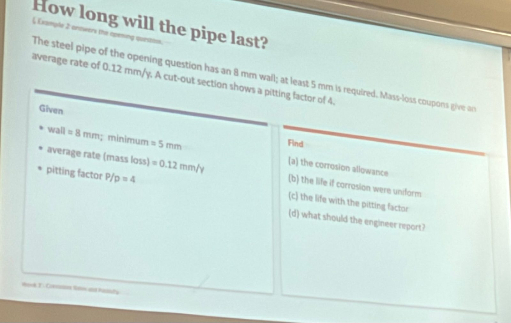{.slayt}

::: soru
Çelik bir borunun et kalınlığı 8 mm, en az 5 mm gerekli. Kütle kaybı kuponları ortalama 0.12 mm/y veriyor. Kesilen bir boru parçası oyuklanma faktörünün 4 olduğunu gösteriyor.

**Verilenler:** $t_{duvar} = 8$ mm, $t_{min} = 5$ mm, ortalama hız 0.12 mm/y, $P/p = 4$

**İstenen:** (a) korozyon payı, (b) korozyon düzgün olsaydı ömür, (c) oyuklanma faktörüyle ömür, (d) mühendis ne raporlamalı?
:::

::: alan
.
:::

::: ref
Çözüm: ders notları Sayfa 57
:::
::::

:::: sayfa
## Soru 22 · Paslanmaz çelik mi, karbon çeliği mi? (Örnek 7.3)

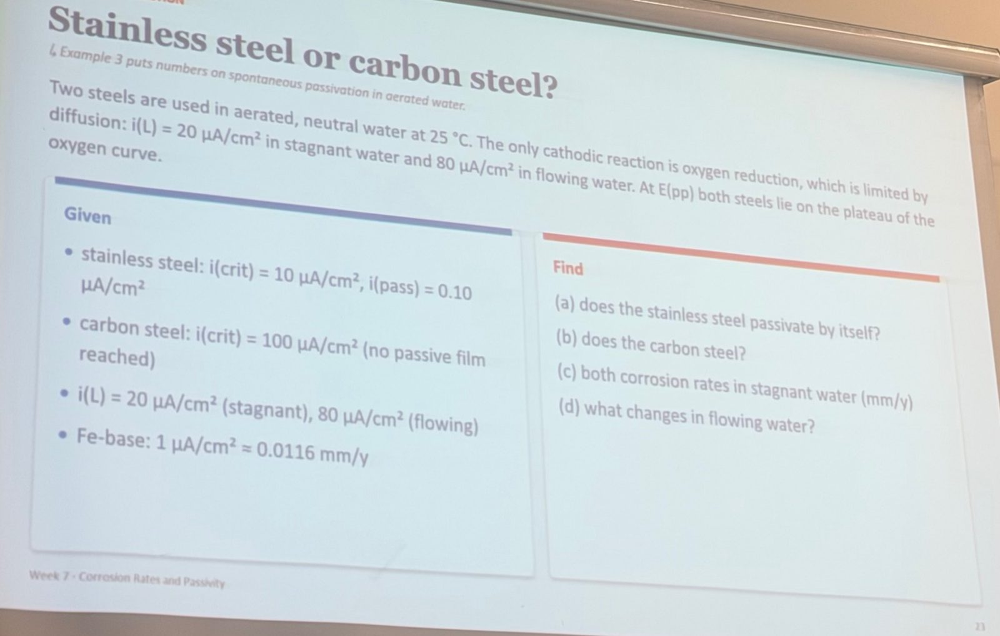{.slayt}

::: soru
İki çelik havalandırılmış nötr suda (25 °C) kullanılıyor. Tek katodik reaksiyon difüzyonla sınırlı oksijen redüksiyonu: durgun suda $i_L = 20$ µA/cm², akan suda 80 µA/cm². $E_{pp}$'de iki çelik de oksijen eğrisinin platosunda.

**Verilenler:** paslanmaz: $i_{crit} = 10$ µA/cm², $i_{pass} = 0.10$ µA/cm²; karbon çeliği: $i_{crit} = 100$ µA/cm²; Fe esaslı için 1 µA/cm² ≈ 0.0116 mm/y

**İstenen:** (a) paslanmaz çelik kendiliğinden pasifleşir mi? (b) karbon çeliği? (c) durgun suda iki hız (mm/y), (d) akan suda ne değişir?
:::

::: alan
.
:::

::: ref
Çözüm: ders notları Sayfa 61
:::
::::

:::: sayfa
## Sınav A · 1. Vize (19.11.2025) · Soru 1

::: soru
$i_{corr} = 5\ \mu$A/cm²  
$Fe \rightarrow Fe^{2+} + 2e^-$  
$M = 55.85$ g/mol, $\rho = 7.87$ g/cm³

Calculate yearly thickness loss.
:::

::: alan
.
:::

::: ref
İlgili konu: ders notları Sayfa 52 (i_corr → mm/y)
:::
::::

:::: sayfa
## Sınav A · 1. Vize (19.11.2025) · Soru 2

::: soru
$i_{peak} = 8$ mA/cm²  
$i_{pass} = 40\ \mu$A/cm²  
Passive region: −0.05 to 0.80 V  
Breakdown at 0.80 V
  
(a) Sketch the curve.    
(b) Why is low $i_{pass}$ important?    
(c) Effect of higher pH and temperature?
:::

::: alan
.
:::

::: ref
İlgili konu: ders notları Sayfa 59–60 (aktif–pasif eğri, pH ve sıcaklık)
:::
::::

:::: sayfa
## Sınav A · 1. Vize (19.11.2025) · Soru 3

::: soru  
(a) Define activation polarization.    
(b) Define diffusion polarization.    
(c) How do you identify the Tafel region?
:::

::: alan
.
:::

::: ref
İlgili konu: ders notları Sayfa 40–43, 51 (polarizasyon, Tafel ekstrapolasyonu)
:::
::::

:::: sayfa
## Sınav A · 1. Vize (19.11.2025) · Soru 4

::: soru  
(a) Draw the Pourbaix diagram and explain the related reactions of water?    
(b) Draw and briefly explain Evans polarization diagrams.
:::

::: alan
.
:::

::: ref
İlgili konu: ders notları Sayfa 29–32, 46–48; çıkmış sorular PDF'i Soru 4
:::
::::

:::: sayfa
## Sınav A · 1. Vize (19.11.2025) · Soru 5

::: soru
$Fe^{2+}/Fe$ has $E^\circ = -0.44$ V and $[Fe^{2+}] = 1\times10^{-4}$ M.
  
(a) Calculate electrode potential.    
(b) Explain whether lower $Fe^{2+}$ increases dissolution tendency.
  
($R = 8.314$ J/(mol·K), $T = 298$ K, $F = 96\,485$ C/mol)
:::

::: alan
.
:::

::: ref
İlgili konu: ders notları Sayfa 20 (tek elektrot için Nernst)
:::
::::

:::: sayfa
## Sınav B · 23.08.2021 · Soru 1

::: soru
Pure copper and pure cobalt electrodes are separately immersed in solutions of their respective divalent ions, making up a galvanic cell that yields a cell potential of 0.65 V (SHE). Calculate the cobalt activity if the activity of copper ions is 0.85 mol/L at 25 °C.

$E^\circ(Co^{2+}/Co) = -0.28$ V; $E^\circ(Cu^{2+}/Cu) = -0.34$ V *(sınav kâğıdında böyle yazıyor; tablo değeri +0.34 V)*
  
($R = 8.314$ J/(mol·K), $T = 298$ K, $F = 96\,485$ C/mol)
:::

::: alan
.
:::

::: ref
İlgili konu: ders notları Sayfa 21 (hücre geriliminden bilinmeyen derişim)
:::
::::

:::: sayfa
## Sınav B · 23.08.2021 · Soru 2

::: soru
Draw the Pourbaix diagram and explain the related reactions of water? (20p)
:::

::: alan
.
:::

::: ref
İlgili konu: ders notları Sayfa 29–32
:::
::::

:::: sayfa
## Sınav B · 23.08.2021 · Soru 3

::: soru  
(a) Derive the Nernst Equation? (10p)    
(b) Briefly explain the mixed potential, potentiostat and anodic polarization? (10p)
:::

::: alan
.
:::

::: ref
İlgili konu: ders notları Sayfa 19–20, 39, 46, 51
:::
::::

:::: sayfa
## Sınav B · 23.08.2021 · Soru 4

::: soru
Copper surface area, $A = 10$ cm², is exposed to an acid solution. After 24 hours, the loss of copper due to oxidation is $15\times10^{-3}$ grams. Calculate:
  
(a) the current density $i$ in µA/cm²,    
(b) the corrosion rate in mm/y,    
(c) the number of reactions per unit time.

Use data: $A_w = 63.54$ g/mol, $d = 8.96$ g/cm³, $q_e = 1.602\times10^{-19}$ C/reaction, $K = 8.75\times10^4$. (20p)
:::

::: alan
.
:::

::: ref
İlgili konu: ders notları Sayfa 6–7, 52, 55–56 (Faraday, CR, ASTM G31)
:::
::::

:::: sayfa
## Sınav B · 23.08.2021 · Soru 5

::: soru
Briefly describe the terms given below:
  
(a) Activation polarization (7p)    
(b) Rate determining step (7p)    
(c) Exchange current density (6p)
:::

::: alan
.
:::

::: ref
İlgili konu: ders notları Sayfa 40–42; çıkmış sorular PDF'i Soru 5
:::
::::
