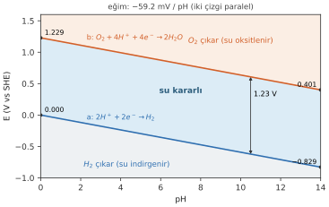
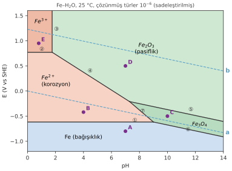
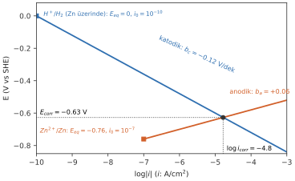
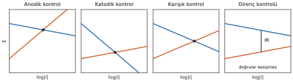

# Çıkmış Sorular · Çözümler

Sorulardaki yazım: "Cu*2" = $Cu^{2+}$, "H*" = $H^+$, "E*" = $E^\circ$ (standart redüksiyon potansiyeli).

Sabitler: $R = 8.314$ J/(mol·K), $F = 96\,485$ C/mol, 25 °C = 298 K, 101 kPa ≈ 1 atm.

## Soru 1 · Bakırın asitte oluşturabileceği maksimum $Cu^{2+}$ aktivitesi

> Aşağıdaki elektrokimyasal hücreyi ($Cu^{2+}\,|\,Cu\,\|\,H_2\,|\,H^+\,|\,Pt$) kullanarak, 25 °C, 101 kPa ve pH = 2'de sülfürik asit içine daldırılmış bir bakır şeridin oksidasyonu nedeniyle çözeltideki bakır iyonlarının maksimum aktivitesini hesaplayın. ($E^\circ_{Cu^{2+}/Cu} = 0.34$ V)

**Verilenler:** $E^\circ(Cu^{2+}/Cu) = +0.34$ V, $E^\circ(H^+/H_2) = 0$ V, pH = 2 → $a_{H^+} = 10^{-2}$, $P_{H_2} = 1$ atm, $T = 298$ K

**İstenen:** $a_{Cu^{2+}}$ (maksimum)

**Fikir:** Bakır çözündükçe çözeltide $Cu^{2+}$ birikir ve hücre potansiyeli düşer. Potansiyel **sıfıra** indiğinde reaksiyon durur (denge). O andaki $Cu^{2+}$ aktivitesi, ulaşılabilecek **maksimum** aktivitedir.

**1. Hücre reaksiyonu**

- Anot (bakır oksitlenir): $Cu \rightarrow Cu^{2+} + 2e^-$
- Katot (hidrojen çıkar): $2H^+ + 2e^- \rightarrow H_2$
- Toplam: $Cu + 2H^+ \rightarrow Cu^{2+} + H_2$, $\;z = 2$

**2. Standart hücre potansiyeli**

$$E^\circ_{cell} = E^\circ_{katot} - E^\circ_{anot} = 0 - 0.34 = -0.34\ \text{V}$$

Standart koşulda negatif: bakır asitte kendiliğinden çözünmeye isteksizdir.

**3. Reaksiyon oranı**

$$Q = \frac{a_{Cu^{2+}} \cdot P_{H_2}}{a_{Cu} \cdot a_{H^+}^2} = \frac{a_{Cu^{2+}} \cdot 1}{1 \cdot (10^{-2})^2} = \frac{a_{Cu^{2+}}}{10^{-4}}$$

**4. Nernst, $E_{cell} = 0$ koşuluyla**

$$E_{cell} = E^\circ_{cell} - \frac{RT}{zF}\ln Q$$

$$0 = -0.34 - \frac{8.314 \times 298}{2 \times 96\,485}\,\ln Q$$

$$\frac{RT}{2F} = 0.01284\ \text{V} \quad\Rightarrow\quad \ln Q = \frac{-0.34}{0.01284} = -26.48$$

$$Q = e^{-26.48} = 3.16 \times 10^{-12}$$

**5. $Cu^{2+}$ aktivitesi**

$$a_{Cu^{2+}} = Q \times 10^{-4} = 3.16\times10^{-12} \times 10^{-4} = \mathbf{3.2 \times 10^{-16}}$$

**Yorum:** Değer son derece küçük. Bu, Hafta 3'teki sonuçla aynı şeyi söyler: bakır, oksijensiz asitte hidrojen çıkışıyla **pratikte korozyona uğramaz**. Bakırın korozyona uğraması için çözünmüş $O_2$ gerekir. (Çözümde sülfürik asidin oksijensiz olduğu, yani tek katodik reaksiyonun $H_2$ çıkışı olduğu varsayıldı.)

## Soru 2 · Cd–Cu hücresinde sıcaklık, ΔS ve ΔH

> Elektrokimyasal hücre $Cd\,|\,0.05\ M\ Cd^{2+}\,\|\,0.25\ M\ Cu^{2+}\,|\,Cu$ için: (a) hücre potansiyeli 0.762 V iken sıcaklığı hesaplayın, (b) ΔS ve ΔH? ($E^\circ_{Cd^{2+}/Cd} = -0.403$ V)

**Verilenler:** $E^\circ(Cd^{2+}/Cd) = -0.403$ V; $E^\circ(Cu^{2+}/Cu) = +0.34$ V (Soru 1'deki değer); $[Cd^{2+}] = 0.05$ M; $[Cu^{2+}] = 0.25$ M; $E_{cell} = 0.762$ V

**İstenen:** (a) $T$, (b) $\Delta S$, $\Delta H$

**Varsayım:** $E^\circ$ değerlerinin sıcaklıkla değişmediği kabul edilir; sıcaklığın etkisi yalnızca Nernst terimiyle gelir.

### (a) Sıcaklık

**1. Reaksiyon ve $E^\circ_{cell}$**

- Anot: $Cd \rightarrow Cd^{2+} + 2e^-$ (E° küçük olan)
- Katot: $Cu^{2+} + 2e^- \rightarrow Cu$
- Toplam: $Cd + Cu^{2+} \rightarrow Cd^{2+} + Cu$, $\;z = 2$

$$E^\circ_{cell} = 0.34 - (-0.403) = 0.743\ \text{V}$$

**2. Q**

$$Q = \frac{a_{Cd^{2+}}}{a_{Cu^{2+}}} = \frac{0.05}{0.25} = 0.20 \qquad \ln Q = -1.609$$

**3. Nernst'i T için çöz**

$$E = E^\circ - \frac{RT}{zF}\ln Q$$

$$0.762 = 0.743 - \frac{8.314 \times T}{2 \times 96\,485} \times (-1.609)$$

$$0.762 - 0.743 = \frac{8.314 \times 1.609}{192\,970}\,T \quad\Rightarrow\quad 0.019 = 6.93\times10^{-5}\ T$$

$$T = \frac{0.019}{6.93\times10^{-5}} = \mathbf{274\ K} \;(\approx 1\ ^\circ\text{C})$$

**Dikkat:** Sonuç $E^\circ(Cu)$ değerine çok duyarlıdır. 0.34 yerine tablo değeri 0.337 V alınırsa $E^\circ_{cell} = 0.740$ V ve $T \approx 317$ K çıkar. Sınavda verilen değeri kullan.

### (b) ΔS ve ΔH

**1. ΔG**

$$\Delta G = -zFE = -2 \times 96\,485 \times 0.762 = -147\,043\ \text{J/mol} = \mathbf{-147.0\ kJ/mol}$$

Negatif: reaksiyon kendiliğinden yürür.

**2. ΔS** — termodinamik bağıntı:

$$\Delta S = zF\left(\frac{\partial E}{\partial T}\right)$$

$E^\circ$ sabit kabul edildiğinden Nernst'ten:

$$\frac{\partial E}{\partial T} = -\frac{R}{zF}\ln Q \quad\Rightarrow\quad \Delta S = -R\ln Q$$

$$\Delta S = -8.314 \times (-1.609) = \mathbf{+13.4\ J/(mol\cdot K)}$$

**3. ΔH** — $\Delta G = \Delta H - T\Delta S$ bağıntısından:

$$\Delta H = \Delta G + T\Delta S = -147\,043 + 274 \times 13.4 = -143\,380\ \text{J/mol} = \mathbf{-143.4\ kJ/mol}$$

**Kontrol:** Bu varsayımla $\Delta H = -zFE^\circ = -2 \times 96\,485 \times 0.743 = -143.4$ kJ/mol çıkmalı. Aynı sonuç ✓

## Soru 3 · Deniz suyunda çelik plakanın korozyon hızı

> Deniz suyuna daldırılmış düşük karbonlu çelik plaka (1 cm × 1 cm × 4 cm) için korozyon hızını mm/yıl cinsinden hesaplayın. $I = 110\ \mu$A, $\rho = 7.87$ g/cm³, $A_w = 55.85$ g/mol.

**Verilenler:** $I = 110\ \mu$A, $\rho = 7.87$ g/cm³, $M = 55.85$ g/mol, $z = 2$ ($Fe \rightarrow Fe^{2+} + 2e^-$), plaka 1 × 1 × 4 cm (tüm yüzler suda)

**İstenen:** CR (mm/y)

**1. Yüzey alanı** (altı yüz):

$$A = 2(1\times1 + 1\times4 + 1\times4) = 2(1 + 4 + 4) = 18\ \text{cm}^2$$

**2. Akım yoğunluğu**

$$i_{corr} = \frac{I}{A} = \frac{110}{18} = 6.11\ \mu\text{A/cm}^2$$

**3. Korozyon hızı** (Faraday yasasının mühendislik biriminde yazılmış hâli):

$$CR\ (\text{mm/y}) = 3.27\times10^{-3}\,\frac{i_{corr}\,M}{z\,\rho} = 3.27\times10^{-3} \times \frac{6.11 \times 55.85}{2 \times 7.87}$$

$$CR = 3.27\times10^{-3} \times \frac{341.3}{15.74} = 3.27\times10^{-3} \times 21.68 = \mathbf{0.071\ mm/y}$$

mpy cinsinden: $0.071 \times 39.4 = 2.8$ mpy → Fontana skalasında **excellent** (1–5 mpy).

**Formülün kaynağı:** $m = \dfrac{MIt}{zF}$ → alana böl → kalınlık $= m/(\rho A)$ → birimleri mm ve yıla çevir. $3.27\times10^{-3}$ sabiti $F$'yi ve birim dönüşümlerini içerir; $i_{corr}$ **µA/cm²** olarak girer.

**Dikkat:** Akım yoğunluğu için alanın **tamamı** (18 cm²) kullanılır. Yalnızca bir yüz (4 cm²) alınırsa hız 4.5 kat büyük çıkar; soruda plaka tamamen daldırılmış.

## Soru 4 · Diyagramlar

### (a) Pourbaix diyagramı ve suyla ilgili reaksiyonlar

Pourbaix (E–pH) diyagramı, 25 °C'de bir metalin suda hangi formda (metal, iyon veya oksit) kararlı olduğunu gösteren bir haritadır. Yatay eksen **pH**, düşey eksen **E (V vs SHE)**.

**Suyun diyagramı:**

Suyla ilgili dört reaksiyon (asitte $H^+$, bazda $OH^-$ ile yazılır; çizgiler aynıdır):

| | Asitte | Bazda | Çizgi denklemi |
|---|---|---|---|
| **a (H₂)** | $2H^+ + 2e^- \rightarrow H_2$ | $2H_2O + 2e^- \rightarrow H_2 + 2OH^-$ | $E = -0.0592\,\text{pH}$ |
| **b (O₂)** | $O_2 + 4H^+ + 4e^- \rightarrow 2H_2O$ | $O_2 + 2H_2O + 4e^- \rightarrow 4OH^-$ | $E = 1.229 - 0.0592\,\text{pH}$ |

- **a çizgisinin altında** su indirgenir, $H_2$ çıkar.
- **b çizgisinin üstünde** su oksitlenir, $O_2$ çıkar.
- **İkisinin arasında** su kararlıdır. Çizgiler paraleldir (eğim −59.2 mV/pH), aralarında her pH'ta 1.23 V vardır.
- Korozyon açısından anlamı: suda metalden elektron alabilecek iki katodik reaksiyon vardır, $H^+$ (a) ve $O_2$ (b). Metalin bağışıklık çizgisi a'nın altındaysa oksijensiz suda da korozyona uğrar (Fe, Zn, Al); a ile b arasındaysa yalnız $O_2$ varken uğrar (Cu); b'nin üstündeyse hiç uğramaz (Au, Pt).

**Bir metalin diyagramı (örnek: demir):**

| Bölge | Kararlı tür | Anlamı |
|---|---|---|
| Bağışıklık | Fe | Korozyon yok |
| Korozyon | $Fe^{2+}$, $Fe^{3+}$ | Metal çözünür |
| Pasiflik | $Fe_2O_3$, $Fe_3O_4$ | Yüzeyde oksit film; yoğunsa korur |

Çizgi tipleri: yalnız $e^-$ içeren reaksiyon **yatay**, yalnız $H^+$ içeren **dikey**, ikisini de içeren **eğik** çizgi verir.

### (b) Evans polarizasyon diyagramı

- Korozyona uğrayan bir metalde aynı yüzeyde iki reaksiyon birlikte yürür: **anodik** (metalin çözünmesi, ör. $Zn \rightarrow Zn^{2+} + 2e^-$) ve **katodik** (ör. $2H^+ + 2e^- \rightarrow H_2$).
- Evans diyagramında düşey eksen **E**, yatay eksen **log |i|**'dir. Her reaksiyon, kendi $(\log i_0, E_{eq})$ noktasından başlayan bir **Tafel doğrusu** olarak çizilir: anodik doğru yukarı ($b_a > 0$), katodik doğru aşağı ($b_c < 0$) gider.
- Metalde yük birikemeyeceği için anodik akım = katodik akım olmalıdır (**karışık potansiyel teorisi**). Bu, iki doğrunun **kesişme noktasında** sağlanır:
  - kesişmenin potansiyeli → **korozyon potansiyeli $E_{corr}$** (iki $E_{eq}$ arasında)
  - kesişmenin akımı → **korozyon akım yoğunluğu $i_{corr}$** (korozyon hızı)
- Hangi doğru daha dikse (daha çok polarize oluyorsa) korozyon hızını o kontrol eder:

- Diyagram, "emf serisinde daha soy olan metal daha yavaş korozyona uğrar" fikrinin her zaman doğru olmadığını da gösterir: hız, katodik reaksiyonun o yüzeydeki $i_0$'ına bağlıdır (ör. aynı asitte demir, çinkodan hızlı çözünür).

## Soru 5 · Kavramlar

**(a) Aktivasyon polarizasyonu**
Elektrot yüzeyindeki yük aktarım adımının yavaş olmasından (bir **enerji bariyeri** olmasından) kaynaklanan potansiyel sapmasıdır. Reaksiyonu belirli bir hızda yürütmek için elektrota denge potansiyelinin ötesinde ek bir gerilim (aşırı gerilim) uygulamak gerekir. **Tafel denklemi** ile verilir: $\eta = b\log(i/i_0)$. Düşük akımlarda baskındır; $i_0$ ne kadar küçükse aynı akım için o kadar büyük olur (ör. cıva üzerinde $H_2$ çıkışı).

**(b) Hız belirleyici adım**
Bir elektrot reaksiyonu birkaç ardışık adımdan oluşur: reaktanın yüzeye taşınması (difüzyon), adsorpsiyon, elektron aktarımı, ürünlerin oluşup uzaklaşması. Bunlardan **en yavaş olanı** toplam reaksiyon hızını belirler; buna hız belirleyici adım ("dar boğaz") denir. Örneğin elektron aktarımı yavaşsa aktivasyon polarizasyonu, reaktanın yüzeye ulaşması yavaşsa (havalı suda $O_2$ redüksiyonu) derişim polarizasyonu baskın olur.

**(c) Değişim akım yoğunluğu ($i_0$)**
Bir elektrot denge potansiyelindeyken ileri (redüksiyon) ve geri (oksidasyon) reaksiyonlar **eşit hızda** yürür; net akım sıfırdır. Bu eşit hızların akım yoğunluğu cinsinden değerine değişim akım yoğunluğu denir (A/cm²). Hem reaksiyona hem de üzerinde yürüdüğü **yüzeye** bağlıdır: $H_2$ çıkışı için Pt'de $10^{-3}$, Fe'de $10^{-6}$, Hg'de $\sim10^{-12}$ A/cm². $i_0$ büyükse reaksiyon kolay yürür, belirli bir akım için gereken aşırı gerilim küçüktür.

**(d) Elektrokimyasal potansiyel**
Yüklü bir türün (iyon, elektron) bir fazdaki toplam enerjisidir: kimyasal potansiyeline elektriksel enerji terimi eklenir.

$$\tilde{\mu}_i = \mu_i + z_i F \phi = \mu_i^\circ + RT\ln a_i + z_i F\phi$$

- $\mu_i$: kimyasal potansiyel, $z_i$: türün yükü, $\phi$: bulunduğu fazın elektrik potansiyeli
- Yüksüz türlerde ($z = 0$) kimyasal potansiyele eşittir.
- Bir elektrot reaksiyonu dengedeyken, reaksiyona katılan türlerin elektrokimyasal potansiyelleri metal ve çözelti arasında dengelenir. Metal/çözelti arayüzünde oluşan potansiyel farkı (elektriksel çift tabaka) ve buradan **Nernst denklemi** bu dengeden türetilir.
- (Soru "elektrot potansiyeli" anlamında soruluyorsa: bir metalin kendi iyonlarını içeren çözeltideki potansiyelinin bir referans elektroda (SHE) göre ölçülen değeridir; standart koşulda $E^\circ$, diğer koşullarda Nernst ile hesaplanır.)
